# CEDARS Platform: architecture as built

This document describes the CEDARS Platform as the code in this repository builds it today: its processes, its code structure and the
rules that hold it together, its data model, who may do what, how filings move from upload to publication (statewide claims included),
how the ReCET engine is pinned, called and kept in step, what runs in the background, what is cached, and how it is deployed. Every
statement here is read from the code, the settings, the migrations, the Dockerfile, `docker-compose.yml` and `infra/terraform/`, not from
the plans. The design it implements is the CEDARS Replacement Architecture (in CEDARS-Research). Section 17 lists where each
part lives and how far it is built.

It describes the platform at the version in `cedars.__version__`, pinned to the ReCET engine in `engine/recet-commit` (its field
catalog is `data/dictionary/recet-<version>.json`). **It is kept current in the same pull request as the change** (see
[Keeping this document current](#16-keeping-this-document-current)); `tests/test_architecture_doc.py` fails when an app, a model, a
management command or an extension hook is added without being described here.

The diagrams are Mermaid, drawn by GitHub when the file is viewed there.

Contents

1. [System context](#1-system-context)
2. [Processes and deployment](#2-processes-and-deployment)
3. [Code structure and the rules between its parts](#3-code-structure-and-the-rules-between-its-parts)
4. [Data model](#4-data-model)
5. [Identity, organizations and roles](#5-identity-organizations-and-roles)
6. [The filing workflow](#6-the-filing-workflow)
7. [Statewide programs and statewide claims](#7-statewide-programs-and-statewide-claims)
8. [The filing modules](#8-the-filing-modules)
9. [The other modules](#9-the-other-modules)
10. [ReCET engine integration](#10-recet-engine-integration)
11. [Publication, snapshots and the query layer](#11-publication-snapshots-and-the-query-layer)
12. [Background work](#12-background-work)
13. [Caching](#13-caching)
14. [Cross-cutting services](#14-cross-cutting-services)
15. [Tests and CI](#15-tests-and-ci)
16. [Keeping this document current](#16-keeping-this-document-current)
17. [Each part in detail](#17-each-part-in-detail)

## 1. System context

One Django project (a modular monolith) serves every page and the API. It prices nothing itself: calculations are done by
the ReCET worker, a separate process that reads a job spec and writes its outputs to object storage. Personal information lives in a
second PostgreSQL database that only the claims PII pages reach.

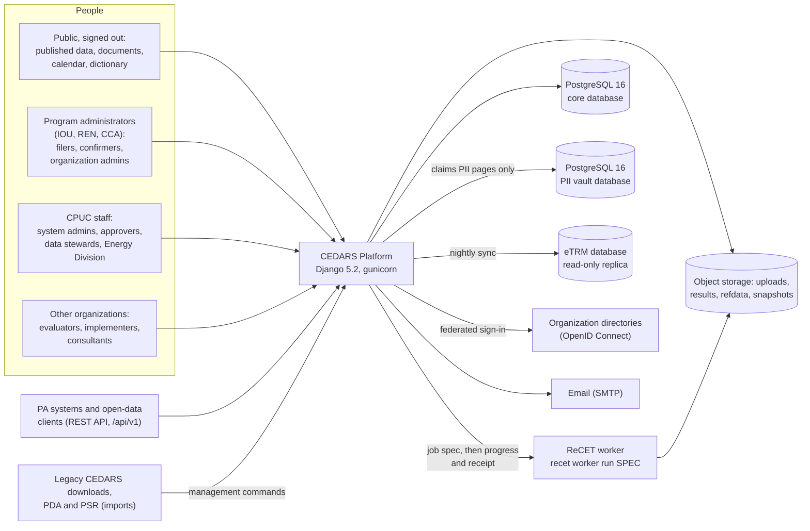

| External system | How the platform uses it | Code |
| --- | --- | --- |
| ReCET worker | Started with a job spec URI; reads its inputs and writes outputs, `progress.json` and `receipt.json` under the run's folder | `cedars/modules/calculations/dispatch.py`, `jobspec.py` |
| Object storage | Four areas (uploads, results, refdata, snapshots): folders under `CEDARS_STORAGE_ROOT` locally, one S3 bucket each in AWS; large downloads are pre-signed URLs | `cedars/core/storage.py` |
| eTRM database | Measure packages and permutations pulled nightly into versioned snapshots (a fixture schema stands in until access is granted) | `cedars/modules/impact_profiles/etrm.py`, `etrm_fixture_schema.sql` |
| Directories | Each federating organization's directory as an allauth OpenID Connect app | `SOCIALACCOUNT_PROVIDERS` in `cedars/settings/base.py` |
| Email | Django's SMTP backend in production (console in development) | `cedars/settings/prod.py` |
| Legacy sources | Public record-level downloads, PDA and PSR responses, CEDARS' own documents, loaded by management commands | `cedars/services/legacy/`, `cedars/modules/*/legacy.py`, `cedars/modules/documents/*_import.py` |

## 2. Processes and deployment

### 2.1 The processes

Everything runs from one image (the `Dockerfile`); a process is the web server or one management command.

| Process | Command | What it does | Where it runs |
| --- | --- | --- | --- |
| Web | `gunicorn cedars.wsgi:application` (3 workers in the image) | Pages, API, uploads, module checks, Edit inputs, Results; queues runs and jobs; rereads the front page's stale claims rows on a thread after the response | ECS service behind the load balancer (AWS); `web` service (Compose) |
| Calculations worker, local backend | `manage.py calculations_worker [--lane small\|large] [--once]` | Claims queued runs from PostgreSQL (`SELECT ... FOR UPDATE SKIP LOCKED`, small lane first), runs `recet worker run`, copies progress, records the receipt; heartbeats as a `Worker` row | Development, sandbox and a single server |
| Calculations on AWS Batch | `recet worker run <spec URI>` in the release's job definition | The same worker, as a Batch job on the small-runs or large-runs queue | AWS Batch on Fargate |
| Calculations sync | `manage.py calculations_sync --loop --sleep 60` | Copies Batch jobs' `progress.json` and `receipt.json` into their runs; fails jobs Batch ended without a receipt | Always-on ECS service (`jobs.tf`) |
| Impact profiles jobs | `manage.py run_impact_profile_jobs --loop --sleep 5` | Upload checks, profile generation, eTRM syncs started from a page, library writes; one queue per PA plus `system`, one job at a time per queue | Always-on ECS service; inline in the request when `IMPACT_PROFILES_INLINE_JOBS` |
| Record downloads | `manage.py run_data_downloads --loop --sleep 10` | Background record downloads larger than `DATA_DOWNLOAD_MAX_ROWS` | Always-on ECS service; inline when `DATA_DOWNLOAD_INLINE_JOBS` |
| Scheduled jobs | `purge_expired`, `send_deadline_reminders`, `close_recertifications`, `documents_read_text`, `sync_etrm`, `check_health`, sandbox bundle or refresh | See [Background work](#12-background-work) | EventBridge Scheduler (AWS) |

### 2.2 The image

`Dockerfile`: `python:3.12-slim` with its Debian packages upgraded to their published security fixes, uv installs the locked dependencies (`uv sync --locked --no-dev`), then the pinned ReCET wheel if one
was built into `engine/wheels/` beforehand (`scripts/build_engine_wheel.sh`; the build itself never sees a token), then the code and
`data/` (the field catalog and ReCET's documents), `collectstatic` (WhiteNoise serves static files), and uv is uninstalled. It runs as
an unprivileged user (uid 10001), exposes port 8000, and its health check asks `/healthz`. Without the wheel the image still builds, and
the pages that call the engine say it is not installed.

### 2.3 Docker Compose

`docker-compose.yml` in this repository is the development shape: PostgreSQL 16 and the web app (`runserver`, `cedars.settings.dev`)
with the source mounted, on port 8000. `CEDARS_REQUIRE_MFA=0` lets a laptop demo sign in with a password alone (dev settings only).

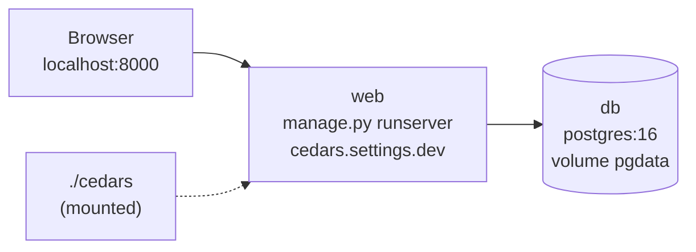

A single-server demo or review instance uses the same image under Compose with the sandbox's settings (a banner on every page, no PII
vault, test or public data only). Its Compose file is kept outside this public repository; its shape is:

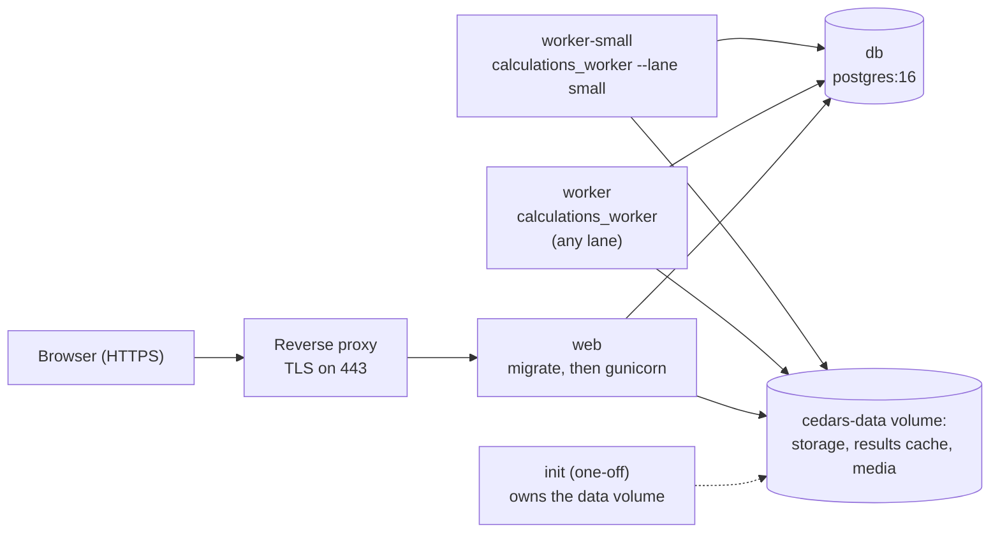

There, impact-profile jobs run inline in the request, the two workers run ReCET from the wheel in the image (so small runs never wait
behind a large one), and object storage is the local folder backend.

### 2.4 AWS (Terraform)

`infra/terraform/` describes the production, staging and sandbox stacks as one module (`modules/platform`). It is written and validated
in CI and applied only by the CPUC's cloud team in its own account.

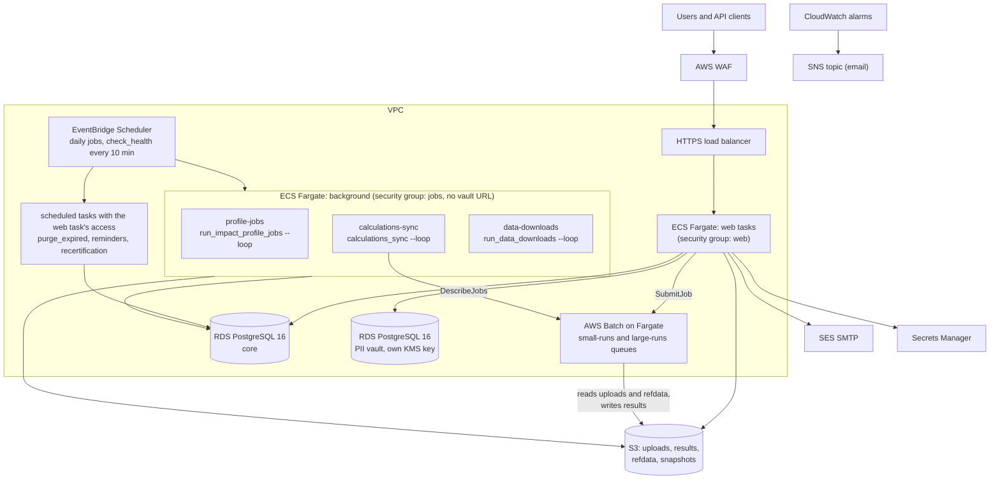

The background services and jobs that need no personal information run in the `jobs` security group, which reaches the core database
only and is given no vault URL; `purge_expired` and the account jobs run with the web task's access. Batch workers reach neither
database. `monitoring.tf` adds metric filters on `check_health`'s JSON line and alarms for failing or silent checks, unhealthy web
tasks, a background service with no running task, 5xx answers, memory and database load.

### 2.5 Settings

`cedars/settings/` has `base` (shared), `dev`, `test`, `sandbox` and `prod`. Everything machine-specific comes from the environment,
never from files: the database URLs, storage, the calculation backend, limits and integrations. The main switches:

| Setting (environment) | Default | Meaning |
| --- | --- | --- |
| `DATABASE_URL`, `VAULT_DATABASE_URL` | local `cedars` database; no vault | The core database; the vault alias exists only when its URL is set (`VaultRouter`) |
| `CEDARS_STORAGE_BACKEND`, `CEDARS_STORAGE_ROOT`, `CEDARS_BUCKET_*` | `local`, `var/storage` | Object storage backend and its four areas |
| `CALCULATIONS_BACKEND` | `local` | `local` (worker processes) or `batch` (AWS Batch) |
| `CALCULATIONS_WORKER_COMMAND` | `recet worker` | What the local backend runs |
| `CEDARS_BATCH_QUEUE_SMALL`, `CEDARS_BATCH_QUEUE_LARGE`, `CEDARS_BATCH_JOB_DEFINITION` | blank | The Batch queues and the job definition a release names none of |
| `CALCULATIONS_SMALL_RUN_RECORDS`, `CALCULATIONS_MAX_RECORDS` | 10,000; 2,000,000 | The small-runs lane's size; the largest job accepted |
| `CALCULATIONS_RESULTS_CACHE`, `DATA_CACHE` | under `var/cache` | Local copies of run group sums and of publication snapshots |
| `FRONT_PAGE_REFRESH_IN_BACKGROUND` | on | The front page's stale claims rows are reread on a thread after the response |
| `IMPACT_PROFILES_INLINE_JOBS`, `DATA_DOWNLOAD_INLINE_JOBS` | off (on in dev) | Run queued jobs in the request instead of a worker |
| `ETRM_DATABASE_URL`, `ETRM_SYNC_RETRY_MINUTES` | blank; 10, 30 | The eTRM source and the nightly sync's retries |
| `IMPACT_PROFILE_TERRITORIES`, `LOAD_SHAPE_FIRST_START` | PGE, SCE, SCG, SDGE; 2027-01-01 | First-run defaults only: CPUC administrators change both on Impact profiles' Settings page (`impact_profiles/policy.py`, `LibrarySettings`, one row per change) |
| `CEDARS_REQUIRE_MFA` | on (only dev may turn it off) | Every account needs a second factor |
| `CEDARS_API_RATE_USER`, `CEDARS_API_RATE_ANON`, `CEDARS_API_TOKEN_MAX_DAYS` | 120/min, 30/min, 365 | API throttles and token life |
| `CEDARS_NUM_PROXIES` | 0 (prod: 1) | Proxies in front; the API throttles and the sign-in rate limits take the caller's address from the entry the load balancer added to `X-Forwarded-For` |
| `CEDARS_UPLOAD_MAX_MB`, `CEDARS_UPLOAD_MAX_FILES`, `CEDARS_UPLOAD_MAX_UNZIPPED_MB` | 150, 20, 1,024 | Each uploaded file; files in one upload; what an uploaded .zip or workbook unpacks to |
| `HEALTH_*` | see `base.py` | Thresholds of the job and system health checks |

Every limit people meet (upload size and files, run records, Edit inputs rows, download rows, API rates, comment length ...) is such a
setting, listed by `cedars/services/releases/limits.py` on the public Limits page. A few are limits the CPUC sets without a release
(`Limit.editable`): runs one account may have waiting or running, how long a sign-in lasts and may sit unused, and the pre-upload
checker's file size. A CPUC system administrator changes them on Change limits (`/limits/manage/`, `releases.service.set_limit`, each
change a `LimitChange` row with its reason and an audit event); the setting is then only the first-run default, and the code that
enforces one reads `limits.value(key)`.

## 3. Code structure and the rules between its parts

```text
cedars/
  settings/      base, dev, test, sandbox, prod
  core/          the site shell: base templates, header (nav.py), page help, help pages, search, My queue, Your work, health,
                 storage, uploads, workbooks, API base, front page and search wiring
  services/      shared services, one Django app each (accounts, audit, registry, dictionary, rules, specifications, submissions, refdata,
                 notifications, retention, vault, legacy, snapshots, releases, feedback, sandbox, accessibility)
  modules/       one Django app per module (administration, impact_profiles, monthly, calculations, programs, budgets,
                 claims, documents, data)
engine/          recet-commit: the pinned ReCET commit; wheels/ (built, not committed)
data/            dictionary/recet-<version>.json (the engine's field catalog), recet_docs/ (the engine's documents)
infra/terraform/ the AWS stacks
scripts/         build_engine_wheel.sh, export_recet_dictionary.py, export_recet_docs.py
tests/           pytest-django on PostgreSQL; tests/a11y drives Chromium with axe-core
```

The apps, in `INSTALLED_APPS` order:

| Layer | App | What it owns |
| --- | --- | --- |
| Core | `cedars.core` | Base templates and static files, the header and its menus (`nav.py`), page help and tours (`page_help.py`), Help and the FAQ, site search (`search.py`), My queue (`queue.py`), Your work (`yourwork.py`), sortable and paged tables (`tables.py`), compact tick lists (`tick_lists.py`, with `TickListInput` for a form field), the shared program, field and member pickers (`pickers.py`, `ProgramsField` for several programs in a form; choices read from the registry, dictionary and accounts services), the two-list column picker every page that chooses columns uses (`core/_field_picker.html` and `core/field_picker.js`, loaded on every page: a catalog of columns with groups and definitions on the left, searched by name and definition, the chosen columns on the right in the order chosen or the catalog's order, filling the page's own text box or hidden comma field; an id prefix per picker so a page holds two; without scripts the page's own tick boxes; on output templates, Results and Compare, record downloads, the cost-test builder's input streams and the publication scan settings' columns left out, over the current data dictionary there), health checks (`health.py`), object storage (`storage.py`), uploads (`uploads.py`), accessible workbooks (`workbooks.py`), zip streaming, the API base and `/healthz`; the database cache table `cedars_cache` (migration) |
| Service | `cedars.services.accounts` | Users, organizations and their codes, memberships, grants, role templates, access requests, recertification, access policy, API tokens, sign-in middleware |
| Service | `cedars.services.audit` | The append-only audit trail, the request context it stamps on every event, and each action in words (`words`) for the histories and the audit log |
| Service | `cedars.services.registry` | Programs and their effective-dated versions, statewide leads and IDs that follow a statewide program, filing cycles, reporting periods, statewide allocation versions, program change policy and requests, goal sets; the operating budget, reported spend, program records and evaluation hooks |
| Service | `cedars.services.dictionary` | Field catalog versions (the engine's and the platform's own records), aliases, usages, value lists, field retirement, templates and schemas, the legacy crosswalk |
| Service | `cedars.services.rules` | Rule sets and rules as data, run by the engine's rule runner; the pre-upload checker; the list of checks written in code |
| Service | `cedars.services.specifications` | Filing specifications: one per kind of filing, in versions the CPUC names, each holding the filing's tables and fields, the rule set and built-in checks it is checked against, what prices it, its file format and example records; the starting versions generated from the filing modules' layouts; the version each deadline is pinned to; the editor (`editor.py`: drafts copied from a published version, locked fields, which built-in checks run, the checks before publishing, publishing with notice and a release note) |
| Service | `cedars.services.submissions` | The filing calendar, the one state machine for every filing, workflow policy, reopen requests and delegations, comments, corrections in place, publication hooks, pricing through the registered pricer |
| Service | `cedars.services.refdata` | Reference-data packs (ACC, impact profiles, eTRM permutations, cost-test sets ...), tie-outs, pinning; the cost-test set builder |
| Service | `cedars.services.notifications` | Subscriptions fed from the audit trail, follows, deadline reminders, the notifications page, email |
| Service | `cedars.services.retention` | Retention periods per record class, legal holds, the purge job and its purgers |
| Service | `cedars.services.vault` | `PIIContact`, `PIISite` and their uploads in the vault database |
| Service | `cedars.services.legacy` | Staged legacy CEDARS downloads and imported years |
| Service | `cedars.services.snapshots` | Publication snapshots and releases, the personal-information scan |
| Service | `cedars.services.releases` | Release notes, the Limits page, the register of CPUC-mandated changes |
| Service | `cedars.services.feedback` | Feedback on any page |
| Service | `cedars.services.sandbox` | The production bundle and the sandbox refresh |
| Service | `cedars.services.accessibility` | Accessibility checks of stored PDFs and workbooks |
| Module | `cedars.modules.administration` | Account, organizations (each with Members, Access requests, Recertification, API tokens and Details pages), members and grants, access requests, recertification, stewardship, role templates, audit log, health, section landing pages (no models of its own) |
| Module | `cedars.modules.impact_profiles` | eTRM sync, load-shape uploads and their checks, generated and custom impact profiles, the profile library |
| Module | `cedars.modules.monthly` | Monthly reports and the 13th-month report |
| Module | `cedars.modules.calculations` | Engine releases, runs, dispatch, results, Compare, Edit inputs, output templates, the job API |
| Module | `cedars.modules.programs` | The program catalog and program pages, change forms, the program fields guide (models in the registry) |
| Module | `cedars.modules.budgets` | Budget filings, fund shifts, the operating budget, change letters |
| Module | `cedars.modules.claims` | Claim years, quarterly and statewide claims, links between claims, true-ups, PII uploads, restatements, the claims API |
| Module | `cedars.modules.documents` | The document library, EM&V deliverables, study register, work orders, public comment, subscriptions, PDA, PSR and CEDARS imports |
| Module | `cedars.modules.data` | The front page, dashboards, query layer, downloads, record downloads, saved views, the open data API, parity checks |

### 3.1 Dependency rules


- **A module changes data only through a service's functions** (it may read a service's models to show them) **and never imports
  another module.** A search of `cedars/modules` finds no import of one module by another.
- **A service never imports a module.** Where a service needs a module's work (pricing a filing, publishing it, describing it in a
  notification, adding its rows to a program page), the module registers a function with the service in its `AppConfig.ready()`.
- `cedars.core` is the site shell above both: its URL configuration takes the front page from `cedars.modules.data`. Site search
  imports no module: the parts a service or module offers (filings, runs, confirmed claims, documents) are registered with it.
- The engine is a package dependency, never copied: the web process imports it for results, Edit inputs, rules, value lists,
  cost-test sets and the ACC tables; pricing always goes through the worker (see [ReCET engine integration](#10-recet-engine-integration)).

### 3.2 Extension hooks

Every point where a service calls back into a module is a registration function. These are the platform's internal interfaces:

| Hook | Service | Registered by | What the service calls it for |
| --- | --- | --- | --- |
| `register_pricer` | submissions | calculations | Price a validated filing version (`price_submission`) |
| `register_run_state` | submissions | calculations | Whether a version's pricing run is still running or ended without pricing it |
| `register_run_walkthrough` | submissions | calculations | The measure walkthrough of the run that priced a version, linked from the version's page |
| `register_restater` | submissions | calculations | Price a published filing again as an analysis run (restatements) |
| `register_publisher` | submissions | budgets, claims, monthly | Publish or withdraw a confirmed version's module data |
| `register_listener` | submissions | snapshots | Snapshot a published version after commit, or drop it on un-confirm |
| `register_reader` | submissions | budgets, claims, monthly | Who may read a filing on the Filings page |
| `register_version_page` | submissions | claims, budgets, monthly | A version's page, which the walkthrough of its pricing run links back to |
| `register_deadline_page`, `register_setup_page`, `register_setup_groups`, `register_setup_link` | submissions | budgets, claims, monthly | The calendar's links, its Add a filing choices, what clearing the calendar removes together, and the set-up page each filing belongs to (the Filing sets page and each deadline's page link it) |
| `register_nothing_to_file` | submissions | monthly | Deadlines that only mark a date (the 13th-month report is generated) |
| `register_filers`, `register_stream` | submissions | claims | Who files a deadline beyond its set-up's list of PAs (statewide: lead PAs), and the run of confirmations it belongs to (`statewide` or the PAs' own) |
| `register_acc_needs` | submissions | budgets, claims, monthly | ACCs the default engine release must carry |
| `register_claims_totals` | submissions | claims | A PA's confirmed claims for a year (read by Monthly reports) |
| `register_operating_budget` | registry | budgets | A PA's operating budget (read by Monthly reports, Claims, dashboards) |
| `register_reported_spend` | registry | monthly | Reported year-to-date spend (budget and spending dashboard) |
| `register_program_records` | registry | budgets, claims, monthly, documents | Each module's rows on a program page, under its own read rules |
| `register_evaluations`, `register_document_filing` | registry | documents | The studies that evaluate a program, and its Add a document link |
| `register_filing` | notifications | budgets, claims, monthly | What a filing version's events concern: its PAs, programs, a summary and the page to open |
| `register_concerns` | notifications | budgets (fund shifts), documents, releases | The same for a module's own records |
| `register_purger` | retention | calculations, data, feedback, notifications, submissions | Find and delete expired records of a class |
| `register_checker` | rules (`precheck.py`) | budgets, claims | The pre-upload checker runs the module's own rule-set step |
| `register_coded_checks` | rules (`coded.py`) | budgets, claims, monthly, impact_profiles, vault | The checks each upload runs in code beside the rule sets, listed read only on Built-in checks (`/rules/built-in/`); a check marked optional runs only when the filing's specification version lists it, with the severity the version gives it |
| `register_locked_fields` | specifications (`editor.py`) | budgets, claims, monthly, vault | The fields each module's code reads, which a draft of its specification cannot remove, rename or retype, nor make optional where required (each module's `locked_fields.py`; a test holds the list to the field names its code names) |
| `register_engine_releases` | specifications (`editor.py`) | calculations | The engine releases a specification version may name (`release_list`: active releases with ReCET's own calculation) |
| `register_list` | dictionary `value_lists.py` | registry (a service) | A list a service keeps as a versioned value list, never handed to the engine: a program's status, segment, primary sector, implementer and category (first version from the program fields guide, read back by `field_guide.values`) |
| `register` | submissions `corrections.py` | budgets, claims, monthly | Each module's record editor for corrections in place |
| `register` | core `queue.py` | accounts, registry, submissions, snapshots, budgets, documents | Items waiting on the signed-in user in My queue |
| `register` | core `yourwork.py` | accounts, submissions, refdata, calculations, data | The signed-in person's own work at the top of the front page and the Calculations, Reference data and Published data pages |
| `register` | core `health.py` | calculations, impact_profiles, documents, notifications, releases | Job and system health checks |
| `register` | core `page_access.py` | documents, impact_profiles, refdata, snapshots | Who may open a page outside the header's menus whose own check is finer than a role, so the Help guides link to it only for people it opens for |
| `register` | core `search.py` | submissions, calculations, claims, documents | Parts of the site search results: a signed-in person's own filings and the runs they see, a confirmed claim by its ClaimID, the document library's search (each under its own pages' rules; a hit the query names exactly leads as the best match) |

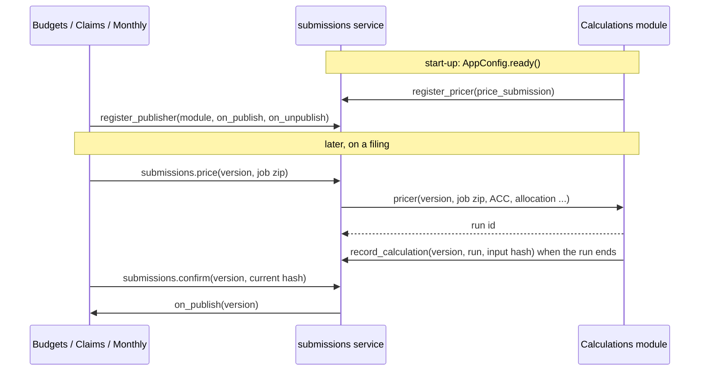

## 4. Data model

### 4.1 Where data lives

| Store | What | Notes |
| --- | --- | --- |
| Core PostgreSQL | Every model except the vault's (section 4.4) | Exclusion constraints on date ranges, partial unique constraints, check constraints and triggers enforce the invariants (section 4.3); also the `cedars_cache` table (Django's database cache) |
| Vault PostgreSQL | `PIIUpload`, `PIIContact`, `PIISite` | `VaultRouter` sends the `vault` app there and nothing else; references to core rows are plain integers (`organisation_id`, `version_id`), never foreign keys across databases |
| Object storage | Uploaded files, run inputs and outputs, reference-data packs, publication snapshots, document files, 8,760 shapes (one float64 array per SHA-256) | Keys such as `runs/<id>/job.zip` in four areas; SHA-256 recorded beside every file a record names |
| Parquet | Publication snapshots, run group sums, legacy tables, the impact-profile library | Read with pyarrow and DuckDB |

Most records keep the "versions, not edits" rule: confirmed filing versions, published rule sets, published specification versions, value lists, packs, catalog versions,
release notes, change letters, comments and the audit trail never change.

### 4.2 Entity-relationship diagrams

Model names are the classes in each app's `models.py` (code identifiers keep the original `Organisation` spelling). Only the main
relationships are drawn; who-did-it foreign keys to `User` (created_by, confirmed_by ...) are left out.

**Identity and access** (`cedars.services.accounts`, `cedars.services.audit`)


`AccessPolicy` and `PolicyChange` hold the access settings (two data stewards confirm a change); they have no relationships worth
drawing. A `PolicyChange` with the setting `organisation_federation` is a system administrator's proposal to switch an organization's
directory sign-in while its members hold or wait for PII access; its value names the organization, and a data steward other than the
proposer confirms it before it takes effect.

**Programs, periods and statewide allocation** (`cedars.services.registry`)

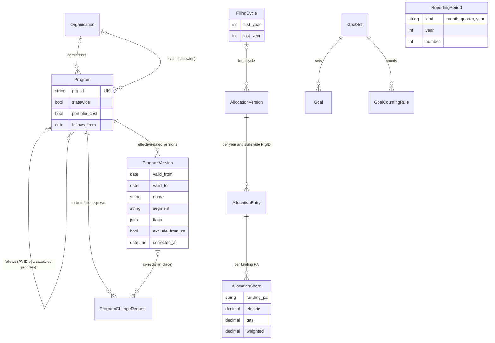

`ProgramChangePolicy` lists the locked program attributes. `ReportingPeriod` is referenced by filing deadlines (next diagram).

A program is added on its page (`registry.create_program`; `can_add_program`: a PA's organization or programs administrators for
that PA, CPUC system administrators for any PA and for statewide programs; `prg_id_problem`: the PrgID starts with one of the PA's
codes, or SW_, and is never reused in any case). A change starts a new version after the latest one. A **correction** puts right a
version's values in place, keeping its dates (`correct_version`: CPUC system administrators and programs approvers; the version
records `corrected_at` / `corrected_by` and the audit event `program.corrected` keeps the values before). A program's own
administrators send a correction as a `ProgramChangeRequest` with `corrects` set (`request_correction`), which `decide_change`
applies with `correct_version` when approved. Correcting a statewide program's version brings every ID that follows it into line
from that version's start (`_follow_from`); an ID that follows is corrected only through its statewide program.

**Filings** (`cedars.services.submissions` and the filing modules)

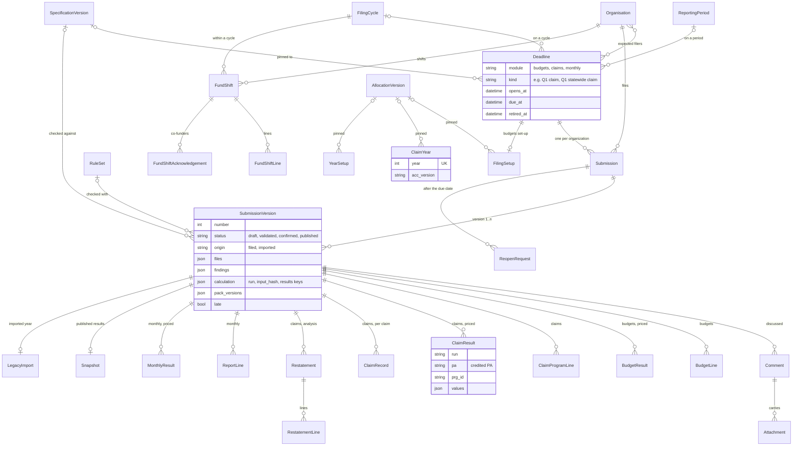

Each filing module also has an append-only `ChangeLetter` (budgets, claims and monthly each have their own, one per corrected
version against the one it replaces). `WorkflowPolicy` holds each module's correction policy, which a system administrator changes
on the workflow settings page (`/filings/workflow-settings/`, with a reason, audited). `Delegation` names an approver's delegate for
one module and a date range, with who named it and why; it is never deleted: ending it early sets `ended_at`, `ended_by` and a reason,
and `Delegation.objects.in_force(day)` is the one rule every reader (the approver check, the reviewer list, the header) uses. `ClaimYear` and `YearSetup` are tied to their deadlines by year; `FilingSetup` by a one-to-one key.

**Filing specifications** (`cedars.services.specifications`)

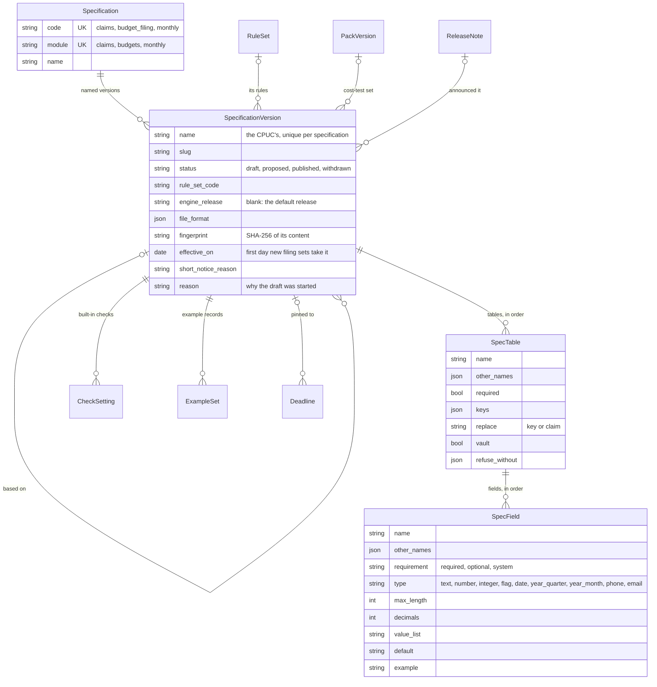

A version's fields take their meaning from the data dictionary and name a value list by its name; value lists keep their own versions
and are not frozen inside a specification version. A field's type is one of a fixed list, each with its own check and words. The
two PII tables are vault tables of the claims specification (`vault`): their fields and rules are public, their data only ever in the
vault.

Who reads a version (`specifications.can_read`): a published or withdrawn one, anyone, signed in or not; a proposed one, anyone signed
in; a draft, CPUC system administrators. Every page, download and API answer below goes through it, and the API serves published and
withdrawn versions only.

**Editing a specification** (`specifications/editor.py`, `editor_views.py`). A CPUC system administrator starts a draft from a
published version (`start_draft`, one draft per specification): its rows are copied, and its rule set is copied as a draft in the rule
library (`rules.new_version`), linked to the draft and published only with it (`rules.publish` refuses it on its own). The draft has a
page per part (Settings, Tables and fields, Rules, Built-in checks, Changes, Publish) and a form per field and table; every change is
audited with its reason (`specification.*` actions). A field's type is chosen from the fixed list. A **locked** field (`locks`) is a
table's key, a column an upload is refused without, a field a module's code reads (`register_locked_fields`) or one the installed
engine reads to price a Measure or ProgramCost record (`recet.editor.CALC_COLUMNS`): it is never removed or retyped, and a required one
stays required. **Publishing** (`publish`) needs the checks of `problems` passed (a summary, a registered active engine release if one
is named, a published cost-test set, keys and refused-without columns that are fields, known value lists, valid examples, every
locked field of the version it was copied from kept, and at least one change) and a day it takes effect after today, with the release
notes' notice (`CEDARS_RELEASE_NOTICE_DAYS`) unless a reason is given. It publishes the draft rule set to take effect that day, a
release note (one specification change, in the module's part of CEDARS) and the version, frozen with its fingerprint. New filing sets
take the newest published version in effect (`current`: `effective_on` passed or blank); a version announced but not yet in effect
is listed as coming.

**Renaming a field** (`editor.rename_field`): a field that is not locked keeps its place and attributes under a new name, recorded as
`SpecField.renamed_from` (migration 0004); the old name joins its other accepted names, so a file in the old layout still uploads, and
the draft rule set's rules that name it are rewritten (`rules.rename_field`, `rules.renamed_test`: the rule's field, the names in its
definition and its conditions on that table; a rewritten rule takes a new ID that records the one it replaces). `compare` shows it as
one renamed field and those rules as unchanged but for the name. Publishing renames the field in the data dictionary
(`dictionary.changes.rename_fields`); another specification's draft that still has the old name lists it as a rename to accept
(`pending_renames`). Data filed earlier is never rewritten and keeps the name it was filed with.

**New value lists** (`editor.new_value_list`): a field that is not locked can take its codes from a new list made in the draft, for
codes no list has. The list is a `ValueList` with `made_for` (the version, in words) and `made_in` (the draft) set (dictionary
migration 0006, `value_lists.create_list`), its first version a draft with the codes typed on the field's page; more are added or
loaded from a CSV on the list's own draft page. The engine has no such list, so `apply_to_engine` never hands it over: each filing
module checks the field itself (CLM-LIST, BUD-LIST, MON-LIST, CEDARS' own processing, so always run) with
`specifications.list_problems` against the codes of the version in force (`value_lists.codes_for_check`), each accepted from its
first to its last year. The list's first version is published only with the specification version, taking effect the same day (the
value-list pages refuse to publish or discard it on its own); a list no field names any more is dropped then, and discarding the
draft drops every list it made. `problems` refuses a draft whose new list has no codes, or that names another draft's unpublished list.

**Built-in checks follow the version.** Each check written in code (`rules.coded.CodedCheck`) is either CEDARS' own processing, which
always runs, or `optional` with the `severities` a version may give it (`choosable`: the claims module's data rules on the Claim and
Site tables, CLM-SITE to CLM-CCAREN, and the budgets and monthly warnings BUD-NOCOST, MON-NOCOST and MON-YTD). The claims, budgets and
monthly checks pass their findings through `specifications.apply_checks_for_filing` before they are stored: an optional check the
filing's version does not list is dropped, and a choosable severity takes the version's `CheckSetting.severity`; a version that lists
no checks, and a check added to the code after the version was published, keep every finding. A new draft lists the checks the code
has now (`_sync_checks`), and the draft's Built-in checks page sets which optional checks run and their severity (`set_checks`,
audited as `specification.checks_changed`).

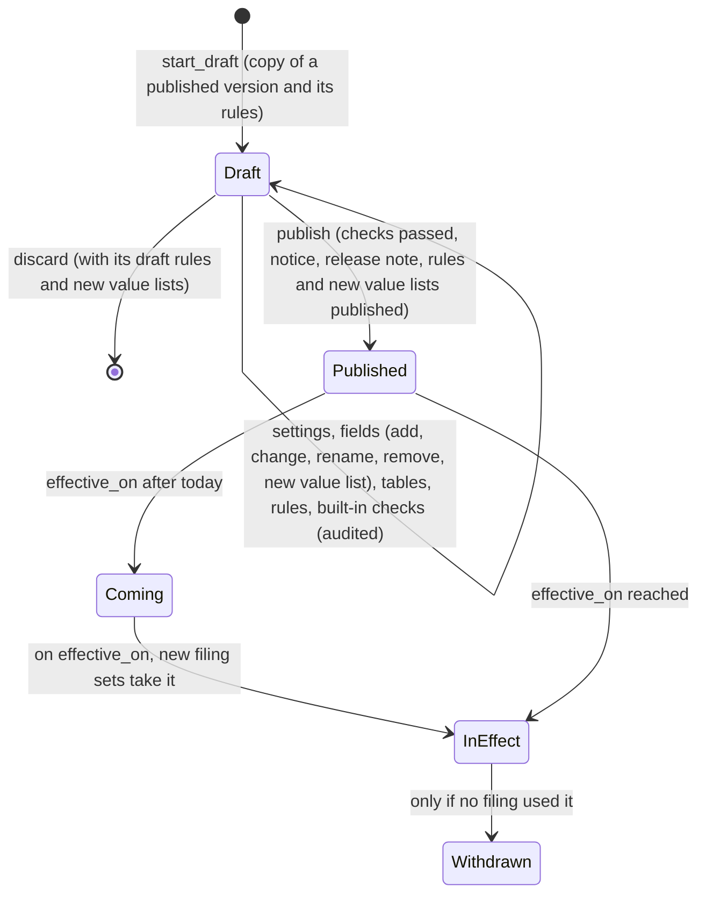

**Calculations and reference data** (`cedars.modules.calculations`, `cedars.services.refdata`, `cedars.services.snapshots`)

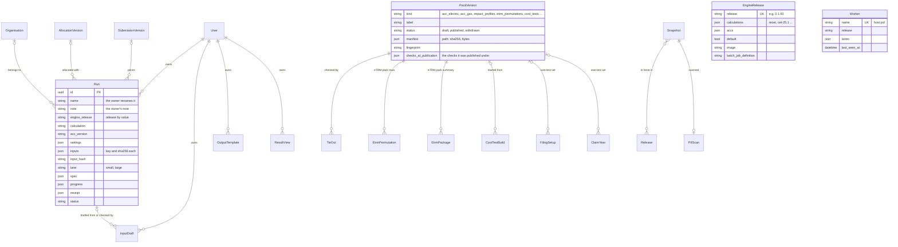

A run names its engine release by value (`Run.engine_release`), so it keeps naming the release it ran on whatever later happens to
the `EngineRelease` row. `TieOutRequirement` says which tie-outs each pack kind needs before it can be published: CPUC system
administrators add and retire them on the Pack acceptance checks page (`/reference-data/packs/checks/`), never edit one, and a pack
keeps the checks it was published under (`PackVersion.checks_at_publication`). A check's result is recorded from its JSON report on the
pack's page (`refdata.service.record_report`: `passed` or `status`, a SHA-256 that must name one of the pack's files) or by the
`record_tie_out` command. eTRM permutation packs are uploaded on a page (`/reference-data/packs/etrm-permutations/`, the
`load_etrm_permutations` command's `etrm.load`); the gigabyte ACC and profile-library packs stay registered from storage by command.
`ScanSettings` holds the publication scan's settings.

**Dictionary, rules and value lists** (`cedars.services.dictionary`, `cedars.services.rules`)

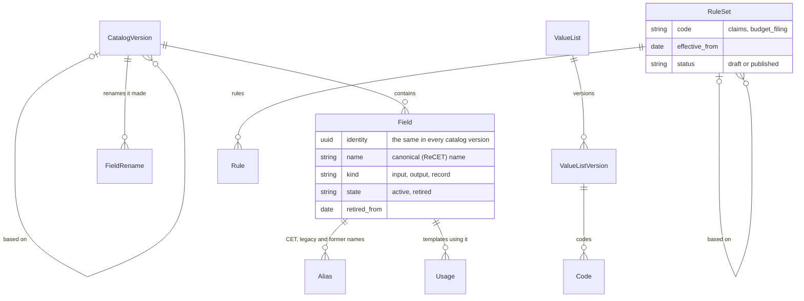

**PII vault** (`cedars.services.vault`, its own database)

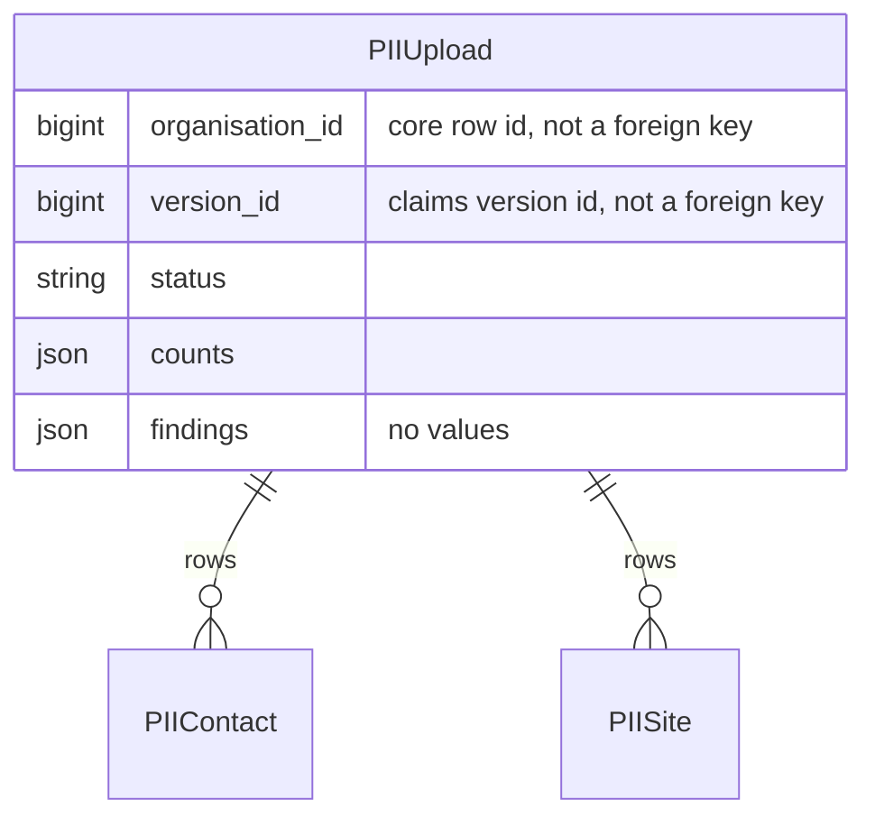

**Impact profiles** (`cedars.modules.impact_profiles`)

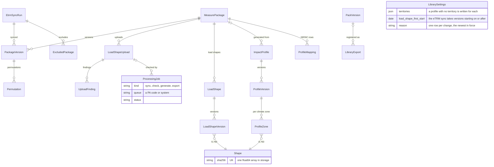

**Documents and EM&V** (`cedars.modules.documents`)

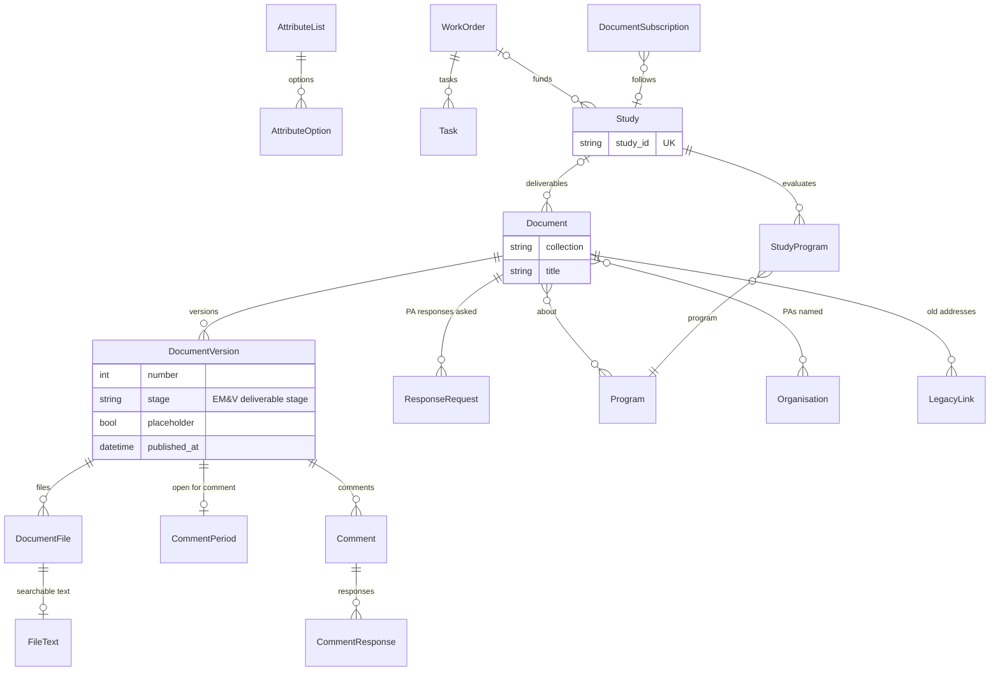

`KeyDate` holds the dates Energy Division posts on the library's home page. `LegacyLink` maps an address of the old CEDARS site or the
2006-2013 EM&V site to the migrated document or file it now opens; CPUC Energy Division's document administrators repoint one on
the Old links page, with a reason (audit `documents.legacy_link_repointed`).

### 4.3 Invariants the database enforces

| Invariant | How |
| --- | --- |
| A program's versions never overlap; an organization's codes never overlap and a code stays with one party | PostgreSQL exclusion constraints on date ranges (registry and accounts migrations) |
| One open membership per user and organization; one CPUC organization; one default engine release; one deadline per module, kind, name and period or cycle | Partial unique constraints |
| An imported version is published; a version's number is unique in its submission; an ID that follows a statewide program has a date | Check and unique constraints |
| The audit trail is append-only | Trigger, `audit` migration 0002 |
| Published rule sets, value list versions, reference packs, release notes and mandates never change; a published mandate is never deleted | Triggers (rules 0002, dictionary 0002, refdata 0002, releases 0001 and 0002) |
| A specification version that is not a draft never changes, except a proposed one being published and a published one withdrawn; a published one is never deleted; the tables, fields, checks and examples of a version that is not a draft never change; one draft per specification; a version's name is unique in its specification; a draft's rule set is published only with its version | Triggers (specifications 0001), partial unique and check constraints; `rules.publish` |
| Change letters, filing comments and attachments never change | Triggers (budgets 0004, claims 0002, monthly 0003, submissions 0004) |
| Published document versions and their files, EM&V deliverable stages and placeholder flags never change | Triggers (documents 0003, 0007, 0016) |
| The vault holds only its own tables; nothing else migrates there | `VaultRouter.allow_migrate` and `allow_relation` |

### 4.4 Every model

`tests/test_architecture_doc.py` checks that every model is named here.

| App | Models |
| --- | --- |
| accounts | `User`, `Organisation`, `OrganisationCode`, `Membership`, `RoleTemplate`, `Grant`, `AccessRequest`, `RecertificationCampaign`, `RecertificationItem`, `AccessPolicy`, `PolicyChange`, `ApiToken` |
| audit | `AuditEvent` |
| registry | `Program`, `ProgramVersion`, `FilingCycle`, `ReportingPeriod`, `AllocationVersion`, `AllocationEntry`, `AllocationShare`, `ProgramChangePolicy`, `ProgramChangeRequest`, `GoalSet`, `Goal`, `GoalCountingRule` |
| dictionary | `CatalogVersion`, `Field`, `Alias`, `FieldRename`, `Usage`, `ValueList`, `ValueListVersion`, `Code` |
| rules | `RuleSet`, `Rule` |
| specifications | `Specification`, `SpecificationVersion`, `SpecTable`, `SpecField`, `CheckSetting`, `ExampleSet` |
| submissions | `Deadline`, `WorkflowPolicy`, `Submission`, `SubmissionVersion`, `ReopenRequest`, `Delegation`, `Comment`, `Attachment` |
| refdata | `PackVersion`, `TieOutRequirement`, `TieOut`, `EtrmPermutation`, `EtrmPackage`, `CostTestBuild` |
| notifications | `Subscription`, `Preference`, `DeadlineReminder`, `Notification` |
| retention | `RetentionPolicy`, `LegalHold`, `PurgeRun` |
| vault | `PIIUpload`, `PIIContact`, `PIISite` |
| legacy | `LegacySource`, `LegacyImport` |
| snapshots | `Snapshot`, `Release`, `ScanSettings`, `PIIScan` |
| releases | `ReleaseNote`, `Change`, `Mandate`, `MandateLink`, `LimitChange`, `SiteNotice` |
| feedback | `Feedback` |
| sandbox | `Refresh`, `CopiedRecord` |
| accessibility | `CheckSettings`, `FileCheck` |
| impact_profiles | `Shape`, `EtrmSyncRun`, `MeasurePackage`, `PackageVersion`, `Permutation`, `ExcludedPackage`, `LoadShapeUpload`, `UploadFinding`, `LoadShape`, `LoadShapeVersion`, `ImpactProfile`, `ProfileVersion`, `ProfileZone`, `ProfileMapping`, `ProcessingJob`, `LibraryExport`, `LibrarySettings` |
| monthly | `YearSetup`, `ReportLine`, `MonthlyResult`, `ChangeLetter` |
| calculations | `EngineRelease`, `InputDraft`, `Run`, `OutputTemplate`, `OutputTemplateDefault`, `ResultView`, `Worker` |
| budgets | `FilingSetup`, `BudgetLine`, `BudgetResult`, `FundShift`, `FundShiftLine`, `FundShiftAcknowledgement`, `ChangeLetter` |
| claims | `ClaimYear`, `ClaimProgramLine`, `ClaimResult`, `ChangeLetter`, `ClaimRecord`, `Restatement`, `RestatementLine` |
| documents | `AttributeList`, `AttributeOption`, `Document`, `DocumentVersion`, `CommentPeriod`, `ResponseRequest`, `Comment`, `CommentResponse`, `DocumentFile`, `WorkOrder`, `LegacyLink`, `Task`, `Study`, `StudyProgram`, `FileText`, `DocumentSubscription`, `KeyDate` |
| data | `DownloadJob`, `SavedView`, `RecordColumnDefault` |

`core`, `administration` and `programs` have no models (Programs' records are the registry's).

## 5. Identity, organizations and roles

### 5.1 Accounts and organizations

- A **user** is one identity per person (email, unique without regard to case), whatever organizations they belong to. Accounts are
  deactivated, never deleted. An account with no membership is a **community account**: it reads what is public and runs its own
  calculations.
- **People pages** (`/admin/people/`, system administrators): find any account, correct its name (with a reason), deactivate or
  reactivate it. `accounts.deactivate_user` needs a reason, refuses the last system administrator and the last data steward, revokes
  the account's API tokens, ends its sessions and records who did it and why on the user (`deactivated_at`, `deactivated_by`,
  `deactivation_reason`); the account's runs, filings and history stay. A community account may close itself from its account page;
  only the CPUC reopens it (`reactivate_user`).
- People set their own **name** on their account page (`set_name`, audited). An **email change** is allauth's: the new address is
  verified by a link before it replaces the old one, the user signs in again to start it (`ACCOUNT_REAUTHENTICATION_REQUIRED`), and
  once it is made the platform audits `user.email_changed` (before and after), ends the user's other sessions and mails a notice to
  the old address (`accounts/signals.py`). A user created without an address record gets one, verified, the next time they sign in or
  open their account page (`ensure_email_record`), so the change page always has the current address.
- An **organization** is of kind `pa` (program administrator), `cpuc` (exactly one) or `other` (evaluators, implementers,
  consultants). A PA has a type, IOU, REN or CCA, which the dashboards and pickers group by, and the claims checks use (a REN's or CCA's
  claim must carry `CCAREN_Flag`). `SW` is the statewide pseudo-PA: statewide programs and the records CEDARS loaded under it; it does
  not file (`Organisation.files` is false for it).
- An organization's **codes** have dates (`OrganisationCode`): a rename closes the old code, a former code can be recorded, and two
  records of one party are merged (`successor`). Data keep the code as filed; `code_map` / `by_code` read any code as its party's.
- `manages_allocation` marks the funding PAs (the four IOUs by default) whose members may hold `allocation.manage`.
- A system administrator changes how an organization's members **sign in** on its page (`change_federation`: directory sign-in with
  its provider, or password and a second factor). It applies at once, unless the organization holds open `claims.pii` grants: then
  it is a proposal (`PolicyChange`, above) that a data steward confirms on the stewardship page.
- An organization is **retired** (`retire_organisation`, with a reason) when it stops filing without merging into another: `active`
  goes false, so it leaves the pickers, filing lists and token checks, while its codes, memberships, data and history stay. It can be
  brought back (`reinstate_organisation`). The CPUC and a merged organization cannot be retired.

### 5.2 Permissions and grants

A **grant** gives one permission to one membership, with who granted it and when, an optional expiry, approval, certification,
suspension and revocation; it is never deleted and every change is an audit event. The catalog (`accounts/permissions.py`):

| Permission | Meaning |
| --- | --- |
| `<module>.<action>` | For each module (programs, calculations, impact_profiles, budgets, claims, monthly, data, documents) and action (read, submit, confirm, approve, admin) |
| `org.admin` | An organization's administrator: manages its members and grants, runs its recertification (the CPUC grants only a PA's first administrator) |
| `claims.pii` | Reaches the PII vault for the organization's claims; a data steward approves every grant, and the CPUC can require a federated session for it |
| `allocation.manage` | Loads, confirms and discards statewide allocation versions; only in an organization marked `manages_allocation` |
| `system.admin` | A CPUC system administrator (CPUC organization only) |
| `pii.steward` | A data steward (CPUC organization only); approves PII grants, confirms access-policy changes; the last one cannot be revoked |

`has_permission(user, organisation, permission)` is the one check: the user's active, unexpired grants in that organization (plus the
federated-session rule for `claims.pii`). **Role templates** (`RoleTemplate`) are named bundles of module permissions a system
administrator defines and an organization's administrator applies, one grant per permission. An organization's administrators give
access on its Members page, one person at a time with several role templates and single permissions and one reason (`give_access`:
all or nothing, permissions already held left as they are, each permission a template brings recording that template). An **access request**
(`AccessRequest`) asks one organization for one or more of its role templates or for single read and submit permissions; its
administrators decide it, or, while it has none, the CPUC's system administrators (`request_deciders`, `can_decide_request`; until then a
system administrator may grant that organization's permissions), and the request shows in the deciders' My queue. The CPUC and the
statewide (SW) pseudo-PA take no requests. Every permission has a name and a sentence on what it lets a person do
(`permissions.label`, `describe`), used wherever a person chooses or reads one. Organization administrators run
periodic **recertification**, keeping or removing each grant (one at a time, all of one member's or all shown: `certify_all`); when a campaign closes (`close_recertifications`, daily), grants nobody certified are suspended if the
access policy says so (never the last data steward).

How the usual roles map onto grants:

| Role | Organization | Typical grants |
| --- | --- | --- |
| PA filer (IOU, REN or CCA) | The PA | `budgets.submit`, `claims.submit`, `monthly.submit`, `calculations.submit`, the matching `read`s |
| PA confirmer | The PA | `<module>.confirm` (confirming publishes the filing) |
| PA organization administrator | The PA | `org.admin` (members, grants, recertification); `programs.admin` to change the PA's programs and record statewide leads |
| Statewide program lead | The lead PA | No extra permission: `Program.lead` names the PA, and its filers file the program's statewide claims and budgets |
| Funding PA allocation manager | An IOU | `allocation.manage` |
| PII handler | The PA (upload), PA or CPUC (read) | `claims.pii`, approved by a data steward |
| CPUC reviewer | CPUC | `<module>.read` |
| CPUC approver | CPUC | `<module>.approve`: decides reopen requests and program change and correction requests (a programs approver also corrects a program version directly); names delegates for a module and a period on the delegates page (`/filings/delegates/`; a delegate is CPUC staff with `<module>.read`; a system administrator can name or end one on an approver's behalf, with a reason) |
| CPUC system administrator | CPUC | `system.admin`: set-up (claim years, filing setups, calendar), engine releases, reference packs, rules, value lists, release notes, organizations |
| Data steward | CPUC | `pii.steward` |
| Community account | none | Public pages, its own runs |

### 5.3 Signing in and acting for an organization

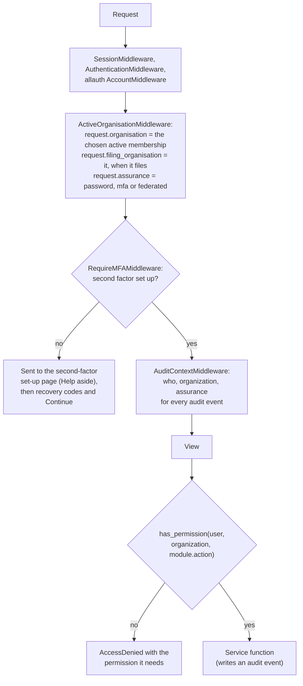

- Sign-in is django-allauth: email and password with a second factor (TOTP, WebAuthn security keys, recovery codes) for every account,
  or a federating organization's directory over OpenID Connect. Email verification is mandatory and failed sign-ins are rate limited,
  per caller address and per account. A sign-in ends after the session_hours limit and after the session_idle_minutes limit
  unused (`SessionTimeoutMiddleware`; a page's background requests do not count as use). There is no Django admin site: every administrative action is a platform page that goes
  through a service and its audit event.
- **Signing in comes back to the page** it started from: the header's and the front page's Sign in link carry the page's own path and
  query as `next` (`core.context_processors.sign_in_url`; the account pages under `/accounts/` carry none), and allauth keeps it through
  the second-factor step and follows it only when it stays on this site. Signing out goes to the front page.
- **A new account's first sign-in** has three steps, shown on its pages as a step line (`core/_set_up_steps.html`): confirm the email,
  set up the second factor, ask an organization for access. The middleware sends a password-only session to the set-up page with the
  address it was heading for (`next`), which the set-up form carries. Adding the account's first authenticator records that address in
  the session (`accounts.signals`, `FIRST_SET_UP`, kept only when it stays on this site); the recovery codes page that follows says what
  the codes are for, offers Download and Print, and Continue (`/account/continue/`, `core.views.after_set_up`), which goes to Ask for
  access for an account in no organization and otherwise to that address.
- A user acts for one organization at a time, switched in the session; runs and uploads made under a membership belong to the
  organization and stay with it when the person leaves.
- The **header** is data (`cedars/core/nav.py`): every item names who sees it (`anon`, `user`, `member`, `guest`, `public`,
  `sysadmin`, `org_admin`, `steward`, `approver`, `delegator`: a CPUC approver of a module that can be delegated); a page's view name
  picks the highlighted menu.
- **API tokens** (`ApiToken`, `Authorization: Bearer cedars_...`, only the SHA-256 stored) act for one organization, reach only their
  scopes and never more than the user's grants there, and never PII or administration.

## 6. The filing workflow

Budgets, claims and monthly reports share one state machine in `cedars.services.submissions`. A **deadline** is a calendar entry of a
module on a reporting period or a filing cycle; an organization's filing for it is a **submission**, whose **versions** carry the
files, findings, the pricing run and the packs it was priced with.

**Which specification.** Each deadline names the filing specification version its filings use (`Deadline.specification_version`), pinned when the deadline is put on the calendar (the current version of its module's specification, `specifications.for_new_deadline`); a legacy CEDARS year imported as published names none, and neither does the 13th-month report, which is generated. Each validated version records the version it was checked against (`SubmissionVersion.specification_version`, beside `rule_set`). **Filings read their version** for how they are checked and priced, on any date, corrections and re-checks included (`specifications.of_filing`: the deadline's version, else, for a deadline pinned to none, its module's current one): the rule set (`rule_set_of`: the one the version names; a version that takes rules but names no rule set, because none of its code was published when it was made, as in a new environment, takes the one of that code in force), the engine release (`engine_release_of`; blank: the default release) and the cost-test set (`cost_test_set_of`; blank: the filing set's, else the set in force for the program year). The submissions service's `price` hands the version's release and set to the pricer, so the Calculations module prices on a named release only while it is active, offers ReCET's own calculation and has the filing's ACC (otherwise the refusal goes to the CPUC's administrators as for the default release), and a release that an in-use version names cannot be retired (`specifications.naming_release`). So do the tables and their fields (`specifications.layout_for_filing`, a `VersionLayout`: each table's names an upload may give it, keys, how a later upload replaces records, whether it is a vault table, the columns an upload is refused without, and each field's other accepted names, requirement, type and length): the claims module reads its tables, columns, keys, the tables replaced by claim and the columns CEDARS fills in from it (`claims/spec.py`, `Layout`), so its uploads, compiled tables, field checks, corrections and record pages follow the filing's version; the PII vault reads the vault tables of the claims filing's version; budget filings and monthly reports read the columns an upload is refused without (their tables are the engine's Measure and ProgramCost inputs, and Commitments). The modules hold no layout of their own: a database with no version of a specification (one emptied and not loaded again) reads the starting version as the platform ships it (`starting/<code>.json`). Each module's template link (`/claims/template.xlsx`, `/budgets/...`, `/monthly/...`) leads to the version's own template download, the filing's version when the upload form names the filing (`?filing=`). A rule set published on the rule pages reaches filings once a specification version names it. Each filing page links its deadline's version from the upload's "Before you upload" line, and its findings name the version they were checked under.

**Who files.** Not every PA files every filing. A deadline's `filers` (many-to-many to `Organisation`; none listed means every PA)
are the PAs expected to file it. A CPUC system administrator ticks them as a budget filing, a claim year or a year of monthly reports
is set up (the module's `add_filing`, `add_year` or `set_up_year` with `filers=`), and adds or removes them later in the set-up page's
Who files section (`submissions.setup.FilersForm`); both go through `submissions.set_filers`, which writes `deadline.filers_changed`
with the PAs before and after, needs a reason and at least one PA, and keeps a PA that has started filing on the deadline. A claim
year's list applies to the PAs' own five claims; its statewide confirmations are filed by the statewide programs' lead PAs
(`register_filers`). `submissions.on_filing(deadline, organisation)` answers from the list; `files_for` adds the module's own rule.
`start` refuses a PA not on the filing; the "Choose a program administrator" list (`filer_statuses`), each module's index ("Nothing to
file: ... is not on this filing") and the Filings page's status (`submissions.status.board`) follow it, and the status table leaves out
a PA on none of the filings it shows.

**Filing sets and canceling one filing.** Each module set-up (a budget filing, a claim year, a year of monthly reports) is a filing
set: the deadlines it put on the calendar. The Filing sets page (`/filings/calendar/sets/`, CPUC system administrators;
`submissions.filing_sets` over `register_setup_groups` and `register_setup_link`) lists each with its filings, how many are canceled,
what is due next and an Edit link to its set-up page. A CPUC system administrator cancels any one filing of a set, from the set-up
page's Filings in this set section (`submissions.setup.CancelForm` / `RestoreForm`) or the deadline's own page, with a reason, while
no organization has started it: `submissions.retire_deadline` sets `Deadline.retired_at` and writes `deadline.retired` (shown as
"Canceled"); `restore_deadline` undoes it (`deadline.restored`). The rest of the set is untouched. A canceled deadline is left off the
calendar (unless asked for), reminders, the Filings page's status and `start`; the modules' index and filing pages mark it Canceled.

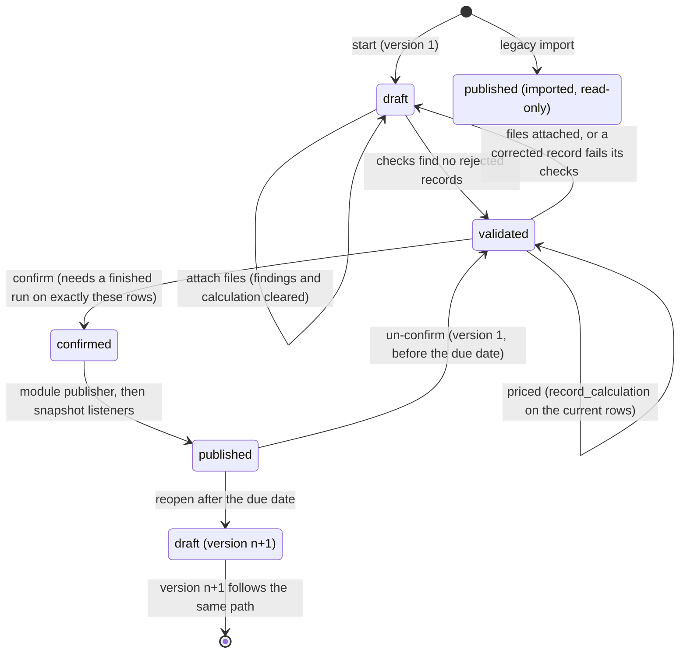

- **Priced before confirmed.** `submissions.price` calls the registered pricer (the Calculations module); when the run ends,
  `record_calculation` stores the run, its input hash, and what it was priced with (release, ACC, allocation version, cost-test set,
  packs, keys of the job spec, receipt and group sums). `confirm` refuses unless the stored hash equals the rows' hash now, so a PA
  confirms exactly what it reviewed.
- **Publication is part of confirmation**: the module's publisher runs, the version becomes published, and the listeners (publication
  snapshots) run once the transaction commits.
- **Before the due date** the first version can be un-confirmed and changed as often as needed; nothing superseded before the due date
  is kept. **After it**, a correction is version n+1 under the module's `WorkflowPolicy.reopen_after_due`: `approval` (a request an
  approver or their delegate decides), `open` (at once, with a reason) or `closed`. A late first confirmation is allowed and marked
  unless `late_confirmation` is off. A system administrator changes both on the workflow settings page; a change that tightens the
  rule offers a release note.
- **Imported versions** (legacy CEDARS years) are published on creation, never validated, priced, un-confirmed, reopened or corrected.
- **Corrections in place** (`corrections.py`): on an open draft only, a record is changed, added or deleted on a form or by a partial
  upload, previewed, then applied; the module re-checks only the records the change affects and every record change is an audit event.
  Correct records opens on the version's records with findings (`with_findings`, rejected first; findings about a whole table said
  apart). A record's form lays its fields out by section (`field_info`: the field's section in the pinned engine's input field
  reference, read by `core.engine_docs.input_sections`, else its data dictionary group), with the fields that have findings first,
  and offers a value list's codes (the version in force, else the engine's list, leaving out codes retired before the filing's first
  year) as a datalist up to the `CEDARS_CORRECTION_LIST_CODES` limit; a longer list links to its dictionary page.
- **Comments** on versions between the filer and CPUC staff, never public and never edited; **My queue** lists what waits on the user.
- **Checks on a file with missing columns.** Each missing column of the module's specification is a finding of its own (`CLM-COL`,
  `BUD-COL`; both its name and its CET name). The rules service's `needing(rule_set, table, missing)` names the rules that read a
  missing column (its field, a spec rule's columns, condition fields and value operands); only those are skipped (`rules.check(...,
  skip=)`), the other rules still run, and `missing_columns_note` tells the filer that more findings may appear once the columns are there.

**The filing pages** (claims period, budget filing, monthly report) are built from shared parts in the submissions service:
`filing_parts.py` and the `submissions/_filing_*.html` templates. `filing_parts.stage` turns a version's state into one of five steps
(Upload, Check, Price, Confirm, Published) and a sentence, drawn as the step line with the current step marked `aria-current="step"`;
the outcome card under it carries the one next action as the page's only primary button (Upload and check, Check again, Price,
Confirm and publish). `findings_by_rule` groups a version's findings by rule, using the corrections editor's record keys: the rule ID
links to the rule in the version's rule set, or, for a check written in code (`rules.coded`), to its row on Built-in checks with
that check's own wording and fix; each rule lists its records (up to the `CEDARS_FINDING_RECORDS_SHOWN` limit) with a link
to correct each one, and a column rule lists every missing column. The upload form, the file's details, the statewide card and
earlier confirmations fold below once they are not the next step. While a pricing run is going, the page polls
`submissions:pricing_status` (`/filings/versions/<pk>/pricing.json?run=<id>`, readers of the filing only; it reports only a run
whose `submission.pricing_started` event names this version) through `core/watch.js`, announces the change through
`window.cedarsAnnounce`, and reloads when the run ends unless something has the focus. Each module's version page shows the same
status words (`filing_parts.status_words`) and offers Confirm and publish beside the results it confirms (`filing_parts.version_page`);
the claims version page marks programs whose filed first-year savings differ from the priced ones by more than 1% (`savings_differ`).
- **One name for a filing.** Wherever a person reads a filing (My queue, Requests to correct filings, notices, messages, the audit
  trail's object names) it is `Deadline.plain_name` / `Submission.plain_name`: the organization, the period or cycle in words, the
  filing's title and the due date in the site's time zone ("PGE 2027 Q1 claim, due 2026-11-01"); `submissions.filing_page` finds the
  page that filing is worked on (the module's page for the deadline, else the version's page).
- **A reopened filing in My queue.** A filing reopened for a correction is listed for its filers (`submissions.queue.corrections`)
  until it is priced and moves to the confirmations. Declining a correction request needs a reason, which the filer is told.

The whole path of one filing, with the calculation and publication:

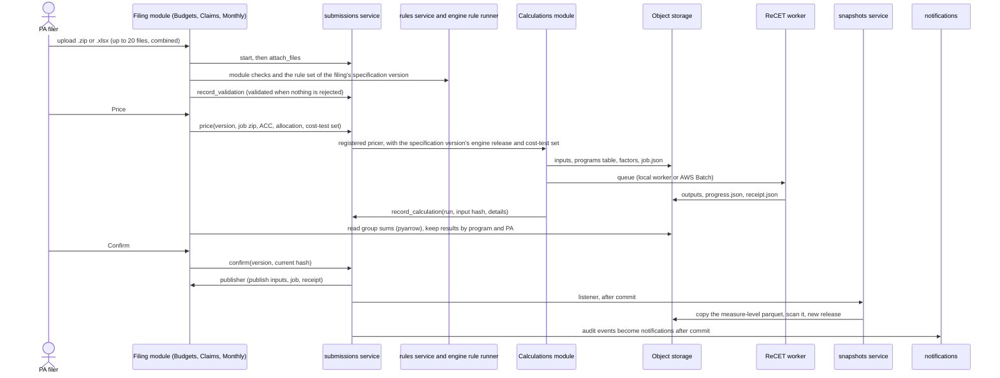

## 7. Statewide programs and statewide claims

Statewide (SW) programs are funded by several PAs through allocation factors and run by one lead PA. The registry holds them as the
source of truth, and Claims files their claims first so that every funding PA sees what is credited to it before it files its own.

### 7.1 The statewide program as source of truth

- A statewide program is a `Program` with `statewide=True` and no administrator. Its **lead PA** is `Program.lead`: recorded on the
  program page by any PA's administrators while it has none, then changed only by the current lead's (or a CPUC system administrator)
  with a reason (`registry.can_set_lead`, `set_lead`).
- Each PA's ID of it (its code before the statewide PrgID, `PGE_SW_FS` for `SW_FS`: `statewide_part_of`, `allocated_ids`) **follows**
  it (`Program.follows`, `follows_from`). `follow_statewide` (a system administrator, or `manage.py follow_statewide`) fills the
  statewide program's record once from its lead PA's own ID (over the dates either covers, so a statewide record that ends with its
  last legacy year reaches its lead's filed years), then gives every PA's ID the statewide program's attributes from that day. Each
  program keeps the dates it covers, gaps included; only attributes change (`_span`, `_pieces`, `_replace_from`: the version in force
  on the day ends the day before, later ones give way, every replaced version is kept in the audit event, and a version a change
  request started is never replaced). From then on nobody edits a following ID (`can_edit` is false); a change to the statewide
  program reaches every ID that follows it from its date on, across all of that ID's later versions (`_start_version`,
  `_follow_from`). Without `apply`, `follow_statewide` makes every change inside a transaction and rolls it back, so a dry run
  reports exactly what the run would do; the command runs each statewide program on its own and goes on past one it cannot link.
- The statewide program and its IDs share their documents and evaluations on the program page (`family`).
- `registry.filing_problem(program, organisation)` is the one rule every filing module applies: a PA files its own programs and the
  statewide programs it leads; a statewide program with no lead recorded is filed by nobody.

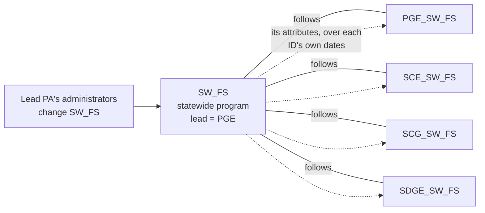

### 7.2 Statewide allocation versions

An `AllocationVersion` holds, per year and statewide PrgID (`AllocationEntry`), each funding PA's electric, gas and weighted factor
(`AllocationShare`). A funding PA's allocation manager loads one from a CSV template (each fuel's factors sum to exactly 1.0000 at four
decimals; weighted factors are computed from PercentElectric and rounded so they too sum to 1.0000), checks and confirms it; the other
managing organizations are notified. A run that allocates carries the whole factor table of the version it pins as an input, and the
receipt names its SHA-256. A filing setup or claim year may pin a version; otherwise the most recent confirmed version with factors for
the year is used. A version's page (`/allocations/<pk>/`) shows its factors as a table, one program year at a time (it opens on the
current year, or the nearest year the version has; Every year is a link), paged and searched by program on the server, beside the
same values as a CSV.

### 7.3 Statewide claims are filed first

A claim year (`ClaimYear`, set up by a CPUC system administrator) creates ten `claims` deadlines: the PAs' five (Q1 to Q4 and the
annual final claim) and five statewide ones (`Q1 statewide claim` ... `Annual (final) statewide claim`). Each statewide deadline must be
due before its PAs' counterpart: by default 14 days before a quarter and one month before the annual claim (`default_sw_due`,
`_sw_due` refuses anything later).

- Only lead PAs file the statewide deadlines (`register_filers`); a PA that leads nothing is shown as having nothing to file.
- The statewide confirmations are compiled and confirmed in order as their own run of confirmations (`register_stream` /
  `same_run`), separate from the lead's own claims.
- Check `CLM-SW` keeps them apart: a statewide filing holds only statewide programs, and a PA's own claims hold none. `CLM-ORG`
  applies `filing_problem` (only the lead files a statewide program).
- A statewide filing is priced with statewide allocation (`allocate_statewide`), so the run credits each measure's results to the
  funding PAs (`ClaimResult.pa` is the credited PA).
- Before filing its own quarter, each funding PA sees its share of the confirmed statewide claims (`statewide_share`, page
  `/claims/years/<year>/statewide/` and its CSV). Only confirmed statewide versions count.
- `year_totals` (the PA's confirmed claims, read by Monthly reports' 13th-month report through `submissions.claims_totals`) adds each
  statewide program's credited share, so the lead never counts the whole program and no funder counts its share twice.
- Publication snapshots keep a lead's statewide claims in a slot of their own beside its own claims.

```mermaid
sequenceDiagram
  actor L as Lead PA (e.g. PGE for SW_FS)
  actor F as Funding PA (e.g. SCE)
  participant CL as Claims module
  participant S as submissions service
  participant C as Calculations and ReCET
  participant D as Dashboards and 13th-month report
  Note over L,CL: Q1 statewide claim, due 14 days before the PAs' Q1 claim
  L->>CL: upload statewide claims (statewide programs only, CLM-SW)
  CL->>S: validate, then price with allocate_statewide
  S->>C: run with the pinned allocation factors
  C-->>CL: results credited to each funding PA
  L->>CL: confirm, publish
  F->>CL: open the statewide shares page
  CL-->>F: its share of each statewide program (statewide_share)
  Note over F,CL: Q1 claim, PA's own programs only
  F->>CL: upload, check, price, confirm its own claims
  CL->>D: year_totals = own claims + statewide shares
```

Budget filings apply the same `filing_problem` rule (only a statewide program's lead files its budget), and a statewide fund shift is
split among the funding PAs by the weighted factors (section 8.1).

## 8. The filing modules

### 8.1 Budgets (`cedars.modules.budgets`)

- A CPUC system administrator sets up each cycle filing (business plan application, TUAL, MCAL) as a `budgets` deadline on a filing
  cycle with a `FilingSetup`: the ACC it is priced on, and optionally its allocation version and cost-test set.
- A PA uploads a job (.zip of Measure and ProgramCost, or a workbook). The module derives `BudgetLine`s (the ten ProgramCost fields and
  the measures' rebates and incentives, per program and year), runs its `BUD-*` checks and CEDARS' budget filing rules year by year,
  prices through the submissions service, and keeps the run's group sums as `BudgetResult`s by program, year and credited PA.
- Confirming publishes the inputs, job spec and receipt and makes the appendix workbook; a corrected version writes a `ChangeLetter`.
- **Fund shifts** (`shifts.py`): a PA moves dollars among its programs and statewide programs within a cycle, with no calculation; a
  statewide line is split among the funding PAs by the weighted factors, each co-funder places and acknowledges its portion
  (`FundShiftAcknowledgement`), and the shift takes effect with the last one. No shift may take a program-year's operating budget below
  zero. The amounts page picks programs with core's program picker (the PA's own and, for the shift's PA, the statewide ones), shows
  what each program-year holds (`shifts.held`, `entry_budget`) and the running net, takes lines pasted from a spreadsheet
  (`paste_lines`), and its script checks each line as it is typed; the save still runs the same checks on the server.
- **Operating budget**: the standing filing's lines plus the shifts in effect since it was confirmed, by program and year; other modules
  read it through `registry.operating_budget` (`register_operating_budget`).

### 8.2 Claims (`cedars.modules.claims`)

- Claims are filed quarter by quarter. Each upload holds the records new or changed since the last confirmed quarter and is
  **compiled** over the standing version of the year's latest earlier confirmation (records replace earlier ones by primary key); the
  compiled year to date is what is checked, priced and published. Confirmations go in order, and a later confirmed quarter blocks
  un-confirming or reopening an earlier one.
- Checks: the module's `CLM-*` checks (columns, types, keys, quarters, registry programs, references between tables, NMEC, SEM, deemed,
  fuel substitution, payments, CCA/REN rules, eTRM by Measure Detail ID with blank deemed fields filled from the eTRM pack) and CEDARS'
  claims rule set on Measure and ProgramCost.
- Pricing: the year to date on the claim year's ACC (default: the ACC of the year's final budget filing, from the engine's table), with
  the year's allocation version and cost-test set, `acc_purpose = claims`.
- Withdrawals keep the records and mark them; they leave pricing and totals. Corrections after the due date write a public
  `ChangeLetter`. `ClaimRecord` links claims (NMEC chains, population sites, SEM phases, projects).
- **True-ups** are priced against the parent's profile as pinned when the parent was priced: the parent's run's profile library is read
  back (`refdata/profiles.py`) and supplied to the engine as `profiles_8760`.
- **PII** goes to the vault on the period page, checked against the version's claims (`claims.pii` to upload or read; every download
  audited). PII tables in a claims upload are refused.
- **Restatements** price a published version's job again as an analysis run (optionally per-record ACCs, with a bridge run) without
  touching the filing (`Restatement`, `RestatementLine`).
- The **claims API** (`/api/v1/claims/`) reads claim years, versions, findings, results and change letters, and uploads, checks,
  prices and confirms through the same service functions.

### 8.3 Monthly reports (`cedars.modules.monthly`)

- A `YearSetup` creates thirteen deadlines, the twelve monthly reports (each opening when its month ends) and the 13th-month report
  (due with the annual claim), and fixes the ACC and allocation version the estimates are priced on.
- A PA uploads Commitments and the year-to-date BCA inputs (Measure, ProgramCost). Spend per program is read from the BCA inputs the way
  Budgets counts a budget; the month's spend is the change since the previous confirmed month. `MON-*` checks; the BCA inputs get the
  engine's input check when priced; savings and TSB are labeled as estimates (`ReportLine`, `MonthlyResult`).
- The **13th-month report** is generated, never uploaded: the PA's confirmed claims (`submissions.claims_totals`, which includes
  statewide shares) against the operating budget and December's report.

## 9. The other modules

| Module | What it does | Key mechanics |
| --- | --- | --- |
| Programs | Public catalog and program pages; Add a program; effective-dated change form (attributes and delivery flags); corrections of a version in place; change and correction requests decided by a CPUC approver; program fields guide | Records in the registry; each module adds its rows to a program page through `register_program_records` |
| Calculations | Engine releases, New run, runs, run pages with downloads (the owner renames a run or adds a note; nothing else about it changes), Results and Compare, a walkthrough of any one measure's calculation, output templates, Edit inputs (up to the engine's 500 measures, checked cell by cell with `recet.editor`), parallel runs against CET outputs, the job API (`/api/v1/calculations/`) | Section 10 |
| Impact profiles | Nightly eTRM sync into versioned snapshots; load-shape uploads with four validation stages; generated profiles with CEDARS' formula; custom profiles; identical profiles stored once under several names; the library written in the engine's format and registered as an `impact_profiles` pack | `ProcessingJob` queues per PA; every 8,760 stored once by SHA-256 (`Shape`) |
| Documents and EM&V | One library for PA documents, CPUC guidance, DEER resources, program files and EM&V documents; numbered versions; publication; full-text search over extracted file text; EM&V deliverable stages; study register; work orders; public comment; subscriptions; PDA, PSR and CEDARS imports with old addresses redirected | `FileText` with a PostgreSQL full-text index; triggers keep published versions unchanged |
| Data | Front page, dashboards, record downloads, background downloads, saved views, the open data API (`/api/v1/data/`), parity checks against CEDARS' published totals | Section 11 |
| Administration | Account, organizations, members, grants, access requests, recertification, stewardship, role templates, audit log, jobs and health, Administration landing page | Calls the accounts service; no models |

## 10. ReCET engine integration

The platform uses ReCET, the rebuilt CET (`JRichardson-PGE/ReCET`, public, MIT), unchanged, in two ways: **the worker prices every
run** in its own process from a job spec, and **the web process imports the pinned package** for what it shows and checks.

### 10.1 The pin and how it reaches each place

```mermaid
flowchart LR
  commit["engine/recet-commit<br/>(a ReCET commit SHA)"]
  commit --> ci["CI: uv pip install<br/>recet @ git+...@commit"]
  commit --> wheel["scripts/build_engine_wheel.sh<br/>engine/wheels/recet-*.whl"]
  wheel --> image["Dockerfile installs the wheel<br/>into the web image"]
  image --> localw["Local worker:<br/>CALCULATIONS_WORKER_COMMAND<br/>= recet worker"]
  commit --> dict["scripts/export_recet_dictionary.py<br/>data/dictionary/recet-version.json"]
  dict --> load["manage.py load_dictionary<br/>a new CatalogVersion"]
  commit --> docs["scripts/export_recet_docs.py<br/>data/recet_docs/"]
  docs --> help["Engine documents pages<br/>/calculations/engine-docs/"]
  rel["EngineRelease rows<br/>(release, image, job definition,<br/>calculations, ACCs, default)"] --> batch["AWS Batch job definition<br/>runs the worker image"]
```

- `engine/recet-commit` names the commit the platform is built and tested against. CI installs that commit; the image installs a wheel
  built from it; `tests/test_dictionary.py` and `tests/test_engine_docs.py` check the shipped catalog and documents are the pinned
  engine's.
- Moving the pin means: change the commit, re-export the field catalog and the engine documents, run the tests; on a server, rebuild the
  wheel and the image, then load the new catalog with `load_dictionary`.
- **Engine releases are data** (`EngineRelease`): a CPUC system administrator adds a release by its version number, with its worker
  image and Batch job definition, the calculations it offers (`recet` and CET replicas such as `cet-25.1`) and the ACCs each
  has, and makes one the default. Filings are priced only with ReCET's own `recet` calculation, on the release their specification version
  names, else the default release; replicas are for analysis runs. A release an in-use specification version names cannot be retired. A local worker reports the release it runs (`Worker`), takes only that release's runs, and New run and the health page say when
  a release has no live worker.

### 10.2 The field dictionary

`scripts/export_recet_dictionary.py` writes every Measure and ProgramCost input and every measure-level output with its definition,
unit, source, cost-test treatment, time basis, aggregation, rounding and years in use (from ReCET's `field_docs` and
`field_attributes`), its type and length from CEDARS' specification, its CET and legacy names, and the templates using it.
`manage.py load_dictionary data/dictionary/recet-<version>.json` publishes it as a `CatalogVersion` with `Field`, `Alias` and
`Usage` rows, plus the platform's own records (every column of the tables listed in `dictionary/platform.py`, kind `record`) unless
`--engine-only`. The canonical names are ReCET's; CET and legacy CEDARS names are accepted on upload through the aliases.
A field keeps one `identity` in every catalog version. A filing specification version that renames a field renames it here when it
is published (`changes.rename_fields`): a new catalog version with the field under its new name, the old name kept as an alias of
system "Former name" and the rename recorded as a `FieldRename`, so a later catalog that still uses the old name takes the new one
(`service.renamed`, applied by `load_catalog`), the change log matches fields by identity and shows the rename, and the old name's
page redirects to the field.
Value lists and their versions are handed to the engine before the rules or Edit inputs read them (`value_lists.apply_to_engine`). The program registry's own lists (`register_list`) are not.

### 10.3 A run, end to end

```mermaid
sequenceDiagram
  actor U as User or filing module
  participant V as Calculations service (web)
  participant DB as PostgreSQL
  participant O as Object storage
  participant B as Local worker or AWS Batch
  participant W as recet worker run
  U->>V: create_run(release, calculation, ACC, settings, job file)
  V->>V: check request, inspect job (zip or workbook), cap records
  V->>O: job.zip or job.xlsx, optional inputs, sw_factors.csv, programs.csv
  V->>V: pin packs (ACC, impact profiles, cost-test set), input hash
  V->>O: runs/id/job.json (spec version 1)
  V->>DB: Run (queued, lane small or large), audit event
  V-->>B: after commit, submit (Batch) or nothing (local)
  B->>DB: local: claim with SKIP LOCKED
  B->>W: run SPEC_URI
  W->>O: refuses a pinned file that differs, then prices
  W->>O: out/ files, progress.json, receipt.json
  B->>DB: progress copied while it runs
  B->>DB: finish(exit code, receipt)
  DB-->>U: notification, run page, Results
```

What every run carries (`calculations/service.py create_run`, `jobspec.py`):

| Input or setting | Source |
| --- | --- |
| `job_zip` (Measure.csv and ProgramCost.csv) or `workbook` | The upload, a draft, or a filing version's compiled tables; optional files in the zip become inputs of their own |
| `programs` | `registry.run_programs(first year)`: the registry's programs as the engine's whole program table (`programs_replace`), so the `Prg_` columns, `Exclude_From_CE` and PrgID checks come from the registry |
| `sw_factors` | The pinned allocation version's whole factor table, when the run allocates statewide programs |
| `run_parameters`, `profiles_8760`, `profiles_gas` | Optional inputs, from the zip, the workbook's sheets or files of their own (`jobfiles.OPTIONAL`); for claims, `profiles_8760` carries the true-ups' parent profiles. A job's own program metadata and statewide factors are noted as not used: the registry's programs and the pinned allocation version are every run's |
| `cost_tests` or `settings.cost_test_set` | A published set by id, or a draft or custom set as the file itself |
| `cet_outputs` | A CET run's outputs, for a parallel run's comparison |
| `packs.files` | The reference-folder files of the pinned ACC and impact-profile packs, by SHA-256: the worker refuses a folder whose files differ |
| `settings` | `acc_version` and the run options (`jobspec.SETTINGS`: filing checks, Priced for, SCT, emissions, market effects, First Year, output template, ACC comparison, components, combined 8,760 ...) |
| `context` | Platform run id, organization, input hash, pinned packs, cost-test set record, notes; echoed into the receipt |

Every input is stored with its SHA-256 and the run's `input_hash` covers them, the settings, the release, the calculation, the ACC, the
allocation table and the pins, so identical jobs share a hash. A filing run that ends successfully calls `record_calculation`; a run
whose receipt names another cost-test set file fails. Runs up to `CALCULATIONS_SMALL_RUN_RECORDS` measures take the small lane, larger
ones the large lane; more than `CALCULATIONS_MAX_RECORDS` are refused before queueing.

### 10.4 What the web process imports

| Where | Engine code | For |
| --- | --- | --- |
| `calculations/results.py` | `recet.results_view`, `recet.outputs` | Results and Compare over the worker's group sums (copied once into `CALCULATIONS_RESULTS_CACHE`) |
| `calculations/walkthrough.py` | `recet.cost_test_sets`, `recet.pipeline.discount_settings`, the release tables shipped in `recet/data/cet_versions/` | Walk through a measure: one measure's steps from its row of the kept measure-level table, every sum set beside the engine's output (a run that priced a claim, budget filing or monthly report is linked from that version's page and open to the filing's readers, a published one to every signed-in user, through `submissions.versions_priced_by`); a CET replica's run is explained as that release prices it (its column names, its discount rates, CET's own tests, the CET errors the replica keeps named) |
| `calculations/walkchart.py` | `recet.pipeline.engine.price_real_hourly_per_measure`, `recet.pipeline.real_impact_profiles.shift_to_acc`, `recet.pipeline.real_avoided_cost_v2`'s utility and missing-zone tables | The walkthrough's charts of steps 3 to 6: savings, discounted savings and value year by year. The value chart prices one measure quarter by quarter with the engine's per-measure function on its load shape from the run's impact-profile pack (`refdata/profiles.py`) and its utility and zone's hourly avoided costs from the run's electric ACC pack (`refdata/acc.py`, one row group read by its statistics; pack files opened by `refdata/files.py` from default storage, a `file://` folder or `s3://`), and is drawn only when the quarters add up to the row's ElecBen (or ElecSupplyCost for added load); Beside it, the value of a kWh saved in each calendar year on the load shape: the ACC's total avoided cost and, read from the same row group, its transmission and distribution columns, so each year's column splits into generation and T&D, in that year's dollars and not discounted. The numbers are kept as `walkthrough/<ACC>/<measure>.json` beside the run's outputs (`CACHE_VERSION` re-reads older ones). Each chart has one tooltip per year (month, hour): server-rendered bands, each with its values as an SVG `<title>` without scripts, and `static/calculations/walkthrough.js` showing them beside the band under the pointer or picked with the arrow keys, spoken through `cedarsAnnounce` |
| `calculations/drafts.py`, `draft_views.py` | `recet.editor`, `recet.fieldnames`, `recet.versions` | Edit inputs: cell checks and dropdowns |
| `services/rules/service.py`, `precheck.py` | `recet.filing_rules`, `recet.editor`, `recet.fieldnames`, `recet.pipeline.real_impact_profiles` | Running stored rule sets with the engine's own rule runner, so the platform, ReCET runs and the checker never disagree |
| `services/dictionary/value_lists.py` | `recet.editor`, `recet.paths` | Handing the value lists in force to the engine |
| `services/refdata/cost_tests.py`, `builder.py` | `recet.cost_test_sets` | Validating, describing and building cost-test sets; the builder files each validator message under its step and shows it beside the form field it names, in that field's label (`builder_forms.problem`) |
| `calculations/service.py`, `claims/service.py` | `recet.versions` | The ACC tables (the claims ACC of a year, Priced for, which ACC applies) |
| `budgets/service.py`, `claims/service.py` | `recet.fieldnames` | Reading CET and older names as the canonical ones |
| `calculations/input_templates.py`, `releases/limits.py` | `recet.templates`, `recet.editor` | Upload templates and the Edit inputs row limit |

Without the engine installed those pages say so; the rest of the platform works.

## 11. Publication, snapshots and the query layer

```mermaid
flowchart LR
  conf["Version confirmed<br/>and published"] -- "listener, after commit" --> snap["Snapshot: copy the run's<br/>measure-level parquet<br/>into the snapshots area"]
  snap --> scan{"Personal-information scan<br/>(PIIScan)"}
  scan -- "hit" --> hold["Held: CPUC told,<br/>earlier snapshot stands"]
  scan -- "clean" --> rebuild["rebuild: snapshots in force<br/>per dataset and slot"]
  rebuild -- "set changed" --> release["New numbered Release<br/>(claims, forecast, monthly)"]
  release --> q["Query layer (DuckDB over<br/>the release's Parquet)"]
  q --> dash["Dashboards, front page"]
  q --> dl["Downloads and<br/>record downloads"]
  q --> api["Open data API"]
```

- **Slots**: forecast keeps every filing; claims and monthly keep one slot per PA and year (the latest year-to-date period, so quarters
  never add up twice), with a lead PA's statewide claims in a slot of their own. A release is made only when the set in force changes; an
  un-confirmation before the due date drops the snapshot and releases without it.
- **Query layer** (`data/query.py`): one query over one release gives every number a page, chart, table and download shows. Each query
  opens its own in-memory DuckDB connection over local copies of the snapshots (`DATA_CACHE`, named by SHA-256), with the thread and
  memory limits `DATA_QUERY_THREADS` and `DATA_QUERY_MEMORY`. Its state is GET parameters, so a link reproduces a view.
- Exclusions (pension and benefits, ESA, codes and standards by default) are stated parameters; downloads are stamped with the release,
  as-of time, snapshots, filters and dictionary version; only fields the dictionary marks public are served.
- Imported legacy years are snapshotted from tables their loads built.

## 12. Background work

Every background task is a management command in the same image. Queued work is claimed from PostgreSQL with `SKIP LOCKED`, so
several workers can share a queue.

| Command | Kind | What it does | Schedule (Terraform) |
| --- | --- | --- | --- |
| `calculations_worker` | Always on (local backend) | Prices queued runs with `recet worker run`, small lane first | Not used in AWS (Batch prices runs) |
| `calculations_sync` | Always on | Copies Batch jobs' progress and receipts into runs | ECS service, every 60 s |
| `run_impact_profile_jobs` | Always on | Impact profiles' per-PA job queues | ECS service, polls every 5 s |
| `run_data_downloads` | Always on | Background record downloads | ECS service, polls every 10 s |
| `purge_expired` | Daily | Deletes what retention says has expired (dry run available), one audit event per class | 02:15 Pacific |
| `close_recertifications` | Daily | Closes due recertification campaigns; uncertified grants are suspended when the access policy says so | 02:30 Pacific |
| `documents_read_text` | Daily | Reads the text of document files stored without it | 03:45 Pacific |
| `send_deadline_reminders` | Daily | Each user's deadline reminders at their chosen lead times | 07:00 Pacific |
| `sync_etrm` | Nightly | eTRM sync, retried after `ETRM_SYNC_RETRY_MINUTES`; alerts administrators if the last try fails | 01:00 Pacific, once the eTRM URL is set |
| `check_health` | Every 10 minutes | Runs every registered health check, alerts system administrators once per new set of failures, prints a JSON line for CloudWatch | `monitoring.tf` |
| `export_sandbox_bundle`, `refresh_sandbox` | Scheduled when configured | Production writes its published, non-PII data; the sandbox loads it | Off unless a bundle place and schedule are set |
| `warm_front_page` | On demand | Reads the front page's claims rows before anyone asks (after start-up, a deploy or a publication) | Not scheduled |

One-off and administrative commands:

| Command | What it does |
| --- | --- |
| `bootstrap_cpuc` | First run only: creates the CPUC organization and its first system administrator, organization administrator and data steward |
| `demo_account`, `seed_sandbox` | Test filers, a test CPUC administrator (`--cpuc`) and demo organizations (sandbox and developer databases only) |
| `load_dictionary` | Publishes a field catalog version from the engine's export |
| `import_rules`, `check_file` | Imports CEDARS' claims or budget-filing rules from the pinned engine as a draft rule set; checks a file as the pre-upload checker does |
| `import_programs`, `import_allocation`, `import_statewide_leads`, `follow_statewide` | Loads programs from a CEDARS Programs export, allocation factors, and statewide lead PAs from CEDARS' statewide programs download; links statewide programs' IDs to them |
| `register_pack`, `record_tie_out`, `register_cost_tests`, `load_etrm_permutations`, `etrm_lookup_timings` | Registers reference-data packs and their tie-outs; loads eTRM permutations; times the eTRM lookup |
| `import_profile_library`, `export_profile_library` | Loads legacy CEDARS' profile library; writes the platform's |
| `stage_legacy_sources`, `load_legacy_filings`, `load_legacy_claims`, `snapshot_legacy` | Stages legacy CEDARS downloads, loads them as imported versions, snapshots them |
| `dashboard_parity` | Checks the query layer against CEDARS' published totals |
| `documents_import_pda`, `documents_import_psr`, `documents_import_cedars` | Migrates the PDA, PSR and CEDARS' own documents |
| `snapshot_published`, `rescan_publication_holds` | Repairs a failed snapshot copy; scans held snapshots again |
| `clear_filing_calendar` | Empties a sandbox or demo calendar: deletes each set-up nothing was filed for, retires the rest |
| `help_revisions` | Records which release each user guide and the FAQ were revised for |

Work that runs after a response without a worker: notifications (`on_audit_event` defers delivery with `transaction.on_commit`),
snapshots (`register_listener` defers the copy the same way), and the front page's refresh thread (section 13).

## 13. Caching

| Cache | Where | What | Invalidated by |
| --- | --- | --- | --- |
| Django cache | Database table `cedars_cache` (`DatabaseCache`) | The front page's claims rows, the API throttle counts (so every web process sees one count) | Keys and timeouts below |
| Run results | `CALCULATIONS_RESULTS_CACHE` | A run's group sums copied once from object storage for Results and Compare | A run's outputs never change |
| Snapshots | `DATA_CACHE` | Local copies of S3 snapshots named by SHA-256, read by DuckDB | Content-addressed |

### 13.1 Front-page claims rows

The front page ("How the portfolio is doing") charts five metrics from the published claims: total system benefit, electricity saved,
peak demand avoided, gas saved and spending, by year, against spending, by PA and as benefit per dollar. It reads one query over every
claims file of the current release, every metric by year, PA type and PA with the dashboards' default exclusions, and keeps the rows
(`data/front.py`); the visitor's choices (metric, PA type, year) are applied to the kept rows in the request, and the charts are drawn
on the server as SVG with a table of the same values under each. `data/front.js` adds the values on hover and from the keyboard.

- The key is `front<CACHE_VERSION>:<default exclusions>`; `CACHE_VERSION` is bumped whenever the cached shape changes, so a deploy
  never reads an old pickle.
- Each entry keeps a **fingerprint** of what the rows were read from: the current claims release. A different fingerprint (a new
  release) reads them again **in the request**, so nobody sees the previous release's numbers.
- An entry older than `FRESH_SECONDS` (600 s) is still shown, and the rows are reread **after the response** on a daemon thread. A
  lock key (`cache.add`, `REFRESH_LOCK_SECONDS` 300 s) keeps one reread at a time; a failed reread leaves the old rows. Entries are
  kept for `KEEP_SECONDS` (7 days).
- `FRONT_PAGE_REFRESH_IN_BACKGROUND` off (as in the tests) rereads in the request instead; `manage.py warm_front_page` reads them
  ahead.

```mermaid
flowchart TD
  visit["Front page request"] --> fp["Fingerprint: current<br/>claims release"]
  fp --> get{"Cached rows<br/>with this fingerprint?"}
  get -- "no" --> build["Read the rows now,<br/>store them (7 days)"]
  get -- "yes" --> age{"Older than 600 s?"}
  age -- "no" --> show["Apply the visitor's metric,<br/>PA type and year; draw the charts"]
  age -- "yes" --> lock{"cache.add lock<br/>(300 s)"}
  lock -- "taken" --> show
  lock -- "got it" --> thread["Daemon thread rereads<br/>after the response"]
  thread --> show
  build --> show
```

## 14. Cross-cutting services

- **Audit** (`cedars.services.audit`): `audit.record(action, obj, before, after, reason)` stamps the actor, active organization,
  sign-in assurance and request id from the request context. Every service that changes a record writes one; the table is append-only.
- **Notifications**: a `post_save` receiver on `AuditEvent` defers delivery until commit, so a rolled-back change notifies nobody; one
  message per user per event, narrowed by the PAs they follow, widened by the programs they follow; email per subscription; deadline
  reminders; module messages through `notify`. **Requests are told directly** (`tell_about_request`, after commit): a correction request
  (submissions), a program change or correction request (registry) and an access request (accounts) reach the people who may decide it
  (the module's CPUC approvers and their delegates for today, `submissions.deciders`; an organization's administrators, or the CPUC
  system administrators when it has none, `accounts.access_deciders`), its decision reaches the person who asked, and a withdrawal
  reaches those told of the request (`told(key)`). Each person's `Preference.own_requests` / `requests_to_decide` (off, the page, or
  the page and email; email by default) says how, on Notification settings' Requests section. The notice carries
  `request_key(object, pk, step)`, the key the same audit event's subscription delivery uses, so a person who also subscribed is told
  once.
- **Retention**: a period per record class (`RetentionPolicy`), legal holds (`LegalHold`), and the daily purge, which
  calls each registered purger and logs `PurgeRun`s.
- **Reference data**: packs registered as drafts, published once their required tie-outs pass (the checks in force, set on a page;
  a published pack keeps the ones it was published under), withdrawn but never deleted; `pin()` is recorded by every run and filing; a
  filing never uses a draft.
- **Rules and the pre-upload checker**: stored rule sets run by the engine's rule runner; `/rules/check/` and
  `POST /api/v1/rules/check` run a module's rule-set step on a file without keeping it, against the rules of the module's current
  specification version unless another published rule set is chosen (`precheck.current`; each choice names the specification versions
  that use it). The checks each upload runs in code beside the
  rule sets (the BUD-, CLM-, MON-, PII- and LS- rules) stay in code and are listed read only on `/rules/built-in/` from the lists the
  modules register (`register_coded_checks`); a test holds each list to the rule IDs its module's code raises.
- **Filing specifications** (`cedars.services.specifications`): public pages `/specifications/` (each specification and its versions,
  with how many filings use each), `/specifications/<code>/<version>/` (the tables, each field's requirement, type, value list,
  definition and the rules about it in words, the rules about a whole table, the built-in checks, what prices it and the filings that
  use it), `/specifications/<code>/current/` (the newest published version) and `/specifications/compare/?a=<code>/<version>&b=...`
  (tables, fields attribute by attribute, rules, built-in checks and settings added, removed or changed). Each version's downloads are
  made from it on request (`downloads.py`): the upload template as a workbook or a .zip of pipe-delimited files, the PII template for
  the vault tables, a fields-and-rules workbook, the whole version as JSON (format `cedars-filing-specification` 1, with its rules) and a
  JSON Schema (2020-12) per table, and its example sets. The API (`api.py`, `/api/v1/specifications/`, `<code>/<version>`,
  `<code>/<version>/schema/<table>`, open to everyone) gives the same JSON. The filing pages name the version: the upload's "Before you
  upload" line links it (`before_upload specification=...`) and the findings say which version a file was checked under. The editor's
  pages, for CPUC system administrators, are under `/specifications/<code>/<version>/edit/` (a draft's Tables and fields, and
  `settings/`, `rules/`, `checks/`, `changes/`, `publish/`, `tables/<table>/`, `tables/<table>/add/`, `tables/<table>/fields/<field>/`),
  with `new-draft` on a published version's page. The rule pages send rule changes to the specification: a published rule set of a
  code a specification takes offers no new version of its own, and a draft specification's rule set links back to the draft.
- **Uploads** (`cedars/core/uploads.py`): limits from settings, several files combined into the one zip a module reads. A .zip or
  workbook is refused before anything in it is unpacked when its files, by the sizes its own directory gives, add up to more than
  `CEDARS_UPLOAD_MAX_UNZIPPED_MB` (`too_large_unzipped`, called by every filing reader, the PII upload and corrections).
- **Release notes, limits and mandates** (`cedars.services.releases`): notes published at least `CEDARS_RELEASE_NOTICE_DAYS` before
  they take effect, the Limits page read from the settings that enforce them (or the value the CPUC set, for an editable limit), Change
  limits for CPUC system administrators, the register of CPUC-mandated changes, and site notices (`SiteNotice`): a short dated
  notice a CPUC system administrator posts at once (`/releases/notices/`), shown at the top of every page from its start to its end,
  withdrawn with a reason, never edited. Coming changes and site notices share one rule at the top of the page (`releases/banners.py`):
  a bar can be put away once its note has been read (a coming change's once its note has been opened) and comes back with a new note;
  what a visitor opened and put away is kept in one cookie in their browser (`cedars_bars`, note keys only), nothing stored on the server.
- **Health** (`cedars/core/health.py`): checks modules register; `/admin/health/` and `check_health`.
- **My queue and Your work** (`cedars/core/queue.py`, `cedars/core/yourwork.py`): read live from each service's and module's
  records through the providers they register, nothing stored. My queue (`/queue/`) is the full list of what waits on the person.
  Your work is the short version at the top of a page, one card per part, each part's `provider(request, page)` returning a `Part`
  or nothing: on the front page the top three queue items and their count (core's own part), the next filing of each kind for the
  organization the person acts for with its status and one action (`submissions.status.your_work`, over the Filings page's board),
  the last three runs (Calculations) and the person's access requests, waiting or decided in the last two weeks (accounts); on
  Calculations the runs and Edit inputs drafts; on Reference data the cost-test sets being built and draft packs the person
  registered; on Published data their saved views and record downloads. The Filings page starts with the organization's own
  filings (`status.own_filings`, its row of the board, with Start, Continue or Open), then the board with that row marked, then the
  page list; the Claims and Monthly reports lists mark the next one to file and end each row with its action
  (`status.mark_next`). A provider that fails is logged and left out, as in My queue.
- **Pages**: server-rendered and usable without scripts; WCAG 2.2 AA (axe in CI on every page in both color schemes); a page help
  entry and tour for every page (`page_help.yaml`); breadcrumbs and section navigation from `nav.py`; long lists sort, page (the pager
  above and below the table) and show their filters as chips through the shared parts in `cedars/core/tables.py`; site search over pages, guides,
  the glossary, programs, fields, confirmed claims and documents, and a signed-in person's own filings and runs, with what the query
  names exactly (a PrgID, field name, ClaimID, run name or page title) first as the best match. Security headers and a same-origin-only CSP (`SecurityHeadersMiddleware`); vendored scripts with
  their integrity checked.
- **Error pages** (`cedars/core/errors.py`, the `handler404`, `handler403` and `handler500` in `cedars/urls.py`, and
  `CSRF_FAILURE_VIEW`): every error page is in the site's layout, with one sentence, a search box and links to the front page, Help and
  My queue. A page that does not exist and a page the account cannot open show the same page and sentence (the status stays 404 or
  403), so neither says whether the page is there; under `/api/` both answer in JSON. The 500 page renders with no context, so a
  failing database or context processor cannot take it down too; a form refused for its security token says why and how to send it
  again.
- **Links only to pages that open** (`cedars/core/page_access.py`, the `` tag): a Help guide links to an
  administrators' page only for a reader it opens for; anyone else reads its name and who it is for. Who may open a page comes from the
  header's menus (`nav.Item.who`), or, for a page outside them with a finer check, from the check its owner registers.
  `tests/test_help_links.py` follows every link in every guide as each kind of account and fails on one that ends at an error page.
- **API**: Django REST Framework under `/api/v1` with an OpenAPI schema at `/api/v1/schema`; token or session authentication; per-user
  and per-address throttles. Pages and the API call the same service functions.
- **Accessibility of files** (`cedars.services.accessibility`): stored PDFs and workbooks checked; generated workbooks are accessible by
  construction (`cedars/core/workbooks.py`), and write filed text that starts with "=" as text, never as a formula.
- **Feedback** and **sandbox refresh**: a feedback link on every page; production's published, non-PII data bundled for the sandbox.

## 15. Tests and CI

- `uv run pytest` on PostgreSQL (pytest-django; the transactional tests and triggers need PostgreSQL); tests that need the engine skip
  without it. `uv run pytest -m a11y` runs axe-core in Chromium on every page listed in `tests/a11y/pages.py`, in both color schemes
  and at 320 px; the header's menus, each opened on its own, are checked on one page for each kind of user.
- CI (`.github/workflows/ci.yml`) on every pull request, on main and weekly: ruff (lint and format), migrations match the models,
  Django's deployment checks on the production settings, the tests with the pinned engine (on four workers), axe (split across four
  parallel jobs, each taking every fourth check through `PYTEST_SHARD` in `tests/conftest.py`, reported together as the accessibility
  check; Playwright's Chromium cached between runs; its extra apt fonts are skipped when the Ubuntu mirrors cannot be reached, and a
  launch check fails the job if Chromium cannot start), the Docker image built with the pinned engine and scanned by grype, pip-audit over `uv.lock`, gitleaks over the whole
  history with the noreply-author check, and Terraform fmt and validate. CI's PostgreSQL runs without disk syncing (a throwaway
  database), and a new push to a pull request cancels that pull request's run still in progress (main and the weekly run are never
  canceled).
- Tests hold the documentation to the code: `test_dictionary.py` and `test_engine_docs.py` (the engine's catalog and documents),
  `test_us_spelling.py` (the docs too), `test_navigation.py` (every page in the header or listed), and `test_architecture_doc.py` (this
  file).

## 16. Keeping this document current

A pull request that changes the platform's structure, models, flows, roles and permissions, engine integration, background work,
caching or deployment updates this document and its diagrams in the same pull request (CLAUDE.md, and the checkbox in
`.github/pull_request_template.md`).

`tests/test_architecture_doc.py` fails when:

- an app in `INSTALLED_APPS` under `cedars.` is not named here;
- a model of those apps is not named here (section 4.4, and the ERDs where it has relationships worth drawing);
- a management command is not named here (section 12);
- an extension hook (`register_*` in the services, `register` in `core/queue.py`, `core/health.py`, `core/search.py` and `core/page_access.py`) is not
  named here (section 3.2);
- a Mermaid block does not start with a diagram type.

What the test cannot see, the author keeps true: a changed flow (a new state, a new check, a new step in pricing or publication), a new
role or permission, a new setting that changes behavior, a new process or schedule, a changed cache rule.

## 17. Each part in detail

Where each part lives, the build phase it belongs to and what of it is built, and the choices made in code that the sections above
summarize. A pull request that builds part of a service or module updates its row here.

### 17.1 Layout

| Path | What |
| --- | --- |
| `cedars/settings/` | `base` (shared), `dev`, `test`, `sandbox`, `prod`; everything machine-specific from environment variables |
| `cedars/core/` | Base templates, the page-wide announcer, security headers, health check, the About page, Help (`help.py`: user guides under `templates/core/help/`, support and feedback from `CEDARS_SUPPORT_EMAIL` / `CEDARS_FEEDBACK_URL`, the guided tour's steps and `static/core/tour.js`), ReCET's own documents (`engine_docs.py`: `/calculations/engine-docs/` and `/calculations/engine-docs/<document>/`, public, under the Calculations menu; the old `/help/recet/` addresses redirect; the pinned engine's `recet/docs/*.md` copied unchanged into `data/recet_docs/` by `scripts/export_recet_docs.py` with a manifest of the engine version, commit and SHA-256s, rendered with ReCET's own Python-Markdown extensions so the anchors match; its Mermaid diagrams drawn as SVG by the export (the engine's own Mermaid in Chromium) and shown as images with their text; links between them stay here and other links go to GitHub at the pin; `tests/test_engine_docs.py` checks the copies are the pinned engine's), and help for each page (`page_help.py`, a (?) beside every page's heading, ``, opens a guide to the page and a tour of it; the content is data in each app's `page_help.yaml`, keyed by template; `/help/pages/` lists every page's help and `/help/pages/<key>/` is the same help written out, for use without scripts; tests check every heading has its help and every tour step not marked optional finds its part of each page, and walk every page's tour as each kind of user: signed out, CPUC system administrator and approver, IOU, REN and CCA filers made with `manage.py demo_account`, an organization administrator, an analyst and a member of no organization, measuring what each step shows (its spotlight, one box laid over the page that outlines the part and dims the rest, covers the part, a heading's with what it heads, in the window below the sticky header and clear of the tour dialog); a step whose part is folded in a closed disclosure opens it while it is shown; a page's tour does not point at its own (?), which the front page's tour teaches once). `/` is the front page, `cedars.modules.data.front`. Site search (`search.py`, `/search/`): the box in the header's identity bar on every page (role=search, labeled "Search CEDARS") finds, in one server-rendered list, the header's pages (`search.PAGES`, listed only to the visitors the header shows them to; a test checks every header and footer link is there and every public one opens signed out), the user guides, each page's help and the FAQ, glossary terms (read from the glossary template) and PA codes, programs (the catalog's search), data dictionary fields (the dictionary's search, retired fields left out) and documents (the library's search, so unpublished ones only for those who may read them); nothing is indexed, each part shows its best `PER_PART` matches and links to its own page's search for the rest |
| `cedars/services/` | One app per shared service |
| `cedars/modules/` | One app per module |
| `tests/` | pytest-django; `tests/a11y/` drives Chromium with axe-core 4.10.2 |
| `engine/recet-commit` | The pinned ReCET engine commit (see `engine/README.md`) |
| `data/dictionary/` | Field catalogs exported from the pinned engine |
| `infra/terraform/` | The AWS stack per environment (sandbox, staging, production): written and validated in CI, applied only by the CPUC's cloud team (`infra/terraform/README.md`) |
| `scripts/` | One-off tools (the catalog export) |

### 17.2 Shared services

| Service | App | Phase | What is built |
| --- | --- | --- | --- |
| Identity and access (organizations, memberships, grants, recertification) | `cedars.services.accounts` | 1 | Built: rules (`service.py`), sign-in with MFA for everyone and OIDC federation (django-allauth), session assurance, recertification job, API tokens (`tokens.py`, `api_auth.TokenAuthentication`); each program administrator typed IOU, REN or CCA (CEDARS' codes typed on creation from `KNOWN_PA_TYPES`, others by a system administrator on the organization page, audited), which the Data module's `pa_type` dimension reads so dashboards and record downloads select a whole group of PAs, or view by PA type; `pa_picker` builds the one PA filter those pages and the Programs catalog share (`core/_pa_picker.html`: All PAs > IOUs / RENs / CCAs > their PAs, statewide programs beside it, tri-state boxes with a script, plain ones without); organization codes with their history (`OrganisationCode`, migration 0004): a rename keeps the organization's identity and closes its old code on a date (EBCE until 2023, AVA from 2024, from CEDARS' changelog, applied by the migration and kept in `KNOWN_RENAMES`), a code stays with one organization for good (PostgreSQL exclusion constraints), a former code can be recorded, and the same party added twice is merged (`successor`: the old organization keeps its own records and counts under the new). Data keeps codes as filed; `code_map` / `by_code` read any code as its party's current one, so the dashboards' PA dimension, PA filters, goal counting rules, the Spending view, record downloads (`CountedPA` beside the filed `CreditedPA`), legacy loads (`organisation_for_filed_code`), load-shape leads and old page links all count a former code under the PA. Rename, former code and merge are a CPUC system administrator's, with a reason, on the organization page, each audited |
| Audit and change log | `cedars.services.audit` | 1 | Built: append-only in the database (migration 0002); log page in Administration |
| Program registry (programs, effective-dated versions, allocation versions, filing cycles, periods) | `cedars.services.registry` | 1 | Built: programs with effective-dated versions (no overlaps, enforced in PostgreSQL), filing cycles, reporting periods, statewide allocation versions (import from a blank template with no weighted columns (PercentElectric required; electric and gas factors at most 4 decimal places, each fuel adding up to exactly 1.0000, a one-fuel program's other fuel equal to it (copied when blank), else the file is refused; weighted factors computed at 4 decimal places adding up to exactly 1.0000, the PA closest to rounding the other way moving first, `registry.weighted_factors`), check, confirm, ReCET CSV export, most recent for a year; page `/allocations/` read by everyone signed in; the funding PAs manage them: permission `allocation.manage`, grantable only in an organization marked `manages_allocation` (PG&E, SCE, SoCalGas, SDG&E by default; the CPUC changes it on the organization page), loads drafts and confirms or discards them alone, each version records the organization it was loaded and confirmed for, the audit history is on its page, and the other managing organizations are notified on confirmation); `import_programs`, `import_allocation` commands; `catalog()` reads every program in two queries; energy efficiency goal sets (`registry/goals.py`, each CPUC goals decision's cycle goals and annual targets per IOU, and optionally its counting rules for which PAs' claims count toward a territory, loaded from CSV as a draft, checked, and confirmed by a second CPUC system administrator; the newest confirmed set replaces earlier goals year by year and older sets stay for the record; `goals(kind, year)`, `counting_rules()`; pages `/admin/goals/`); statewide programs as the source of truth (`follow_statewide`, `manage.py follow_statewide`): each PA's ID of a statewide program (its code in front of the statewide PrgID, `statewide_part_of` / `allocated_ids`) follows it (`Program.follows` / `follows_from`, migration 0008): from that day its attributes are the statewide program's over the dates its own versions cover, written by the registry when the statewide program changes (`_start_version` / `_follow_from`; a dry run makes the changes and rolls them back), and nobody changes it otherwise (`can_edit`); the statewide program's record is filled once from its lead PA's ID, then its lead PA's administrators change it; a new ID of a followed program follows it from its first version; the statewide program and its IDs share their documents and evaluations on the program page (`family`, `program_records`); `register_document_filing` / `add_document` give every program page its Add a document link without Programs importing Documents; programs added on the catalog's Add a program page (`create_program`, `can_add_program`, `prg_id_problem`: a PA's administrators for their PA, CPUC system administrators for any PA and statewide programs; a PrgID starts with the PA's code and is never reused), a version's values corrected in place with its dates kept (`correct_version`, `corrected_at` / `corrected_by`, migration 0009; by CPUC system administrators and programs approvers, or requested by the program's administrators through a change request that `corrects` it; a statewide correction reaches the IDs that follow), and the delivery flags changed on the change form; a program's status, segment, primary sector, implementer and category values are value lists kept on the dictionary's Value lists pages (`field_guide.VALUE_LISTS`, registered with `value_lists.register_list`; the program fields guide's values are their first version) |
| Dictionary and templates | `cedars.services.dictionary` | 1 | Built: catalog versions loaded from ReCET's export (`scripts/export_recet_dictionary.py`, `data/dictionary/`) plus the platform's own records (`dictionary/platform.py`, added by `load_dictionary` unless `--engine-only`: every column of the 91 tables in `platform.TABLES` as kind "record", named `<app>.<Model>.<column>`, its type, length and allowed values (choices) from the model, its definition from `dictionary/data/platform_fields.yaml`, the help text, the program fields guide or a rule for a common column, its audience from the table's, restricted for a column naming a person; every other model is in `NOT_DESCRIBED` with why, and a test fails on a new model in neither or a column with no definition; the field page shows the table and its allowed values, the index filters by platform table), aliases (CET names) and header mapping, CSV / Excel templates and JSON schemas per module table, public dictionary pages and downloads. Claims, budget and monthly tables join the catalog with their modules; value lists (code sets) kept by CPUC system administrators without a code change (`dictionary/value_lists.py`, `/dictionary/lists/`): each list the engine ships is versioned here, a draft copied from the newest version (the shipped list for the first), changed code by code or from a CSV (add, describe, retire with the last claim year accepted, reinstate; a code from an earlier version is never deleted, a draft drops only codes it added) and published with its effective date and reason; published versions and their codes never change (database triggers, migration 0002); every change is an audit event; the version in force is handed to the engine before the rules check a file or Edit inputs offers dropdowns (`value_lists.apply_to_engine` over `recet.editor.set_value_list_changes`; an engine code the version lacks is not accepted). The ReCET worker's own filing checks still read the engine's shipped lists. Fields are retired, never dropped (`dictionary/changes.py`): a CPUC system administrator retires a field from a date (today or later) after a usage, audience and regulatory review, which makes a new catalog version (a copy of the current one, `based_on`, labeled "<label> rev N") with the field's `state` retired, `retired_from`, reason and the three reviews (database check: a retired field has a date); reinstating makes another; both audited (`dictionary.field_retired` / `.field_reinstated`); a field a published, in-force entry of the register of CPUC-mandated changes links to is refused until that entry is superseded or withdrawn; a retired field stays in the catalog and resolves, leaves `table_fields` (templates, schemas, `map_headers`' wanted columns, where it is reported as `retired` and ignored) from its date, and a later `load_catalog` keeps the retirement and carries forward a retired field the export leaves out. The specification change log (`/dictionary/changes/`, `/dictionary/changes/<id>/`, `/dictionary/changes.csv`, public): each catalog version against the one before it, field by field (added, retired with its reason, reinstated, changed attribute by attribute with other names and uses, dropped), beside every published value-list and rule-set version; each field's page has its history; the dictionary lists retired fields on request (`?state=retired` / `all`) |
| Validation rule library | `cedars.services.rules` | 1 | Built: rule sets as data (CEDARS' claims and budget-filing rules imported from the pinned engine, 215 / 221 rules), published versions never change, the version in force by date (what a specification version without a rule set of its own takes), suggested fixes, set comparison, the engine's runner (`recet.filing_rules.check_frame`) over the stored rules, findings in one format; the pre-upload checker (`rules/precheck.py`): each filing module registers the rule-set step its own validation runs (Claims: the table read as its upload reads it, the claim year as the filing year; Budgets: year by year), and the page `/rules/check/`, the API `POST /api/v1/rules/check` (file, module, table, optionally a published rule set's id and the filing year; JSON or CSV findings; a session or a token with the module's scope; nothing kept) and the `check_file` command run that step, so a table gets the same findings there as on upload, against the version in force or any other published one; the published rule sets as data (`GET /api/v1/rules/sets`, `sets/<id>`, and each rule set page's JSON download; signed in, as the rule library pages are since 2026-11-02, with drafts shown only to system administrators): every rule's test, the specification's columns, the value lists in force that its rules read, and how each kind of rule is checked, for systems that check files without sending them; administrators change the rules without a code change: a new version of a published set is a draft copy with a later effective date and a reason, in which a CPUC system administrator adds rules (a test on a record with up to five conditions, or a field constraint: filled in, number, length, value list, range), changes a rule's test or wording, or takes a rule out, from `/rules/<set>/add/` and each rule's page; a rule is run once on a blank record by the engine before it is saved, its ID is the engine's content hash of its test, and a changed test takes the new ID and records the one it `replaces`, which the set comparison lists as changed; published sets and their rules never change (database triggers, migration 0002); every change is an audit event with its reason |
| Filing specifications | `cedars.services.specifications` | 1 | Built so far: `Specification` (claims, budget and application filings, monthly reports; one per filing module) and its `SpecificationVersion`s, each with a name the CPUC gives it and no number, a status (draft, proposed, published, withdrawn), the rule set it takes, the engine release and cost-test set that price it (blank: today's default release, and the set the filing set names or the one in force for the program year), its file format, a fingerprint of its content, and its `SpecTable`s (names, keys, how a later upload replaces records, vault tables, columns an upload is refused without), `SpecField`s (requirement, type from a fixed list, length, decimals, value list by name, default, example, other accepted names, definition), `CheckSetting`s (the built-in checks that apply, with the settings the CPUC may change) and `ExampleSet`s; database triggers freeze every version that is not a draft (migration 0001). The starting version of each was generated from the filing modules' code as it stood before filings read their version (claims: CEDARS' 2026 Claims specification plus the vault's two PII tables; budgets and monthly: their required columns and the engine's input tables in the shipped field catalog), each field's value list from the value-list rules of the rule set the pinned engine ships, and the built-in check lists, kept as JSON documents (`starting/<code>.json`, the same format `as_document` gives) and published by migration 0002 with the rule set in force; that code is gone, and the documents are what a database with no version reads. Every deadline already on the calendar was pinned to its module's starting version (submissions migration 0011; not a legacy year imported as published, nor the 13th-month report); a deadline put on the calendar is pinned to the current version (`for_new_deadline`); a legacy import clears the pin of a deadline nobody filed on the platform; a validated version records the version it was checked against. Filings read their version: they are checked against the rule set it names and priced with the engine release and cost-test set it names (blank: the default release, and the filing set's set or the one in force; tests/test_specification_filings.py), and take their tables, keys, fields and the columns an upload is refused without from it (`layout_for_filing`), and run the built-in checks it lists with the severities it gives (`apply_checks`: CEDARS' own processing always runs; an optional check only when the version lists it). The editor (`editor.py`, `editor_views.py`, `forms.py`): drafts copied from a published version with a draft copy of its rule set, settings (name, summary, engine release, cost-test set), fields added from the dictionary or new, changed, moved and removed, table names and guidance, locked fields (`locks`: keys, refused-without columns, the fields each module's code reads by `register_locked_fields`, and the installed engine's pricing inputs), what changes, which optional built-in checks run and their severity (`set_checks`), renaming a field with its rules and the data dictionary following (`rename_field`), new value lists for new codes, published with the version and checked by the filing modules (`new_value_list`), the checks before publishing (`problems`), and publishing with the release notes' notice or a reason, a release note and the draft rule set published the same day; `effective_on` decides when new filing sets take a version (migration 0003). Still to come: generated example files, the impact test, choosing and moving versions on the set-up pages, the workbook round trip and export and import. Public pages (the specifications and their versions, a version's tables, fields, rules in words and built-in checks, comparing two versions), downloads made from the version (upload and PII templates as a workbook or .zip, the fields-and-rules workbook, JSON, a JSON Schema per table, example sets) and the API `/api/v1/specifications/` (published and withdrawn versions; `current` follows the newest published one); proposed versions are shown to anyone signed in, drafts to CPUC system administrators; the filing pages link the version |
| Submissions and workflow | `cedars.services.submissions` | 1 | Built: one state machine for every module's filings (draft, validated, confirmed, published; a version is never edited once confirmed), the filing calendar (deadlines per period or cycle; each deadline's page `/filings/calendar/<id>/`, public, shows its dates, notes and audit history, and there a CPUC system administrator changes its due date, opening date or notes with a reason (`change_deadline`: `deadline.moved` for a new due date, so reminders are sent again, else `deadline.changed`) and cancels any one filing, a set-up's or one added by hand, that no organization has started, or restores it (`retire_deadline` / `restore_deadline`, migration 0005; also from the set-up page's Filings in this set); canceled deadlines leave the calendar, reminders and new filings, the modules' pages mark them Canceled, and administrators list them with `?retired=1`; the Filing sets page (`/filings/calendar/sets/`) lists every set-up with an Edit link to its set-up page (`register_setup_link`); every change notifies the calendar's subscribers), confirm only on a finished run over the current rows (`record_calculation` + the rows' hash), publication through hooks modules register (`register_publisher`), un-confirm before the due date on the same version, after it a reopen as version n+1 under the module's policy (approval, open, closed) decided by an approver or their delegate; the workflow settings page (`/filings/workflow-settings/`, system administrators, a reason each change, a release note offered when it tightens the rule) and the delegates page (`/filings/delegates/`: an approver names CPUC staff with read on the module as a delegate for a date range and can end it early; a system administrator can act for an approver); calendar and reopen-request pages; comments on filing versions (`comments.py`, migration 0004): the filing organization and CPUC staff discuss a filing on each Budgets, Claims and Monthly version page (``), the whole submission's thread on every version, with files checked and stored as the document library's are (`cedars.core.files`: accepted types, `DOCUMENTS_MAX_FILE_MB`, the uploads area under the version), never public and never edited (a database trigger), at most `CEDARS_COMMENT_MAX_CHARS` characters and `CEDARS_UPLOAD_MAX_FILES` files; posting and each file download are audit events on the version, and subscribers hear of a comment (`submission.commented`), while a filing organization's comment goes straight to the module's CPUC reviewers (holders of `<module>.approve` in the CPUC and today's delegates; `comments.tell_reviewers`, a direct message, one per user with a subscriber's by `notice_key`); My queue (`/queue/`, `cedars.core.queue`): the work waiting on the signed-in user, read live from providers each service or module registers (correction requests and program changes to decide, data steward and access decisions, versions priced and ready to confirm, fund shifts to acknowledge, comments whose reply is the user's side's, documents to publish, responses to recommendations, unanswered questions); records corrected in place (`corrections.py`, the architecture's "a cell corrected in place: that row re-validated"): on an open draft only (never a confirmed version), a submitter finds a record by key or any value (also the records filed before the version that a module offers, e.g. Claims' year so far: correcting one adds the corrected record to the version; a table whose rows for a claim are one set carries the set in whole), changes, adds or deletes it on a server-rendered form, or uploads a partial correction (only the changed and new records, a Delete table naming those to remove; a column left out keeps its values), previewed field by field before it is applied and applied only to the records it was previewed against (`state`), at most `CEDARS_CORRECTION_MAX_ROWS` records; each record changed is an audit event `submission.record_corrected` (table, key, fields, before and after, how: record editor or the file's name and SHA-256), the version's file is rewritten as a new file set (`attach_files`, so its pricing is void) and the module re-checks only the changed records and those whose checks they affect (`Scope`: each old line's new line and the changed lines), carrying every other record's findings over; each module registers an `Editor` (tables, keys, fields, rows, earlier rows, save), or for a module whose records are CSV tables kept whole with each version (Budgets, Monthly reports) a `FileTables` editor (its tables, keys, required and number columns, how it reads its files; the fields are the file's own columns, described from the data dictionary in force); pages `/filings/versions/<id>/records/...`; change letters and refile notices say how many records were corrected in place (`summary`) |
| Notifications | `cedars.services.notifications` | 1 | Built: subscriptions per event type (a filing published is offered per module: budget filings, monthly reports, claims; optionally per organization) fed from the audit trail after commit, so a rolled-back change notifies nobody; what a user follows: the PAs (every PA, the ones they choose, or none), which narrow every subscribed event about a PA (approvers' work is never narrowed), and programs by PrgID (settings page, or Follow on the program's page), whose followers hear whatever their PA choice of the events they keep ticked: a filing or its correction that includes the program, a fund shift moving its funds, a change to its record, a document about it; what an event concerns (its PAs, programs, a summary and the page to open) comes from hooks a module registers (`register_filing(module, describe)`, `register_concerns(object_type, describe)`), so the service never imports a module; publications are public, events about filings in progress (un-confirmed, reopened, declined) go only to the organization's members and CPUC staff; a published correction (a refile) reaches every subscriber of its PA and every follower of a program it changed, with a summary of what changed and a link to its change letter; one message per user per event; every notification on the user's page, email per subscription through Django's mail backend (SES SMTP in production) with failures kept on the notification; `notify(user, ...)` for modules (run finished or failed, honoring the user's preference); deadline reminders at the lead times each user chooses (`DeadlineReminder`: days before, 0 to 365, per module or every module, several per user; `send_deadline_reminders` daily sends the shortest lead time still ahead of each deadline once per due date, so a moved deadline is reminded of again; migration 0002 turned the old fixed 7-day and 1-day subscriptions into reminders); notifications page, settings page and an unread count in the navigation |
| Release notes and limits | `cedars.services.releases` | 1 | Built: release notes as data (`ReleaseNote` with its `Change`s: kind specification / rule / limit / system, the part of CEDARS, what changes, what to do, and for a limit change the limit and its new value); drafted and published by CPUC system administrators (/releases/manage/), published only before the date they take effect and at least `CEDARS_RELEASE_NOTICE_DAYS` (14) days before unless a reason is given and shown; a published note never changes and is never deleted (database trigger), only withdrawn with a reason; `release.published` / `release.withdrawn` are notification events (any user may subscribe, Send me each release note on /releases/); public pages /releases/ (coming, this release with the guides revised for it, in effect and withdrawn), a note's page, /releases/feed.xml (RSS); every page announces notes taking effect within the notice period. The Limits page (/limits/, also ?format=json) lists each limit from the setting that enforces it (`releases/limits.py`: upload size `CEDARS_UPLOAD_MAX_MB` and files per upload `CEDARS_UPLOAD_MAX_FILES`, enforced in `core/uploads.py` for filings and calculation jobs on pages and API, and stated beside every upload field; document, load-shape and custom-profile sizes; run records; Edit inputs rows; download rows and jobs; API rates and token life) with the announced changes to it. User guides and the FAQ carry the release they were revised for (`core/revisions.py`, `core/help_revisions.json`; `manage.py help_revisions --update`, a test fails on a guide changed without it); the `releases.notes` health check flags a running release without notes, a limit change in effect that the setting does not match, and a guide not revised for a release that changed its part of CEDARS. The FAQ (`core/faq.yaml`, /help/faq/: search by words and topic without scripts, worked examples, limits filled in as they stand). The register of CPUC-mandated data and calculation changes (`releases/mandates.py`, `Mandate` and `MandateLink`, migration 0002; public `/mandates/`, `/mandates/<id>/`, `?format=csv`; CPUC system administrators `/mandates/manage/`): each entry names the decision or resolution, what it requires, what it changes (data, calculations or both), when it takes effect, its implementation status (not started, in progress, implemented with its date, superseded, withdrawn) and the published records that carry it (a rule set, catalog version, value list version, field, reference-data pack or release note, each checked to exist and be published when linked); a draft is seen only by administrators; a published entry is never deleted (database trigger; withdrawn instead), each later change and link needs a reason and is audited (`mandate.changed`, `mandate.link_added`, `mandate.link_removed`), and the entry's page shows that history without who made it; only public CPUC information (a document link must be https on a ca.gov site); published with the specification change log (linked both ways, and from the release notes) |
| Reference data (pack registry) | `cedars.services.refdata` | 1 | Built: eTRM's published permutations as a pack of their own (`etrm_permutations`, `refdata/etrm.py`: eTRM permutations downloads loaded with `manage.py load_etrm_permutations`, every row indexed by Measure Detail ID with the deemed values the platform reads, its offering keys as columns under one index for the input editor's narrowing lookup and a summary per measure package (`EtrmPackage`), and the field maps from eTRM's columns to the claims-template fields; a lookup on the pack's page) until the eTRM database replica carries them; pack versions by kind (ACC electric / gas, impact profiles, eTRM, DEER, value lists, run parameters, engine releases) with a SHA-256 manifest, a fingerprint (the manifest's SHA-256) and a storage URI; registered as drafts (analysis runs only), published once the tie-outs their kind requires pass (`TieOutRequirement`, data; a difference over the stated precision fails); published packs never change and are withdrawn, never deleted (database trigger); `in_force`, `usable(pack, purpose)`, `pin()` for runs and submissions; `register_pack` / `record_tie_out` commands; pages to view, publish, withdraw. Cost-test definition sets are packs of their own (kind `cost_tests`, `refdata/cost_tests.py`, ReCET's COST_TESTS.md): one ReCET `definition.yaml` each, registered on the Cost-test sets page or with `manage.py register_cost_tests`, published once its `engine_check` tie-out passes (the engine loads it, and a set ReCET ships is byte for byte the engine's file; a file marked `draft: true` is never published), in force by program year (`cost_tests.for_year`: the newest published set whose first program year is not after the job's); its page shows the set in words as the engine installed here writes it out (`cost_tests.in_words`: ReCET's `describe`, or what the engine says is wrong with it) and anyone signed in downloads its file (`/reference-data/<pack>/definition.yaml`, checked against the pack's SHA-256 on the way out). The set builder (`refdata/builder.py`, `CostTestBuild`; every signed-in user builds sets for their own analysis runs, only the CPUC's cost-test pack managers register them) keeps a set being built as its YAML mapping (in the set's own order: kept as JSON text, since jsonb reorders keys), started from a registered set, one of the user's own, a set the engine ships, an uploaded file (keys the format does not have set aside) or nothing, private or shared with the organization the user may start runs for; its pages edit the header, pricings, the engine's streams (from ReCET 0.1.92's `engine_streams()` catalog: include, pricings, unit and definition only), input streams (their Measure columns and 2nd-baseline columns each chosen with the core two-list column picker, sent as `columns_picked` / `columns_2nd_picked`), aggregates and tests (added, changed, renamed with the shares that name them, ordered, removed), check every save with the engine's validator and file each message under its step, and Review shows the set in words, what changed since the set it was copied from (`builder.changes`), its file and Register (a draft pack, `cost_tests.register_set`); every change is audited (`cost_test_build.*`). Registering a set records its `engine_check` tie-out at once with the engine installed in the web process (`cost_tests.engine_check`: its validator finds nothing and a set the engine ships is the engine's own file), and the pack page checks it again on request. A builder offers a set to the CPUC with a note (`builder.offer`; withdrawn with `withdraw_offer`): the cost-test pack managers see every offered set (Offered to the CPUC on the Cost-test sets page) and register it or decline it with a reason (`builder.decline`), and its builder is notified either way. New run's "Or one of my cost-test sets" prices an analysis run on one of the user's sets as its own file (`RunRequest.cost_test_build`, down the custom-set path; the run's context records the build). Every ReCET run is pinned to one (`calculations.service.cost_test_pack`): the set the request or the filing's setup names (`FilingSetup.cost_test_set`, `ClaimYear.cost_test_set`; published only), else the one in force for the job's first program year; a published set goes to the worker by its id (`settings.cost_test_set`), a draft (analysis runs only, never with filing checks or a filing purpose) as the file itself (`inputs.cost_tests`); the run's context and filing record carry the set's id, version and file SHA-256, and a receipt naming another file fails the run. A ReCET run is pinned to its ACC year's electric pack and the impact-profile library in force (`calculations.service.packs_for`: published, or for analysis runs a draft when none is; a filing refuses a draft): the files under the engine's reference-folder paths (`acc/<year>/`, `impact_profiles/`) become the job spec's `packs.files`, so the worker refuses a folder whose files differ, and `pin()` goes into the spec's context, the receipt and the input hash, and a filing's calculation keeps it (`calculation.packs`); `refdata/profiles.py` reads one profile's 8,760s back out of a library pack (its catalog's `profile_version` and `shape_id`, the hourly row group) and writes them as ReCET's supplied 8,760 file, for a true-up priced against its parent's pinned profile |
| Retention | `cedars.services.retention` | 1 | Built: a period per record class (the design's default periods seeded, each changed on the Retention page with a reason), legal holds on one record or a whole class, the daily `purge_expired` job (dry run, one audit event per class, a purge log); notifications and idle unconfirmed filing drafts register their deletion step, Calculations adds scratch runs |
| PII vault | `cedars.services.vault` | 4 | Built: PII_Contact and PII_Site (CEDARS' PII data rules; their fields, types and lengths the vault tables of the claims filing's specification version) in their own database, the `vault` alias from `VAULT_DATABASE_URL` (its own RDS instance and KMS key in Terraform; `VaultRouter` keeps every other table off it and it off the core database; tests use `<name>_vault`; the sandbox has none and refuses PII). A file is attached to a submission version and checked at once (`PII-*`: key filled in, PA prefix, once, named by the claim's ContactClaim / Site / Claim / ClaimSite records, lengths, digits-only phones, an @ in emails, an electric or gas account per site); only a file with no findings is stored, superseding the version's earlier one (its rows deleted), a rejected one keeps its findings only. Uploading needs claims.pii in the organization, reading it there or in the CPUC organization (a data steward approves every grant; the federated-session policy applies); uploads, rejections and every download are audited with counts, keys and the reason, never values. No other part of the platform reads its tables |
| Legacy CEDARS years (phase 7) | `cedars.services.legacy` | 7 | Built: the crosswalk from the public record-level downloads' labels to canonical names (`dictionary/legacy.py`, `dictionary/data/legacy_crosswalk.csv` and `legacy_layouts.json`: all six published layouts, 1,083 columns, each mapped to a Measure, Claim, Participant, program (Prg_) or output field, or kept as `Legacy_*`; none dropped; listed in the dictionary's crosswalk download); imported versions in the submissions service (`origin` "imported", always published, `submissions.import_version`; every change, pricing, un-confirm, reopen and correction path refuses a submission that holds one); `manage.py stage_legacy_sources MANIFEST FOLDER` (each download checked against the manifest's size and SHA-256 and the published layouts, copied to the uploads area under `legacy/cedars/`, re-runs skip what is staged; `LegacySource`); `legacy.record_import` (a loaded year becomes a published imported version and a `LegacyImport` with its sources, counts and reconciliation; refused while a hard check fails). Budget filings load built: `manage.py load_legacy_filings [--filing KEY] [--pa CODE]` (`modules/budgets/legacy.py`) loads each staged filing (the 2017-2023 ABALs, the 2024-2027 application, the 2024-2025 true-up, the archived 2026-2027 TUAL, the 2026-2027 mid-cycle, the 2028-2031 application's archived snapshot then its current files) as one imported version per PA under a Budgets deadline with the filing's ACC; each version keeps the records as Measure / Outputs / Programs parquet, budget lines (the ten weighted cost fields summed by program and year) and CEDARS' CET outputs as results (run `legacy-cedars`, not re-priced); the registry gains the program years it lacked (`registry.add_history`, the registry's own versions kept). Hard checks (rows against the per-PA file, numbers readable, rows written, additive outputs exact, weighted costs = Weighted Program Cost) refuse a PA; soft checks (benefits = ratio x cost, budget lines = Budget) and ratios without a cost are recorded in the reconciliation. Claims load built: `manage.py load_legacy_claims [--year YEAR] [--pa CODE]` (`modules/claims/legacy.py`) streams each staged claim year (2016-2026) and splits it by PA (`legacy.tables`), then loads each PA as one imported version on the year's annual (final) claim (the Q1-Q4 deadlines stay empty; ClaimYearQuarter is kept on every record; the ClaimYear takes the claims ACC from the engine's table): the records as Measure / Claim / Outputs / Programs (and, 2026, Participant) parquet, a claim record per claim (a repeated ClaimID gets #2, #3), program lines and CEDARS' CET outputs as results (run `legacy-cedars`). From 2023 the statewide unallocated claims (PA SW) load as the SW version, outside every total (`year_totals` gives none; the totals come from the PA files, which hold the statewide claims allocated). Pages built: Claims and Budgets list legacy years and filings as "Imported from legacy CEDARS"; an imported version's page names its source download at CEDARS and shows its reconciliation (`legacy/_imported.html`, from `legacy.imported`), lists its loaded tables and report for download, marks the statewide version as outside every total, and offers no un-confirm, reopen or correction. Dashboard snapshots built (`legacy/snapshot.py`): each import but the statewide unallocated claims gets one measure-level file joined from its stored Measure / Outputs / Programs tables (TRCBen, PACBen, RIMBen where the layout lacks them as the loads build them, `legacy.tables.benefits`: TRCBen = ElecBen + GasBen + OtherBen, PACBen = RIMBen = ElecBen + GasBen (on a filed PAC Benefits column, claims from 2023, which already holds Other Benefits: TRCBen = RIMBen = PACBen), ratio x cost only for a record with no benefit values, since CEDARS' published ratios are the benefit columns over the costs and the files' ratios are rounded; TotalExpenditures = WeightedProgramCost + the four incentive outputs and RebatesandIncents = those outputs where the file lacks them), frozen as its snapshot with one release per load; `manage.py snapshot_legacy` gives imports loaded earlier theirs (`--replace` builds them all again). Years loaded when the missing benefits were ratio x cost are corrected by `load_legacy_claims --rebuild-benefits` and `load_legacy_filings --rebuild-benefits` (results rebuilt from the stored Outputs table, audited). Level 3 of the reconciliation (the published dashboard totals) is checked by `manage.py dashboard_parity` (`data/parity.py`) on an instance with the years loaded; the totals are not in this repository. Not done: the pages |
| Publication snapshots | `cedars.services.snapshots` | 3 | Built: a published, priced version's measure-level results frozen in the snapshots area (`Snapshot`: dataset claims / forecast / monthly, organization, year, run, SHA-256, rows), copied once the confirming transaction commits (a submissions listener, `register_listener`); numbered, never-changed `Release`s of the snapshots in force per dataset (every filing for forecast; for claims and monthly the latest year-to-date period per PA and year, so quarters never add up twice), made only when that set changes; an un-confirmation before the due date deletes the snapshot and releases without it; `as_of` and `release_files` for the Data module; `snapshot_published` command repairs a failed copy. Imported legacy versions are snapshotted from a file their load builds (`publish(area=, key=, release=False)`, then one `rebuild`). Every new snapshot is scanned for personal information before it can join a release (`snapshots/pii.py`, `PIIScan`): a hit holds it out of the releases (the filing's earlier version, or for claims and monthly the PA's previous period, stands), the filing's confirmers and the CPUC system administrators are told, and a system administrator releases it with a reason or scans it again after changing the settings (pages `/publication/`) |
| Feedback | `cedars.services.feedback` | 1 | Built: a "Feedback on this page" link in every page's footer (signed in or not) opens `/feedback/?from=<page>`; a message is kept with the page it came from, the sender and the organization they act for (none when signed out: only a keyed hash of the address, to limit how often one sends), audited (`feedback.received`), and every CPUC system administrator is told (Notifications page, and email unless they turned direct emails off), as is the team inbox `CEDARS_FEEDBACK_EMAIL` when set; administrators read, close with a note and reopen with a reason at `/admin/feedback/` (`feedback.closed`, `feedback.reopened`); limits `CEDARS_FEEDBACK_MAX_CHARS` and `CEDARS_FEEDBACK_PER_HOUR` on the Limits page; retention class `feedback` (730 days, closed messages only) |
| Sandbox refresh | `cedars.services.sandbox` | 1 | Built: `manage.py export_sandbox_bundle --to <folder or s3://...>` in production writes a bundle (manifest with each file's SHA-256, the rows, the snapshot files) of its published, non-PII data, as listed in `sandbox/bundle.py` SPECS: PA and other organizations with their codes, programs and versions, cycles, periods, confirmed allocation factors and goal sets, published and withdrawn reference packs (files read in place), dictionary versions, published value list versions and rule sets, published and withdrawn filing specification versions with their tables, fields, checks and examples, and the publication snapshots in force with their published filing versions (without uploaded files); never a person (every "by" field blank), never the vault (the export runs in the jobs task, which has no vault URL; a test checks no spec names one). `manage.py refresh_sandbox --from <same>` (sandbox or a developer database only) matches each row by its natural key, adds what the sandbox lacks with its children in a savepoint, leaves what it has (bringing a few fields up to date: a version's end date, a pack's withdrawal), lists clashes with the sandbox's own records (a tester's filing for the same deadline, a draft under the same key) instead of overwriting them, records the rows it added (`CopiedRecord`, so the sandbox_data clean-up keeps copied filings) and the run (`Refresh`, audited `sandbox.refreshed`), then rebuilds the releases. Terraform schedules both (`sandbox_bundle_uri`, `sandbox_refresh_schedule`), off by default |
| Document accessibility | `cedars.services.accessibility` | 1 | Built: every PDF and workbook stored as a document's file or attached to a comment on a document or a filing is checked as it is stored (`checks.py`: untagged or image-only PDFs, PDFs with no title or language; sheets with no marked header row, merged cells, pictures or charts with no alternative text, default sheet names; pure functions, no database), the check kept per file (`FileCheck`, audited), the uploader warned, the document page offers an accessible copy on request, and Administration, Document accessibility (`/admin/document-accessibility/`, system administrators) lists flagged files to mark reviewed with a note. Nothing is refused unless `CheckSettings.block` is on (settings page, reason, audited), for the findings it names; legacy imports are never refused. Every generated workbook (budget appendix, record and dashboard downloads, upload templates) is written by `cedars/core/workbooks.py`: title, subject and language, named sheets, the rows as an Excel table with a marked header row, print titles, frozen header, no merges or pictures; the tests hold each to no findings. Conformance report: `docs/ACCESSIBILITY_CONFORMANCE.md` |

### 17.3 Modules

| Module | App | Phase | What is built |
| --- | --- | --- | --- |
| Programs | `cedars.modules.programs` | 2 | Built: catalog and program pages public, signed in or not (signed out, a page leaves out who entered each version and pending change requests; changes and requests need an account); catalog (search by name or PrgID, PA, open or closed, segment, program year; an Other filters panel for any other attribute (`programs/filters.py`: status, sectors, category, implementer, contractor, direct install, financing, statewide and parent program, start and end year ranges, the CEDARS flags and exclusions), each a GET parameter so a filtered catalog is a link, applied filters shown as chips that each remove themselves; works without scripts; CSV download of the filtered list), program page (definition in force, versions with field-level changes, statewide allocation history, and every record about the program, each linked to its record: budget filing lines by version and program year with the priced TSB and TRC, fund shifts, claims by confirmation, monthly reports, evaluations and documents; one program year at a time with `?year=`, which carries to a filing's page. The modules supply the rows through `registry.register_program_records` / `program_records(program, user, year)`, each applying its own read rules: published filings, claims, reports and documents are shown signed out, unpublished versions and fund shifts only to their PA's readers and CPUC staff), effective-dated change form for the program's administrators and the CPUC; change requests for locked attributes (the registry's dated `ProgramChangePolicy` names them, a CPUC programs approver or their delegate decides, approval starts the version; pages `/programs/requests/` and `/programs/locked/`); program fields guide (`/programs/fields/`, public): every field's definition (the data dictionary's Prg_ field where it has one), how to fill it in and its valid values with how many programs carry each, from `registry/program_fields.yaml` (`registry.field_guide`; a value is retired from a date, never deleted); the change form shows each field's guidance under it and offers only the listed values for status, segment, primary sector, implementer and category (a program keeps a retired value it already has), and each label on the program page links to its entry) |
| Calculations (ReCET) | `cedars.modules.calculations` | 2 | Built: engine releases as data (CPUC page: release, worker image, Batch job definition, calculations and their ACCs, default, retire, return to service; a release is named by its version number only and a new ReCET version is a release of its own, added with the default's calculations filled in and optionally retiring the old default in the same step, so each run keeps naming the release it ran on (`Run.engine_release`); Change edits a release's calculations, ACCs, image and job definition with a reason, never its number; the Calculations box takes the codes `recet` / `cet-25.1` or the names the table shows), run records (organization or own, settings, inputs by key and SHA-256; the job as a .zip of Measure.csv and ProgramCost.csv or as ReCET's job workbook, told apart by its contents and handed to the worker as its `job_zip` or `workbook` input, a CET replica refusing a workbook's RunParameters, SWAllocation, GasProfiles and Profiles8760 sheets (`jobfiles.py`); ReCET's optional input files (run parameters, 8,760 electric profiles, gas monthly profiles) in the zip, as workbook sheets or uploaded on their own (`jobfiles.OPTIONAL`), each its own worker input, the zip handed on with only Measure.csv and ProgramCost.csv; a job's own program metadata and statewide factors noted as not used, since the program registry and the allocation version are every run's; a replica takes none; input hash, lane, job spec, progress, receipt), the job spec for ReCET's `recet worker run` (`jobspec.py`), local and AWS Batch dispatch (`dispatch.py`, `calculations_worker`, `calculations_sync`; a local worker records the release it runs and its lanes as a `Worker` heartbeat and takes only that release's runs, New run says when no live worker serves a release, and the `calculations.workers` health check fails for a release that is the default or has queued runs with no worker), statewide allocation versions pinned per run, the registry's programs for the program year in every run, queue position and estimates, New run / runs / run pages with downloads (the run page shows the engine's input check from preflight.json, unpriced measures and the ACC check first, and the run's log.txt, which the worker sends while it runs from ReCET 0.1.90 and the page updates in place; every output file and every input download as one zip written as it is sent, `core/zipstream.py`), owner notices, scratch-run retention, a finished filing run priced into its submission version, a published filing's job priced again as an analysis run for a restatement (`restate_version`, registered with the submissions service; never linked to the version; an ACC per record pins each named ACC's pack too, `RunRequest.record_accs`); the output template page's two-list field picker (the core `field_picker.js` and `_field_picker.html` over the field catalog, also Results' and Compare's Choose columns, `template_views.picker_fields`: fields by kind and output group with search and definitions on the left, the template in file order with add, remove and reorder on the right, the Columns box kept in step; without scripts the box and tick boxes); New run's engine options (an ACC comparison, whose second ACC's pack is pinned too and whose Results get a tab per ACC and one for the engine's `comparison_summary` table; First Year, market effects, ACC components, the combined 8,760 and its years, Exclude_From_CE in the summary, "Priced for" with each budget filing and the "Which ACC applies" table from the engine's `recet.versions`). Job API, Results, Compare, templates, Edit inputs and parallel runs follow. Edit inputs offers and checks end uses from the impact-profile library pack in force (its catalog, as ReCET's editor does from its own library; `drafts.choices`), runs "Check with the engine" as a check-only run of the draft whose `preflight.json` cells are mapped back onto the draft's rows (`drafts.check_findings`, while the tables' hash is the one checked; `InputDraft.check_run`, migration 0006), and downloads a draft as an accessible job workbook (`drafts.workbook_bytes`). Rerun with different settings (`/calculations/new/?from=<run>`) fills New run from a run and uses its stored job file and optional inputs again unless others are uploaded (`service.reused_inputs`); an owner deletes their own ended run (`service.delete_run`, audited `calculation_run.deleted`; never an organization's, a filing's or a held run); the run page's tile help and the day retention deletes a run (`service.deletion_dates`: the scratch_run period from its end, kept with a filing or under a hold), each run's settings line, run time and input-check tag on the runs list, New run's table of what each cost-test set prices, upload progress (`new_run.js`, the plain post without scripts), a default name (the job file's and the ACC, `service.run_name`), Walk through a measure (`walkthrough.py`, `/calculations/runs/<id>/walkthrough/`): any measure of a finished run followed in ten steps from its inputs to its cost-test ratios in plain words, read from the kept measure-level table, run_settings.json and the run's cost-test set, each sum, product and ratio set beside the engine's output; on a CET replica's run the steps follow that release (its column names and discount rates, quarterly tables, CET's own tests) and a difference caused by a CET error the replica keeps is named as that error; and an analysis run's own cost-test set file (`RunRequest.cost_tests_file`: `inputs.cost_tests` with its SHA-256, the context's set marked custom; refused for a replica, a filing, filing checks, Priced for or beside a named set) |
| Impact profiles | `cedars.modules.impact_profiles` | 2 | Built: nightly eTRM sync into a versioned snapshot with sync history and exclusions; a nightly sync that fails is tried again after each wait in `ETRM_SYNC_RETRY_MINUTES` (10 and 30 minutes) and, if its last attempt fails, every CPUC system administrator and `impact_profiles.admin` holder is alerted by notification and email (`etrm.nightly`, `alert_failure`) (against a fixture schema until we have database access); load-shape upload with the four validation stages as rules LS-F/T/S/E; generation with CEDARS' formula and ID formula, 2nd-baseline profiles, NR/NC mapping rows; custom profiles (upload, replace, retire); DEER/TOU/legacy import (a consolidated ReCET library too); identical profiles (only a 100% match, every zone's 8,760 and the calendar, `identical.py`, `ProfileVersion.content_sha256`) are one profile under several names: each name keeps its own versions, the profile page lists every name, an identical upload or generated profile is reported as another name of it; the library written in the engine's format (ReCET 0.1.87: one catalog row per name with `shape_id`, each stored profile's 8,760s written once), numbered and registered as a reference-data pack; per-PA job queues |
| Budgets (filings, fund shifts) | `cedars.modules.budgets` | 3 | Budget filings built: a CPUC system administrator sets up each cycle filing (business plan application, TUAL, MCAL: a `budgets` deadline on a filing cycle) with the ACC it is priced on and, optionally, its allocation version (`FilingSetup`); a PA uploads a .zip of Measure and ProgramCost or an Excel workbook, which gives the version's budget lines (each program and year: the ten ProgramCost fields CET adds up, plus its measures' rebates and incentives), the module's checks (years in the cycle, PrgIDs in the registry and the PA's own, numbers) and the budget filing rule set run year by year; pricing goes through the submissions service to Calculations, and the run's group sums become the version's results by program, year and credited PA; confirm publishes; any two versions compare by program; programs excluded from the budget or from C/E are filtered, never zeroed, with a reconciliation of every line; a confirmed version publishes its inputs, job spec and receipt, and generates the appendix workbook. Fund shifts built (`budgets/shifts.py`): a PA moves dollars between its own and statewide programs across the cycle's years, with no calculation run; a statewide line changes every funding PA's portion of that program by its weighted allocation factor (the standing filing's pinned allocation version, else the most recent), recorded on submission; each PA's own lines plus its portion must add up to zero, and an unbalanced shift is rejected and stays a draft; each other funding PA is notified, places its portion among its own programs and acknowledges, and the shift takes effect with the last one; one in effect is undone by another shift, never withdrawn. Operating budget: the standing filing's lines plus the PA's part of the shifts in effect since it was confirmed (its own lines, and its portion on each statewide program's row), by program and year, page and CSV; each program year stands on the latest filing whose lines hold it (`service.standing_by_year`: a TUAL or MCAL that re-files only some of the cycle's years leaves the others on the earlier filing, as legacy CEDARS' 2024-2025 TUAL and 2026-2027 MCAL do), and a shift counts for a year when it took effect after that year's filing was confirmed. Change letters: a corrected version's publication writes an append-only `ChangeLetter` (migration 0004) with each program whose budget or priced results changed, before and after, and the totals; public change log at `/budgets/changes/`. Records corrected in place (`corrections.py`, a `FileTables` editor): a draft's Measure and ProgramCost records (keys CEInputID; PrgID + PrgYear), kept as the version's new job and checked again by `_store_and_check(scope=...)`: the module's checks on every record (they are file-wide and quick: years, PrgIDs, duplicates, program-year lines) and the budget filing rules only on the changed records and those with the same key, every other rule finding carried to its new line, a whole check when the rule set in force or a table's columns changed; a reopened version's inherited job is checked when its records are first opened (`ensure_checked`); the change letter has an "in_place" count. A fund shift that takes effect is announced to the followers of its PAs and programs (`shifts.notice`). |
| Claims | `cedars.modules.claims` | 4 | Claim years, uploads, checks, pricing and confirmation built: a CPUC system administrator sets up each claim year (`ClaimYear`: five `claims` deadlines on its quarters and the year, Q1 to Q4 and the annual (final) confirmation, and five statewide confirmations due before them (by default two weeks before a quarter's, a month before the annual claim; each must come first), in which each statewide program's lead PA (`Program.lead`, recorded on the program page by any PA's administrators while it has none, then only by the lead's, `registry.can_set_lead` / `set_lead`; `registry.filing_problem` refuses another PA's program or a statewide one by any PA but its lead, in claims and budgets) files its statewide claims, compiled on their own (`service.same_run`), priced with allocation, never in a PA's own claims (CLM-SW); each funding PA sees its share of the confirmed statewide claims before it files (`statewide_share`, page `/claims/years/<year>/statewide/` and CSV) and `year_totals` counts it, so the 13th-month report has it and the lead never counts the whole program; the Filings page shows a PA that leads nothing as having nothing to file (`submissions.register_filers`) and the snapshots keep a lead's statewide claims in a slot beside its own (`submissions.register_stream`); the ACC, default the year's claims ACC, and optionally its allocation version); a PA uploads a .zip or workbook of the claims template (CEDARS' 2026 Claims specification under the canonical field names, CET and CEDARS names accepted, plus the fuel-substitution infrastructure cost table; PII tables refuse the upload); each upload is compiled over the year's earlier confirmations; module checks `CLM-*` (columns, required fields, types, keys, ClaimIDs, quarters, programs in the registry and the PA's own, references between tables, NMEC, SEM, deemed, fuel substitution, payments, CCA/REN rules) and CEDARS' claims rule set on Measure and ProgramCost; pricing the year to date through the submissions service; results by program and credited PA beside what was filed; confirm publishes the compiled non-PII inputs, the version's own upload, the job, spec and receipt; un-confirm before the due date and reopen after, in quarter order; the year's confirmed totals for Monthly reports (`submissions.claims_totals`); withdrawals (the template's Withdrawal table, `CLM-WD` checks, the records kept and marked, not priced or counted) and a public change letter for each correction (`ChangeLetter`, append-only; pages `/claims/changes/`); links between claims (`ClaimRecord`, per version: NMEC chains with `CLM-CHAIN` checks across years; a population claim's sites in the ClaimSite table; SEM participants across phases; ProjectID as the project key; page `/claims/links/` and each version's links CSV); a NMEC true-up priced against its parent's profile (ReCET 0.1.89): the check names each true-up's parent profile in ReCET's `AC_Elec_Impact_Profile_Parent` columns, pinned to the version the parent's standing confirmed version was priced on (its run's impact-profile library, `calculation.packs`, read back with `refdata/profiles.py`) as "<profile> (v<N>)", and keeps those 8,760s as the job's supplied profile file (`parent_profiles.parquet`, Parquet so every impact reads back exactly; the run's `profiles_8760` input, and a restatement's), so the true-up is priced on them whatever the library holds then; a parent filed in the same claims is named as it is (same run, same library); the version page shows the incremental benefits by program and each true-up's pinned parent profile, the chain page each true-up's change in total system benefit (from the run's measure-level results); reported only, never in the totals or ratios; personal information through the PII vault (`cedars.services.vault`, a PII file uploaded on the period page with the claims it belongs to, checked against them, a reopened version using its predecessor's until it has its own, an audited download for PII readers); deemed claims checked against eTRM by MeasDetailID (`CLM-ETRM`: the published eTRM permutations pack in force; blank Claim and Measure fields filled from it in the compiled tables, the stored upload unchanged; a filed value that differs rejects the record, except the NTG fields, which warn; eTRM's "Any" is the PA's to supply, never filled or compared; an unknown permutation of a loaded measure version rejects, an unloaded version warns, a permutation not in effect in the claim's quarter warns); the claims submissions API (`/api/v1/claims/`, `api.py`): reads first, claim years and their confirmations, a confirmation's versions for one organization, a version's check summary, totals, files, its run being priced and whether it is stale, its findings (the organization and CPUC readers only), its results by program (the version CSV's rows), its published files, change letters and NMEC chains; then the period page's writes for the organization the call acts for, through the same service functions: upload a confirmation's claims (`periods/<id>/upload`, checked at once, 201), check again, price (202, refused when already priced or a run was started since the records changed unless `again`) and confirm (`versions/<id>/check`, `/price`, `/confirm`; only on the confirmation's latest version, so a client confirms what it reviewed; claims.submit, confirm needs claims.confirm; a refusal is 409 with the service's message, an unreadable file 400); a token needs the claims scope, reads its own organization's versions and every published one, and never reaches the PII vault (PII files, un-confirming and reopening stay on the period page); restated results (`restatements.py`, `Restatement` / `RestatementLine`): a confirmed version's published job priced again as an analysis that never changes the filed record (pages `/claims/versions/<id>/restate`, `/claims/restatements/`), on a chosen release and ACC, with an optional ClaimID / ACC file that prices those claims on their own ACC through ReCET's ACCVersion column; when any record's ACC differs from the filed one a second "bridge" run prices the filed job on the filed ACC, so the change splits into the program and engine effect (bridge less filed: the release, today's program registry, the claim year's allocation version and cost-test set) and the ACC effect (restated less bridge), by program and in total, with a CSV; a restatement can be set beside the PA's confirmed claims of another year (on that year's ACC the difference is what the programs did); the runs go through `submissions.restate` and belong to the requester's organization (or are their own), like any run; records corrected in place (`corrections.py`, the submissions service's corrections): a draft's own records (its upload) and the year so far (the confirmation it is compiled on; a claim filed earlier is withdrawn, never deleted), checked again by `check(scope=...)`: the module's checks on the changed records and those related to them (same key; the claim's other records and true-ups naming it; a ProgramCost record's measures; a Site's records), the claims rule set on the changed Measure and ProgramCost records only, every other finding carried to its new line, and a whole check instead when the rule set in force or a table's columns changed since; the change letter has an "in_place" count |
| Monthly reports | `cedars.modules.monthly` | 5 | Built: a CPUC system administrator sets up a program year (`YearSetup`: twelve `monthly` deadlines on the year's months, each opening when its month ends and due on a set day of the next, and the ACC and allocation version the estimates are priced on); a PA uploads a .zip or workbook of Commitments (the separate commitments file, with CEDARS' committed columns as reported today) and the year-to-date BCA inputs (Measure, ProgramCost); each program's spend is read from the BCA inputs as Budgets counts a budget (the ten ProgramCost cost fields plus NumUnits times the measures' four unit incentive fields; OnBillFinancing apart), and the month's spend is the change in the year-to-date spend since the previous confirmed month; module checks `MON-*` (PA, programs, month, numbers, duplicates, BCA years up to the month's quarter; warnings for year-to-date spend below the previous confirmed month's and measures without program costs); the BCA inputs get BCA-level validation only, the engine's input check when priced through the submissions service, and their savings and TSB are shown as preliminary estimates; a report with no measures has nothing to price and confirms without a run; un-confirm before the due date, reopen after; the report by program against the approved and operating budgets, with paid incentives (the measures' rebates and incentives, part of spend) and committed incentives (Commitments' YTDCommittedFunds, to be paid in the future) as separate figures that are never set against each other (no difference or ratio: they are not comparable), in the pages, CSVs, change letters and the program page and the year in one view with each month's spend and a flag where the year-to-date spend falls. CEDARS' monthly expenditure, MonthFundShifts and savings columns are named and not read. The 13th-month report is generated, never uploaded: each program's totals from the PA's confirmed claims through `submissions.claims_totals` (final once the annual claim is confirmed, provisional on the confirmed quarters before), against the operating budget, with December's confirmed report beside it and the programs whose claimed expenditures differ from December's year-to-date spend flagged. Change letters: a corrected report's publication writes an append-only `ChangeLetter` (migration 0003) with each program whose year-to-date spend, commitments or estimates changed, before and after; public change log at `/monthly/changes/`. Records corrected in place (`corrections.py`, a `FileTables` editor): a draft's Commitments, Measure and ProgramCost records (keys PrgID; CEInputID; PrgID + PrgYear), kept as the report's new files and checked again whole (every MON check is file-wide: one row per program, spend against the previous month's); the change letter has an "in_place" count. |
| Data, dashboards, downloads | `cedars.modules.data` | 6 | Query layer built: `query.run` sums the metric catalog's fields by dimension (PA, segment, sector, implementer type, use category, year, program, measure, measure type, filing) over one release of the claims, forecast or monthly snapshots with DuckDB over Parquet (snapshots in S3 read from a local copy named by SHA-256, `DATA_CACHE`); filters, year range and the default exclusions (Pension and Benefits, Energy Savings Assistance and codes and standards on every page; programs flagged Exclude_From_CE on the cost-effectiveness page) are GET parameters (`from_params`, `Query.query_string`), so a link reproduces a view; forecast reads, for each PA and program year, the latest filing that holds that year (a true-up or mid-cycle filing covering some of its cycle's years stands for those, the rest keep the earlier filing; `pick_files`, `file_years`), or the filing asked for whole; an earlier release can be read by number. Metric catalog (`metrics.py`): each metric's canonical fields, unit, display scale and rounding; ratios from summed benefits and costs, blank over a zero cost; `/data/metrics.csv`. Stamped downloads (`downloads.py`): CSV, XLSX, Parquet at `/data/download.<fmt>?<query>`, public, carrying the release, as-of time, snapshots, filters, exclusions and fields; up to `DATA_DOWNLOAD_MAX_ROWS` rows. Record-level downloads (`records.py`): `/data/records/` filters the published measure-level records by dataset, filing, years, PA, program, measure and the other dashboard filters, leaves nothing out unless asked (each exclusion is a choice), shows the first hundred with the columns chosen, and downloads every matching record as one file for all PAs (CSV, XLSX, Parquet, streamed through DuckDB in batches, stamped with the release, as-of time, snapshots, the records each PA holds, filters, exclusions, columns and dictionary version); the column picker (the core two-list picker, in the file's order, sending the chosen columns as one comma field `cols` that the post reads as `col`; without scripts tick boxes by group) offers the release's columns under their canonical names in the data dictionary's groups and never a field the dictionary does not mark public; column choices are short GET parameters (`columns` key / all / none, `colgroup`, `col`, `drop`; the form posts and redirects to the shortest), so every choice has a link; with no parameters the page opens on the current year; up to `DATA_DOWNLOAD_MAX_ROWS` records are made in the request. Larger ones are background downloads (`jobs.py`, model `DownloadJob`): a signed-in person asks for one on the records page (CSV, Parquet, or XLSX up to a worksheet's rows; at most `DATA_DOWNLOAD_JOBS_PER_USER` waiting), pinned to the release they saw; `manage.py run_data_downloads` makes it (workers share the queue with SKIP LOCKED; an always-on ECS service in `infra/terraform/modules/platform/jobs.tf`; in the request with `DATA_DOWNLOAD_INLINE_JOBS`, on by default in development) into the results storage area under `downloads/<id>/` with its size and SHA-256, and the notification service tells the person (page and email) when it is ready or failed; `/data/downloads/` lists a person's own, each with a status page and its file (a pre-signed URL on S3); audited (`data_download.requested`, `.made`, `.failed`); retention class `data_download`, 7 days from the file being made. Dashboard framework built (`dashboard.py`): each page is one server-rendered GET form (series forecast / claimed, filing, years defaulting to the current cycle, or to the newest cycle the forecast release holds when the current one has no filing yet, view by, metric, gross or net, first year or lifecycle, each exclusion, filters whose values come from the registry), runs one query per series and shows them side by side (claimed less forecast, and % of forecast over the years both series have data for, stated when they differ), an SVG bar chart with no script (forecast hatched, claims solid, so they differ by pattern as well as color) above the table that is its text alternative; with scripts (`static/data/dashboard.js`) each chart is one tab stop whose rows the arrow keys move through, and the row under the pointer or with the focus shows its values (the same text a screen reader reads; Escape hides them), and the Filters and view part, each chart and each table fold away (native `<details>`), remembered in the browser (the filters for every page, a chart or table for its own page), drill links one level down (PA > sector > program > measure), the applied filters with a link that removes each, and each series' download with the records behind its rows beside it (`records.behind`: the same query with every exclusion stated and the key columns, as files up to `DATA_DOWNLOAD_MAX_ROWS` records and a background download beyond, and a link to the records page to choose columns); pages at `/data/<page>/`, public. Pages built: Overview; Goals (`goal_view.py`: each IOU territory's annual targets or cycle goals from the goal set in force against forecast and claimed, CCA and REN results counted by the set's counting rules and shares, TSB without codes and standards, the C&S metrics on C&S programs only, a goal marker on the chart, drill to the overview by the PAs counted); Total system benefit (by sector, by year, a share matrix of each PA's total by sector, and by program); Cost effectiveness (each test's ratio with or without admin, from summed benefits and costs, by sector, year and program; no % of forecast for a ratio); Energy savings (kWh, therms, kW, gross or net, first year or lifecycle); Environmental impact (CO2, NOx, PM10 in metric tons). Program detail (programs ranked, each linked to its program page and drilling to its measures by use category; the chart shows the first 20); Measure detail (by use category and by measure, each measure linked to the records behind it for each series); the records page (`/data/records/`, `records.page`: the measure-level records a query keeps, 100 a page, with their total, which equals the row they came from). Budget and spending (`budget_view.py`, the operating budget from `registry.operating_budget` against the forecast budget, the monthly-reported year-to-date spending from `registry.reported_spend` (Monthly reports registers it; labeled preliminary) and claimed expenditure, by year with cumulative totals and the budget as the chart's marker, cost elements by sector, and by program). All nine pages built. Front page (`front.py`, `/`, redesigned 2026-11-11): what CEDARS is, then how the portfolio is doing from the published claims: five figures (total system benefit, electricity saved, peak demand avoided, gas saved, spending) for the chosen year, each with its change from the year before in words and a sparkline, and four server-drawn SVG charts of the chosen metric (by year with each year's change, the average and the current cycle shaded; against spending, each as a share of its first year; the largest PAs from the first published year to the chosen one; total system benefit per dollar spent), each with a table of its values and a link to the dashboard page that breaks it down; every choice (metric, PA type, year) is a link or a GET form, years before a metric was published are said in words, never drawn as zero; `static/data/front.js` adds values on hover and from the keyboard (one tab stop per chart, arrow keys, announced through the page-wide live region); one query (every metric by year, PA type and PA, with the dashboards' default exclusions) is kept, reread after the response once older than `front.FRESH_SECONDS` and in the request only for a new claims release; `manage.py warm_front_page` reads it ahead; then Help and the guided tour (a modal dialog, one step per part of the page, with steps for the parts only signed-in users and administrators see; `/help/tour/` without scripts). Saved views (`saved.py`, `saved_pages.py`, models `SavedView` and `RecordColumnDefault`): a signed-in person saves a dashboard page's or the records page's query string (its GET parameters, columns included, the release and page number dropped so it reruns on current data, checked by the page's own parser) under a name, from the Saved views part at the foot of each of those pages (or over one of their own views of the page); `/data/views/` lists their own, those shared with them and the published ones, and `/data/views/<id>/` opens one with its choices in words. The owner shares a view with named people (any active account, by email, told by notification; at most `DATA_SAVED_VIEW_SHARES`) and with the active members of one organization they belong to, renames it, asks the CPUC to publish it (the system administrators are told), or deletes it; a CPUC system administrator publishes, declines or unpublishes it with a reason; a published view is open to everyone, signed in or not, without its owner's name, and does not change until unpublished; others save a copy of their own. Each person may keep their own default columns for the records page, used when a link names none (`records.from_params(default_columns=)`). At most `DATA_SAVED_VIEWS_PER_USER` views each; both limits on /limits/. Every change is an audit event (`data_view.saved`, `.changed`, `.shared`, `.unshared`, `.deleted`, `.publication_requested`, `.publication_declined`, `.published`, `.unpublished`, `.default_columns_set`, `.default_columns_cleared`); the owner and administrators see a view's history on its page. Parity (`parity.py`, `manage.py dashboard_parity --expected CSV [--known CSV] [--report CSV]`): each published total (dataset, year, PA or ALL, filing, metric, value, scope) against the query layer, with the exclusions the page's scope implies and ALL limited to the IOUs unless it names CCAs and RENs; sums within 0.5% or half a unit, ratios within 0.005 (a published 0 agrees with a ratio left blank over a zero cost); Pension and Benefits always counted (CEDARS has no switch); a known-differences file marks explained gaps; fails on any other difference or missing number |
| Documents & EM&V (replacing Reports & Documents, DEER Resources, the PDA and the PSR) | `cedars.modules.documents` | 6 (any time after 1) | Document library built: one record type for five collections (PA documents, CPUC staff guidance, DEER resources, program files, EM&V documents); each document at a permanent link (`/documents/<id>/`) with its PAs (a joint document names several, and each can see and manage it), programs, program years and attributes from value lists CPUC ED keeps (`/documents/lists/`: each collection's document types and the PDA's eight categories with its 82 options, PDA ids kept; options retired, never deleted); files in numbered versions (a replacement is a new version with its reason; a published version and its files never change, enforced in PostgreSQL by migration 0003); an implementation plan's version can be filed as a placeholder (migration 0016: the full plan comes as a later version; the flag of a published version never changes; the program page, the document page and the library mark it until a full plan is published); publication per version (documents.confirm), public read of published documents without an account; search by words, collection, type, PA, program, year, dates and attributes, with the result list as CSV; every download or view an audit event, listed per document. Evaluation study register built (replacing the PSR): one record per study with its PSR fields (`StudyID` `<year>_<sector>_<number>`, never changed), public at `/documents/studies/` with filters and a CSV of every public field, an activity report (next activities due, recently updated), each study's page with its documents and its history (every change audited with the reason; status and budget marked; contacts hidden from the public), the programs and program years it evaluates in whole or in part, shown on each program's page through `registry.evaluations` so Programs never imports Documents, and the EM&V plan's study and budget tables per funding cycle (`/documents/studies/budgets/`, planned against completed, CSV); CPUC ED keeps the work orders and their tasks (`/documents/work-orders/`), and an EM&V document may name its study, work order and task. EM&V deliverables built: an EM&V document marked as a study's deliverable keeps every stage on its one record (draft workplan, final workplan, draft study results, final study results, PA responses, CPUC ED reply; a version never goes back a stage; drafts numbered, finals revised with a reason), its page shows the revision history in order and search lists it once at its current stage; CPUC ED asks PAs to respond by a due date and each PA files and publishes its own response without managing the rest. Public comment built: any version may have a comment period (changed only with a reason); registered users post comments and questions with a section and an optional file while it is open, the author withdraws one until it is answered, CPUC ED, the document's PAs and the study manager respond, all public with name and organization (never an email), and the comment-and-response report downloads per document, study or work order; comments and responses never change (migration 0007). The aging review (`/documents/studies/aging/`, CPUC staff) lists what each study manager and PA owes and for how long; drafts are never purged. Search reads the files too: each file's text is read when it is stored (`documents/textract.py`: PDF through pypdf, Word / PowerPoint / Excel text runs, text and CSV; scanned PDFs, images, zips and the pre-2007 Office formats are found by title and file name only, with the reason kept) into `FileText` with a PostgreSQL full-text index; a search matches the details or the text (web-search syntax: phrases, or, -word) and shows a few words around each match, and only published versions' text is searched for those who do not see the unpublished work; `manage.py documents_read_text` reads files stored before. Subscriptions built: a signed-in user follows collections and any value documents carry (`/documents/subscriptions/`) and studies and work orders from their pages, and hears through the notification service (`notifications.send`, page only or also email) when a matching version is published, when a published version's comment period opens or moves, and when a followed study's status changes; one message per user per event, none for unpublished work; CPUC staff see who follows what (`/documents/subscribers/`, CSV). Key dates: CPUC ED posts and removes them (audited) on the library's home page beside the list of what is open for comment now. The PDA migration: `manage.py documents_import_pda` (`documents/pda_import.py`) files every published PDA document in the EM&V collection with its attributes (by the PDA option ids the value lists keep), work order and task, main file and attachments (a refused type such as .exe kept inside a zip), comment window, and comments and responses, with their original dates and the authors' names as the PDA shows them (no accounts: `author` is empty on migrated comments), from saved API responses and a folder of files or from the site itself; `--dry-run` reports what would be imported and what does not map, and a run can be repeated. Each migrated record keeps its PDA id, and the PDA's and PSR's old addresses redirect under `/documents/pda/` and `/documents/psr/` (docs/LEGACY_LINKS.md, with the rules for the old domains). The PSR migration: `manage.py documents_import_psr` (`documents/psr_import.py`) adds every PSR project to the study register under its project number and study ID, with its dates, from a saved `/api/projects` response or the site; its free-text lists (lead, status, study type, group, sectors, funding cycles, study manager) are matched to the register's lists and organizations, a CSV map (`--map`, written with every value by `--write-map`) settles the rest without a code change, and what maps to nothing is kept as the PSR had it on the study (`Study.psr`, seen only with the contacts; an unmatched manager leaves the study with the CPUC). CEDARS' own documents: `manage.py documents_import_cedars` (`documents/cedars_import.py`) files Reports & Documents (PA reports, CPUC staff guidance), DEER Resources and the program documents (implementation plans with their redlines and change summaries) from a manifest, one row per file of a version, with every version, its original date and its in-effect dates and notes, and each record's and file's old CEDARS addresses (`LegacyLink`), which then redirect to them (`/deer-resources/...`, `/documents/guidance-document/...`, `/documents/standalone/...`, `/documents/history/...`, `/documents/download/...`). The 2006-2013 EM&V site (energydataweb.com/cpuc, the PDA's predecessor): its document pages and files carry the PDA's deliverable ids, so its addresses redirect under `/documents/edw/` to the PDA's migrated documents (`views.edw_archive`), and the home-page files that never reached the PDA (quarterly meeting materials, project status spreadsheets, program information) come through the same manifest as EM&V records keyed `edw/...`, their old addresses kept under `/edw` |
| Admin and configuration | `cedars.modules.administration` | 1-2 | Access pages built: account, organizations, members and grants, access requests, recertification, stewardship, access settings, audit log, statewide allocation versions; role templates (`accounts.RoleTemplate`, named bundles of module permissions a CPUC system administrator defines at `/admin/role-templates/`, offered by kind of organization, retired never deleted; an organization's administrators grant one on its page, `accounts.service.apply_role_template`: one grant per permission recording the template, all or nothing, audited `role_template.applied`; four starters, CPUC reviewer, Evaluator, Implementer and Consultant, to edit); People (`/admin/people/`, system administrators: find an account, correct its name, deactivate or reactivate it with a reason; deactivation revokes its API tokens and ends its sessions, never the last system administrator or data steward); people set their own name and change their email address (verified by link; the old address is told and other sessions end), and a community account may close itself; an organization's sign-in is switched on its page (a data steward confirms when its members hold PII access) and an organization is retired or brought back without merging |

### 17.4 Choices made in code

- Rules are stored as rows but run by ReCET's own rule runner (`recet.filing_rules.check_frame`, given a RuleSet built from the rows), so
  the platform, ReCET runs and the checker can never disagree. A rule's test (`definition`) is never edited; new CEDARS rule files are a
  new rule set version. The engine is needed to import and run rules; the pages work without it.

- A limit people meet is a setting, never a number written into a page: `releases/limits.py` reads it for the Limits page, the
  upload fields' help text reads it when the form is shown (`uploads.limit_text`), and the checks read it when they run. A change to
  one is announced as a release note's limit change before the setting changes; the health check says when the two disagree.

- Sign-in is django-allauth: email and password with a second factor (TOTP, WebAuthn security keys, recovery codes) required of every
  account (`RequireMFAMiddleware`), and each federating organization's directory as an OpenID Connect app
  (`SOCIALACCOUNT_PROVIDERS["openid_connect"]["APPS"]`). Cognito or the CPUC's provider plugs in the same way. A session's assurance
  (password, mfa, federated) comes from allauth's sign-in records and is stamped on every audit event. The sign-in, sign-up,
  password-reset and second-factor pages and emails are the platform's own templates over allauth's forms (`cedars/core/templates/account`,
  `mfa`; `ACCOUNT_FORMS` for the field labels, `CEDARS_SUPPORT_EMAIL` for the help address). Setting up the second factor takes one
  password: `accounts/signals.py` marks a fresh password sign-in as a recent reauthentication (allauth asks for one before an
  authenticator is added) and records an activated authenticator as the session's second factor; a password-only session is sent to the
  set-up page from every other page (public ones too, Help aside) and sees no module navigation until then: straight after signing in without a
  word, after that with an error alert ("Set up your second factor first."). The middleware and the header ask the same question
  (`accounts.middleware.mfa_pending`), so a laptop demo that turns the requirement off (`CEDARS_REQUIRE_MFA=0`, dev settings only) gets
  in with the whole header.
- Run `manage.py bootstrap_cpuc EMAIL --steward` once per environment, and `manage.py close_recertifications` daily.
- Impact profiles: `manage.py sync_etrm` nightly (scheduled in Terraform once `etrm_database` is set) and `manage.py run_impact_profile_jobs
  --loop` as an always-on service (upload checks, generation, syncs
  and library writes, one at a time per PA queue). `import_profile_library FOLDER` loads legacy CEDARS' library (the engine's
  catalog.parquet and hourly.parquet). Every 8,760 is one float64 array in default storage under its SHA-256, stored once. The profile
  catalog lives in the module; each library write registers as a draft `impact_profiles` pack in the reference-data service.
  The eTRM database layout is `cedars/modules/impact_profiles/etrm_fixture_schema.sql`: only `etrm.PACKAGES_SQL` and `PERMUTATIONS_SQL`
  change when the real schema is known.

- The API is Django REST Framework under `/api/v1` (JSON only), described by drf-spectacular at `/api/v1/schema`. Calls are rate limited
  (`CEDARS_API_RATE_USER`, default 120 a minute per user across their tokens and sessions; `CEDARS_API_RATE_ANON`, 30 a minute per
  address without one; 429 with Retry-After), counted in the shared database cache (`cedars_cache`, migration core 0001) so every web
  process sees one count; the WAF also blocks any address over `waf_requests_per_5min`. A call authenticates
  with an API token (`Authorization: Bearer cedars_...`; only its SHA-256 is stored) or the session. A token acts for one organization and
  reaches only its scopes (modules), never more than its user's grants there, and never PII or admin permissions; API views check
  `cedars.core.api.allowed(request, "<module>.<action>")` or use `ModulePermission.of(...)`. `CEDARS_API_TOKEN_MAX_DAYS` (365) caps a
  token's life.
- The open data API (`cedars/modules/data/api.py`, `/api/v1/data`) is public, needs no account and is throttled like
  every call. It serves the published snapshots through the dashboards' and record downloads' own code, so an answer equals the page
  and the file for the same query string: `metrics` (the metric catalog), `dimensions` (dimensions, their values from the registry, the
  PAs by type, the exclusions and their defaults, the forecast filings), `query` (`query.run`: metrics summed by dimension, the
  dashboards' default exclusions), `columns` and `records` (`records.py`'s query and column choice, read a page at a time in CEInputID
  order, nothing excluded unless asked). Pages hold up to `DATA_API_MAX_ROWS` (1,000; default `DATA_API_DEFAULT_ROWS`, 100) rows with
  `next` / `previous` links. Every data answer carries the downloads' stamp (release, as-of time, snapshots and filings read, filters,
  exclusions, the records each PA holds) and the dictionary version. A column, metric, dimension or exclusion is served only when every
  field it reads is marked public in the data dictionary in force (a field the dictionary does not have, such as a `Legacy_` column, is
  not), besides the platform's FiledBy, Filing and CountedPA; anything else is refused with 400, as is an unknown parameter.
- Pages and the API call one service layer; the API (`/api/v1`, OpenAPI) has its own tests. This keeps the design's aim (the API is never a
  less-tested path) without pages making HTTP calls to their own server.
- Edit inputs (`calculations/drafts.py`, pages under `/calculations/drafts/`) keeps a small job's tables (up to the engine's 500
  measures) as text in Postgres and checks them cell by cell with the pinned engine's `recet.editor` (the web app
  installs ReCET); impact profiles are not matched there (no profile library on the web servers), the run checks them. The page is a
  spreadsheet with scripts (`calculations/edit_grid.js` on Tabulator 6.3.1, vendored with its SHA-256s in
  `static/calculations/vendor/tabulator-6.3.1/`, as ReCET's own Edit inputs page with its NVDA-tested fixes: one tab stop with the
  focus on the active cell, Tab leaves the grid, a help line that follows the cell, the ARIA tabs pattern): paste from Excel, add,
  copy and delete rows, undo; every change saves both tables whole (`PUT drafts/<id>/grid.json`, `drafts.save_tables`: refused with
  409 when the tables' SHA-256 `drafts.revision` changed since the page loaded them, one `calculation_draft.tables_saved` audit
  event with the rows and cells changed) and answers with the cell checks and the dropdown values. Without scripts, or with
  `?view=rows`, the page is server-rendered forms, one row at a time. A draft downloads as a job zip, or starts from a run's inputs
  (Edit inputs and rerun).
  Add a measure from eTRM (prototype; `draft_views.draft_etrm`, `drafts.add_from_etrm`) fills a new measure row from the
  eTRM permutations pack (`refdata.etrm.editor_pack`: the published one in force, else the newest draft): find the measure package
  (`EtrmPackage`, written at load), then narrow its offering one key at a time in the Measure Detail ID's order (`etrm.OFFERING_KEYS`);
  each choice's values are a loose index scan of `refdata_perm_offering` (`etrm.choices`: one index probe per distinct value, so the
  cost follows the values, not the pack's size), a key with one value is chosen for you, and each step is a plain GET form. The row
  takes the claims maps' Measure fields (`etrm.measure_row`), MeasureID = the Measure Detail ID and the climate zone from the building
  location; eTRM's "Any" is left for the person. `manage.py etrm_lookup_timings [--synthetic N]` times the lookup on a pack.
  At eTRM's size (2026-11-01, `--synthetic 2100000`: 600 packages, the largest 250,000 permutations, local PostgreSQL 16): one
  choice 0.6 ms median (1.1 ms 95th percentile), a page view 3 ms (11 ms), package to permutation in 24 ms (42 ms) over 6 to 12
  page views; a plain SELECT DISTINCT on the largest package takes 340 ms. Loading the 2.1 million rows takes 6 minutes; the
  offering-key index is 335 MB.
  "Run these inputs" opens New run on the draft (`?draft=`): its job zip is the run's upload. New run's "Check the inputs only" button
  queues a preflight-only run (setting `preflight_only`), from a file or a draft. Drafts are scratch data, purged with scratch runs from their last change.
- A filing module prices a version through the submissions service (`submissions.price`), which calls the pricer the Calculations
  module registers (`register_pricer`), so modules never import each other. The run's end records, with the version's calculation,
  the job's SHA-256, the release, the ACC, the allocation version and the storage keys of the run's group sums, job spec and receipt
  (`record_calculation(details=)`); Budgets reads its results from those keys with pyarrow and needs no engine for its tables.
  Confirming a budget version checks that the priced job is the version's current upload.
- Budget filings run CEDARS' budget filing rules per program year: CEDARS' rules take one filing year (PrgYear and CEInputID must
  name it), and a cycle filing spans four. A file without the specification's columns is rejected on those columns before the rules
  run. The module's own checks (`BUD-*`) are in `budgets/service.derive`.
- Claims are uploaded quarter by quarter, as in CEDARS: each confirmation's upload holds its new and changed records, and is compiled
  over the standing version of the year's latest earlier confirmation (records replace the earlier ones by primary key; a claim's
  ContactClaim and infrastructure cost rows replace its earlier rows as a set). The compiled year to date is what is checked against
  the specification, priced (ProgramCost is a year-to-date row per program and year) and published. Confirmations go in order: an
  earlier quarter's open draft blocks a later upload, and a later confirmation blocks un-confirming or reopening an earlier one; a
  version compiled on a base that has since changed must be checked again before it confirms. Monthly reports reads a PA's year from
  the latest confirmation through `submissions.claims_totals`, which Claims fills (`register_claims_totals`).
- A claim is withdrawn, not zeroed out: an upload names it in the Withdrawal table with the reason, CEDARS marks it with the
  confirmation that withdrew it (WithdrawnIn), and its records stay in the compiled year as filed but leave the job priced and the
  programs' counts and filed totals. Only a claim confirmed earlier (or filed by the version a correction replaces) can be withdrawn,
  once, and its ClaimID is never filed again. A correction after the due date is a new version of the most recently confirmed
  confirmation (the annual one once it is confirmed); its publication writes a change letter against the version it replaces: the
  claims added, changed, removed, withdrawn and reinstated, each table's records, and each program's year to date before and after.
  The letter is append-only in the database, as the audit trail is. The change log, each letter and the linked-claims lookup are
  public pages, as the filing calendar is; version pages stay behind sign-in.
- Claims link up through fields CEDARS already has: ParentClaimID (a NMEC true-up's parent), ParticipantID and SEM_Phase (a SEM
  engagement) and ProjectID, which serves as the project key rather than a new field: it is "the unique and persistent
  project identifier", stays on a claim when it is reclassified, and groups a multi-meter project or a population cohort. A true-up's
  parent must be a claim the PA filed this year so far or confirmed in an earlier year, not withdrawn and not in a cycle. Each checked
  version keeps a `ClaimRecord` per claim; the links read the standing versions only, so they show confirmed claims. A chain's
  "true-up records" are each true-up's filed totals less its parent's, shown with the chain; no record is generated or filed for the
  PA. The ACC lock for a chain and claiming NMEC/SEM savings once actuals are in wait on those decisions.
- A true-up's revised 8,760 is priced against "the original profile" read as the profile version its parent was priced on,
  not the parent's profile ID as the library holds it now: the usual true-up replaces the PA's own custom profile with the metered one,
  so the same ID would price no difference. The version comes from the parent's standing confirmed version (its run's pinned library),
  and its 8,760s go to the engine as a supplied file under a versioned name, so a later run or a restatement prices the same shapes.
  The engine prices the difference with the true-up's own quantities on both profiles (the effect of the shape alone; ReCET C21).
- A statewide fund shift changes every funding PA's operating budget: the shift's PA enters the change to the
  whole statewide budget, Budgets splits it by the weighted allocation factors of the version the PA's standing filing pins (else the
  newest confirmed one), rounding's cents going to the shift's PA, and each co-funder decides where its net gap comes from in its own
  portfolio. Two statewide lines move money between statewide programs; with different rates each funder's portions
  net to its gap, and a funder whose portions cancel out is informed and does not hold the shift. No fund shift may take a
  program-year's operating budget below zero: `shifts.shortfalls` rejects a line or portion that would, at
  submission for every PA's part and again when a co-funder places its lines, counting the lines of shifts still waiting as spent. A
  statewide program's operating-budget row is each PA's portion (its factor of the whole budget the lead PA filed), so Monthly
  reports and dashboards compare a PA's statewide spend with what it funds. A filing confirmed after a shift took effect is taken to carry it in its own numbers, so the
  operating budget adds only the shifts in effect since the standing filing was confirmed; the shift, operating budget and filing pages
  say so. Monthly reports, Claims and dashboards read the operating budget through the registry service
  (`registry.service.operating_budget(organisation, cycle)`), which Budgets fills (`register_operating_budget`), so they never import it.
- The calculation job API, run records and S3 orchestration live in the Calculations module; ReCET supplies the worker and the job contract.
  Runs are priced only by the worker, never inside the platform's own processes (the web image carries the engine for Results, Compare, Edit
  inputs, Walk through a measure and its lookup tables: `engine/README.md`). The platform writes a job spec (spec version 1) to the results bucket with every input pinned by SHA-256,
  and the worker (`recet worker run <spec>`, locally through `CALCULATIONS_WORKER_COMMAND` or on Batch through the job definition's
  `Ref::job_spec`) writes outputs, `progress.json` and `receipt.json` beside it. Runs of up to `CALCULATIONS_SMALL_RUN_RECORDS` (10,000)
  measures take the small-runs queue; `CALCULATIONS_MAX_RECORDS` (2,000,000) is refused before queueing. A run that allocates statewide
  programs carries its allocation version's whole factor table as an input, and the spec names its SHA-256. Every run also carries
  the registry's programs (`registry.run_programs`) as the engine's whole program table (`inputs.programs`, ReCET's
  `programs_file` with `programs_replace`, 0.1.82; the engine has no program set of its own in the platform): every
  program with its version for the job's earliest program year (its latest version when it has none that year), so the Prg_ columns,
  Exclude_From_CE and the PrgID checks come from the registry; a PrgID the registry does not hold is unknown to the run, and an empty
  registry sends the header alone. ReCET releases before 0.1.82 refuse such a spec (unknown setting). Every ReCET run also names its
  cost-test set (ReCET 0.1.83): a published set by its id in `settings.cost_test_set`, a draft (analysis runs only) as its file in
  `inputs.cost_tests`; the receipt's `cost_tests.sha256` must be the pinned pack's. The job API
  (`calculations/api.py`, `/api/v1/calculations`: engines, start, list, follow, stop, download) takes New run's fields as multipart form data and answers with the same run record the run page shows; a call
  sees its organization's runs (calculations.read or .submit) and the caller's own. A call names an output template by id (`templates`
  lists those it sees), `default` for the caller's default, or gives `output_columns`; one that names none writes every column.
- Parallel runs (the engine beside CET, phase 2): New run and the job API take a CET run's outputs CSV for the same job
  (`cet_outputs`, ReCET's own calculation only); it is an input of the run, so the worker compares each measure on CET_ID and writes
  `cet_comparison_measures_*` and `cet_comparison_summary_*`, and the run page shows the summary's totals and ratios.
- Several files per filing upload (the engine keeps its one job .zip, the filing modules consolidate):
  Budgets, Claims and Monthly reports take up to 20 files at once on their upload pages (and Claims through its API, the `file` field
  repeated). `cedars.core.uploads.combine` joins them into the one .zip each module's reader takes, before any check or pricing: each
  file a .zip, a workbook or one table's CSV, a table in parts named after it (`Measure_1.csv`, `Measure (2).csv`) with the same
  columns, rows joined in the order chosen; the module names its tables and may refuse a name (Claims' PII tables). One .zip
  or workbook alone is kept exactly as sent; a combined upload's file entry lists its source files with their SHA-256 (`sources`).
- Object storage is `cedars.core.storage`: four areas (uploads, results, refdata, snapshots), one bucket each in AWS, folders under
  `CEDARS_STORAGE_ROOT` locally. Downloads from S3 are pre-signed URLs; nothing large passes through a page.
- A run's Results and Compare pages (`calculations/results.py`) call the pinned engine's `recet.results_view` unchanged (
  the web app installs ReCET) over the group sums the worker keeps in `out/_results/`, copied once into `CALCULATIONS_RESULTS_CACHE`; the
  measure level reads the kept measure-level parquet for runs of up to 50,000 measures. Without the engine the pages say so. Both pages
  share one column picker (`_column_picker.html`, `views._picker`: the output template page's two lists, the core `_field_picker.html` and
  `field_picker.js`, sending the columns in the order chosen; without scripts Find over names and definitions, tick boxes, Clear; Default) and a person's saved
  views (`ResultView`, `calculations/result_views.py`: named lists of Results column keys, their owner's own, offered for every run,
  audited as `result_view.added` / `.changed` / `.deleted`); Compare also filters rows and lists the column definitions.
- Documents: a document's files live in the uploads area under `documents/<id>/v<n>/<position>/<name>`, at the permanent
  address `/documents/files/<file id>/<name>`; PDFs, text and images open in the browser with `?view=1` (served with their stored type
  and `nosniff`), everything else downloads, and executables and web pages are refused at upload. Who may do what is in
  `documents/service.py`'s docstring: documents.read, .submit, .confirm, .admin held in the owning organization or a PA named on the
  document, or in the CPUC; guidance and DEER resources are the CPUC's to file. Search reads titles, summaries, file names and the files' own
  text (read when a file is stored; the nightly `documents_read_text` job catches up on files stored without it).
- Hosting: ECS Fargate (web, behind an HTTPS load balancer with AWS WAF; three always-on services, the Impact profiles job worker, the
  calculations sync and the record download worker; scheduled jobs on EventBridge Scheduler, `infra/terraform/modules/platform/jobs.tf`), AWS Batch on Fargate
  (workers; a large-run queue and a small-run queue with its own capacity, submitted to directly by the Calculations module), RDS
  PostgreSQL 16 (core, and the vault as its own instance and KMS key; workers reach neither), S3 (uploads, results, data packs,
  snapshots), the CPUC's OIDC provider or the platform's own MFA sign-in. `infra/terraform/` describes it; nothing is applied until
  the CPUC's cloud team reviews it in their account.
- Job and system health: `cedars/core/health.py` holds checks that services and modules register in their `ready()` (so the
  Administration page never imports a module): Calculations (runs queued or running too long, failed runs), Impact profiles (jobs
  queued or running too long, failed jobs, the eTRM sync: failed, or no success for 36 hours), Documents (files not yet searchable by
  their text), Notifications (emails that failed). Thresholds are `HEALTH_*` settings. `/admin/health/` (CPUC system administrators,
  "Jobs and health" in the menu) shows them failing first; `manage.py check_health`, every 10 minutes in Terraform, alerts every system
  administrator once for each new set of things failing and prints the JSON line CloudWatch's alarms read (`monitoring.tf`, which also alarms when
  a background job service in `jobs.tf` has no task running).
- Output templates (`calculations/output_templates.py`, page `/calculations/templates/`) name fields of the published field
  catalog (Measure inputs and outputs; CET and older names saved as the canonical name). Templates with no owner are offered to everyone
  and kept by CPUC system administrators (ReCET's two shipped ones added by migration); the rest are their owner's. A run carries the
  chosen template's columns in its settings (`output_template`, `output_template_name`), so a later change never alters what it asked for.
- The publication scan searches every text column of a snapshot (leaving out the settings' columns, by default CEInputID,
  PrgID and ClaimID, the PAs' claim record key) for what look like email addresses, phone numbers, street addresses, Social Security
  numbers and account numbers of 9 or more digits. A pattern may add a stricter check that RE2's candidates must also pass (Python's
  `re`, for lookaheads; `pii.Pattern.confirm`): a street address needs a street name after the house number, not a unit or connector
  ("28 Watt Street Light", "75 HP Variable Speed Drive" are measure descriptions), and a phone number needs its area code set
  off by parentheses or a separator (so a measure code such as "430123-0001" is not one). The patterns are code; which run and which columns are left out are the CPUC's settings (`ScanSettings`, page
  `/publication/scan-settings/`, a reason and an audit event for every change). It matches each row group's distinct values with
  pyarrow's RE2 matcher, so the cost grows with the distinct text, not the rows. A file it cannot read is held. Nothing it finds is
  stored: a finding keeps the column, the pattern, the record count, up to five CEInputIDs and up to three examples masked to their
  shape ("4**-***-****"), so the core database never holds personal information. Numeric columns kept as text (the fields the
  dictionary in force types as numbers, under any of their names, and the legacy amounts such as `Legacy_Budget`,
  `dictionary.legacy.NUMERIC_LEGACY`; `snapshots.numeric_columns`) have their plain-number values left out (`pii.NUMBER`), so a
  budget such as "234567.8901" is not a phone number; anything else in them is still searched, and the scan records them
  (`PIIScan.numeric`). The hold page offers the records behind the findings as CSV (`/publication/holds/<id>/records.csv`: filing,
  organization, CEInputID, PrgID, column, what the value looks like; never the value), to the filing's organization and the CPUC
  system administrators, read again from the snapshot and audited. Snapshots made before the scan have no scan and
  stand. Audit actions: `snapshot.held`, `snapshot.hold_released`, `snapshot.rescanned`, `snapshot.scan_settings_changed`,
  `snapshot.hold_records_downloaded`.
- The sandbox is the production stack with `cedars.settings.sandbox`: no PII vault, a banner on every page, [SANDBOX] in every email
  subject, test filings deleted after the sandbox_data period, `seed_sandbox` to fill it, `demo_account` for a test filer for one or more
  program administrators (`--org`, `--pa-type`) (read, submit and confirm in every module) or, with `--cpuc`, a CPUC administrator (system administrator, data steward and every permission in the CPUC organization) (sandbox and developer databases only), and `refresh_sandbox` to add production's
  published, non-PII data from the bundle `export_sandbox_bundle` writes (copied filings are kept past that period).
- CI (`.github/workflows/ci.yml`) on every pull request, on main and weekly on Mondays: ruff, the tests on PostgreSQL, axe on every page,
  the Docker image (built with the pinned engine, then scanned by grype for High or Critical vulnerabilities that have a fix), pip-audit
  over every package in `uv.lock`, gitleaks over the whole history with the noreply check, and Terraform fmt and validate.
