# CEDARS Platform: architecture as built

This document describes the CEDARS Platform as the code in this repository builds it today: its processes, its code structure and the
rules that hold it together, its data model, who may do what, how filings move from upload to publication (statewide claims included),
how the ReCET engine is pinned, called and kept in step, what runs in the background, what is cached, and how it is deployed. Every
statement here is read from the code, the settings, the migrations, the Dockerfile, `docker-compose.yml` and `infra/terraform/`, not from
the plans. The design it implements is the CEDARS Replacement Architecture (CEDARS-Research, decisions A to M); `docs/ARCHITECTURE.md` is
the per-requirement map of where each part of that design lives and how far it is built. This file is the picture of the whole.

It describes the platform at the version in `cedars.__version__`, pinned to the ReCET engine in `engine/recet-commit` (its field
catalog is `data/dictionary/recet-<version>.json`). **It is kept current in the same pull request as the change** (see
[Keeping this document current](#16-keeping-this-document-current)); `tests/test_architecture_doc.py` fails when an app, a model, a
management command or an extension hook is added without being described here.

The diagrams are Mermaid, drawn by GitHub when the file is viewed there.

Contents

1. [System context](#1-system-context)
2. [Processes and deployment](#2-processes-and-deployment)
3. [Code structure and the rules between its parts](#3-code-structure-and-the-rules-between-its-parts)
4. [Data model](#4-data-model)
5. [Identity, organizations and roles](#5-identity-organizations-and-roles)
6. [The filing workflow](#6-the-filing-workflow)
7. [Statewide programs and statewide claims](#7-statewide-programs-and-statewide-claims)
8. [The filing modules](#8-the-filing-modules)
9. [The other modules](#9-the-other-modules)
10. [ReCET engine integration](#10-recet-engine-integration)
11. [Publication, snapshots and the query layer](#11-publication-snapshots-and-the-query-layer)
12. [Background work](#12-background-work)
13. [Caching](#13-caching)
14. [Cross-cutting services](#14-cross-cutting-services)
15. [Tests and CI](#15-tests-and-ci)
16. [Keeping this document current](#16-keeping-this-document-current)

## 1. System context

One Django project (a modular monolith, decision D) serves every page and the API. It prices nothing itself: calculations are done by
the ReCET worker, a separate process that reads a job spec and writes its outputs to object storage. Personal information lives in a
second PostgreSQL database that only the claims PII pages reach.

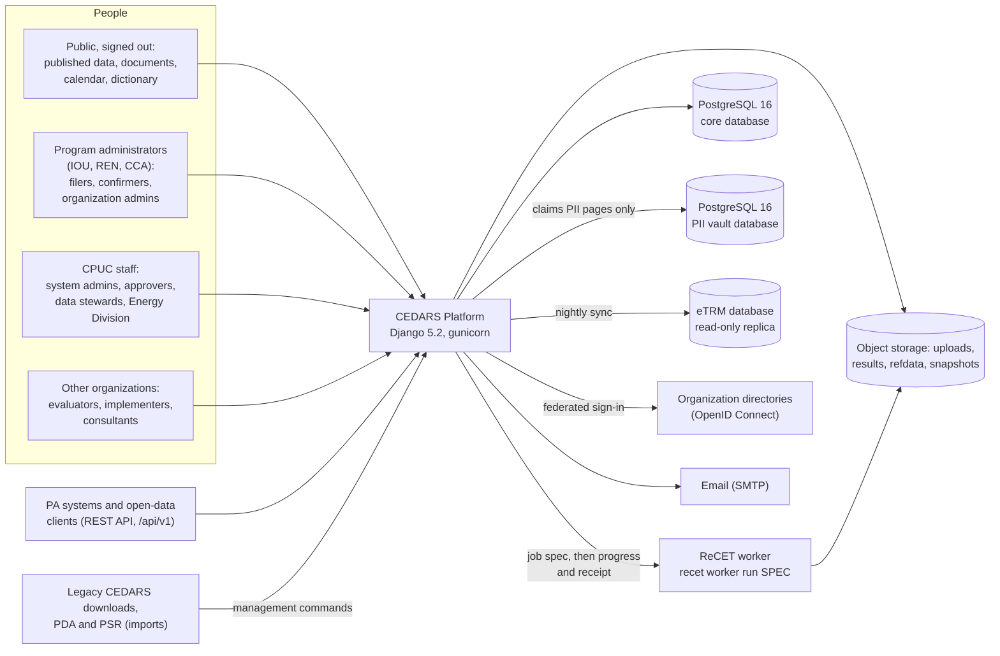

| External system | How the platform uses it | Code |
| --- | --- | --- |
| ReCET worker | Started with a job spec URI; reads its inputs and writes outputs, `progress.json` and `receipt.json` under the run's folder | `cedars/modules/calculations/dispatch.py`, `jobspec.py` |
| Object storage | Four areas (uploads, results, refdata, snapshots): folders under `CEDARS_STORAGE_ROOT` locally, one S3 bucket each in AWS; large downloads are pre-signed URLs | `cedars/core/storage.py` |
| eTRM database | Measure packages and permutations pulled nightly into versioned snapshots (a fixture schema stands in until access is granted) | `cedars/modules/impact_profiles/etrm.py`, `etrm_fixture_schema.sql` |
| Directories | Each federating organization's directory as an allauth OpenID Connect app | `SOCIALACCOUNT_PROVIDERS` in `cedars/settings/base.py` |
| Email | Django's SMTP backend in production (console in development) | `cedars/settings/prod.py` |
| Legacy sources | Public record-level downloads, PDA and PSR responses, CEDARS' own documents, loaded by management commands | `cedars/services/legacy/`, `cedars/modules/*/legacy.py`, `cedars/modules/documents/*_import.py` |

## 2. Processes and deployment

### 2.1 The processes

Everything runs from one image (the `Dockerfile`); a process is the web server or one management command.

| Process | Command | What it does | Where it runs |
| --- | --- | --- | --- |
| Web | `gunicorn cedars.wsgi:application` (3 workers in the image) | Pages, API, uploads, module checks, Edit inputs, Results; queues runs and jobs; rereads the front page's stale claims rows on a thread after the response | ECS service behind the load balancer (AWS); `web` service (Compose) |
| Calculations worker, local backend | `manage.py calculations_worker [--lane small\|large] [--once]` | Claims queued runs from PostgreSQL (`SELECT ... FOR UPDATE SKIP LOCKED`, small lane first), runs `recet worker run`, copies progress, records the receipt; heartbeats as a `Worker` row | Development, sandbox and a single server |
| Calculations on AWS Batch | `recet worker run <spec URI>` in the release's job definition | The same worker, as a Batch job on the small-runs or large-runs queue | AWS Batch on Fargate |
| Calculations sync | `manage.py calculations_sync --loop --sleep 60` | Copies Batch jobs' `progress.json` and `receipt.json` into their runs; fails jobs Batch ended without a receipt | Always-on ECS service (`jobs.tf`) |
| Impact profiles jobs | `manage.py run_impact_profile_jobs --loop --sleep 5` | Upload checks, profile generation, eTRM syncs started from a page, library writes; one queue per PA plus `system`, one job at a time per queue | Always-on ECS service; inline in the request when `IMPACT_PROFILES_INLINE_JOBS` |
| Record downloads | `manage.py run_data_downloads --loop --sleep 10` | Background record downloads larger than `DATA_DOWNLOAD_MAX_ROWS` | Always-on ECS service; inline when `DATA_DOWNLOAD_INLINE_JOBS` |
| Scheduled jobs | `purge_expired`, `send_deadline_reminders`, `close_recertifications`, `documents_read_text`, `sync_etrm`, `check_health`, sandbox bundle or refresh | See [Background work](#12-background-work) | EventBridge Scheduler (AWS) |

### 2.2 The image

`Dockerfile`: `python:3.12-slim` with its Debian packages upgraded to their published security fixes, uv installs the locked dependencies (`uv sync --locked --no-dev`), then the pinned ReCET wheel if one
was built into `engine/wheels/` beforehand (`scripts/build_engine_wheel.sh`; the build itself never sees a token), then the code and
`data/` (the field catalog and ReCET's documents), `collectstatic` (WhiteNoise serves static files), and uv is uninstalled. It runs as
an unprivileged user (uid 10001), exposes port 8000, and its health check asks `/healthz`. Without the wheel the image still builds, and
the pages that call the engine say it is not installed.

### 2.3 Docker Compose

`docker-compose.yml` in this repository is the development shape: PostgreSQL 16 and the web app (`runserver`, `cedars.settings.dev`)
with the source mounted, on port 8000. `CEDARS_REQUIRE_MFA=0` lets a laptop demo sign in with a password alone (dev settings only).

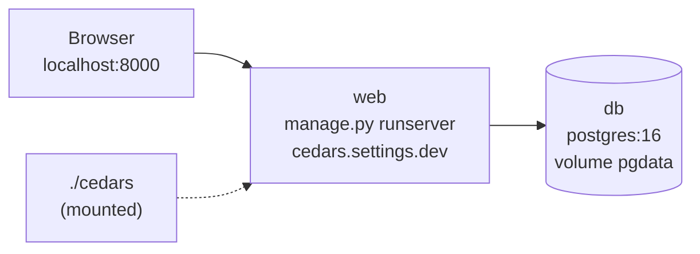

A single-server demo or review instance uses the same image under Compose with the sandbox's settings (a banner on every page, no PII
vault, test or public data only). Its Compose file is kept outside this public repository; its shape is:

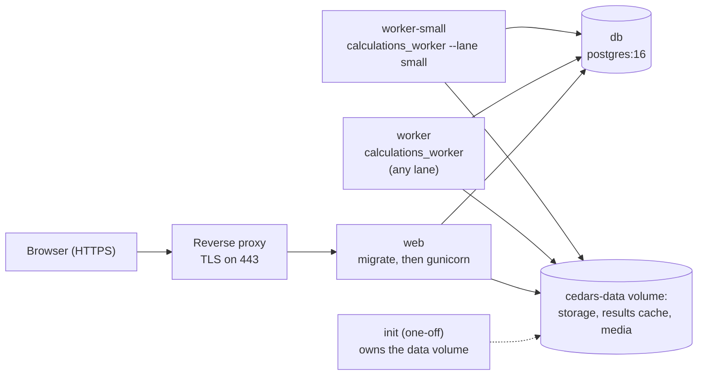

There, impact-profile jobs run inline in the request, the two workers run ReCET from the wheel in the image (so small runs never wait
behind a large one), and object storage is the local folder backend.

### 2.4 AWS (Terraform)

`infra/terraform/` describes the production, staging and sandbox stacks as one module (`modules/platform`). It is written and validated
in CI and applied only by the CPUC's cloud team in its own account.

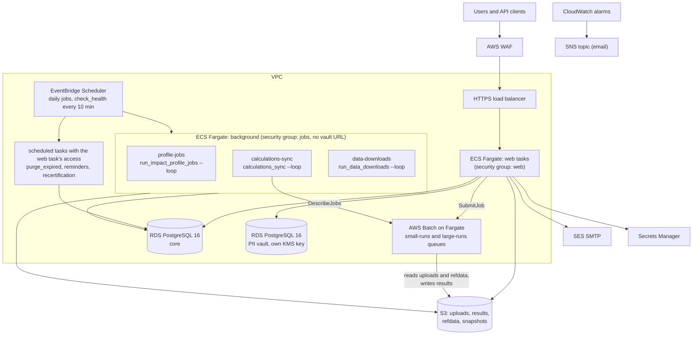

The background services and jobs that need no personal information run in the `jobs` security group, which reaches the core database
only and is given no vault URL; `purge_expired` and the account jobs run with the web task's access. Batch workers reach neither
database. `monitoring.tf` adds metric filters on `check_health`'s JSON line and alarms for failing or silent checks, unhealthy web
tasks, a background service with no running task, 5xx answers, memory and database load.

### 2.5 Settings

`cedars/settings/` has `base` (shared), `dev`, `test`, `sandbox` and `prod`. Everything machine-specific comes from the environment,
never from files: the database URLs, storage, the calculation backend, limits and integrations. The main switches:

| Setting (environment) | Default | Meaning |
| --- | --- | --- |
| `DATABASE_URL`, `VAULT_DATABASE_URL` | local `cedars` database; no vault | The core database; the vault alias exists only when its URL is set (`VaultRouter`) |
| `CEDARS_STORAGE_BACKEND`, `CEDARS_STORAGE_ROOT`, `CEDARS_BUCKET_*` | `local`, `var/storage` | Object storage backend and its four areas |
| `CALCULATIONS_BACKEND` | `local` | `local` (worker processes) or `batch` (AWS Batch) |
| `CALCULATIONS_WORKER_COMMAND` | `recet worker` | What the local backend runs |
| `CEDARS_BATCH_QUEUE_SMALL`, `CEDARS_BATCH_QUEUE_LARGE`, `CEDARS_BATCH_JOB_DEFINITION` | blank | The Batch queues and the job definition a release names none of |
| `CALCULATIONS_SMALL_RUN_RECORDS`, `CALCULATIONS_MAX_RECORDS` | 10,000; 2,000,000 | The small-runs lane's size; the largest job accepted |
| `CALCULATIONS_RESULTS_CACHE`, `DATA_CACHE` | under `var/cache` | Local copies of run group sums and of publication snapshots |
| `FRONT_PAGE_REFRESH_IN_BACKGROUND` | on | The front page's stale claims rows are reread on a thread after the response |
| `IMPACT_PROFILES_INLINE_JOBS`, `DATA_DOWNLOAD_INLINE_JOBS` | off (on in dev) | Run queued jobs in the request instead of a worker |
| `ETRM_DATABASE_URL`, `ETRM_SYNC_RETRY_MINUTES` | blank; 10, 30 | The eTRM source and the nightly sync's retries |
| `IMPACT_PROFILE_TERRITORIES`, `LOAD_SHAPE_FIRST_START` | PGE, SCE, SCG, SDGE; 2027-01-01 | First-run defaults only: CPUC administrators change both on Impact profiles' Settings page (`impact_profiles/policy.py`, `LibrarySettings`, one row per change) |
| `CEDARS_REQUIRE_MFA` | on (only dev may turn it off) | Every account needs a second factor |
| `CEDARS_API_RATE_USER`, `CEDARS_API_RATE_ANON`, `CEDARS_API_TOKEN_MAX_DAYS` | 120/min, 30/min, 365 | API throttles and token life |
| `CEDARS_NUM_PROXIES` | 0 (prod: 1) | Proxies in front; the API throttles and the sign-in rate limits take the caller's address from the entry the load balancer added to `X-Forwarded-For` |
| `CEDARS_UPLOAD_MAX_MB`, `CEDARS_UPLOAD_MAX_FILES`, `CEDARS_UPLOAD_MAX_UNZIPPED_MB` | 150, 20, 1,024 | Each uploaded file; files in one upload; what an uploaded .zip or workbook unpacks to |
| `HEALTH_*` | see `base.py` | Thresholds of the job and system health checks |

Every limit people meet (upload size and files, run records, Edit inputs rows, download rows, API rates, comment length ...) is such a
setting, listed by `cedars/services/releases/limits.py` on the public Limits page. A few are limits the CPUC sets without a release
(`Limit.editable`): runs one account may have waiting or running, how long a sign-in lasts and may sit unused, and the pre-upload
checker's file size. A CPUC system administrator changes them on Change limits (`/limits/manage/`, `releases.service.set_limit`, each
change a `LimitChange` row with its reason and an audit event); the setting is then only the first-run default, and the code that
enforces one reads `limits.value(key)`.

## 3. Code structure and the rules between its parts

```text
cedars/
  settings/      base, dev, test, sandbox, prod
  core/          the site shell: base templates, header (nav.py), page help, help pages, search, My queue, Your work, health,
                 storage, uploads, workbooks, API base, front page and search wiring
  services/      shared services, one Django app each (accounts, audit, registry, dictionary, rules, submissions, refdata,
                 notifications, retention, vault, legacy, snapshots, releases, feedback, sandbox, accessibility)
  modules/       one Django app per module (administration, impact_profiles, monthly, calculations, programs, budgets,
                 claims, documents, data)
engine/          recet-commit: the pinned ReCET commit; wheels/ (built, not committed)
data/            dictionary/recet-<version>.json (the engine's field catalog), recet_docs/ (the engine's documents)
infra/terraform/ the AWS stacks
scripts/         build_engine_wheel.sh, export_recet_dictionary.py, export_recet_docs.py
tests/           pytest-django on PostgreSQL; tests/a11y drives Chromium with axe-core
```

The apps, in `INSTALLED_APPS` order:

| Layer | App | What it owns |
| --- | --- | --- |
| Core | `cedars.core` | Base templates and static files, the header and its menus (`nav.py`), page help and tours (`page_help.py`), Help and the FAQ, site search (`search.py`), My queue (`queue.py`), Your work (`yourwork.py`), compact tick lists (`tick_lists.py`), the shared program, field and member pickers (`pickers.py`, choices read from the registry, dictionary and accounts services), health checks (`health.py`), object storage (`storage.py`), uploads (`uploads.py`), accessible workbooks (`workbooks.py`), zip streaming, the API base and `/healthz`; the database cache table `cedars_cache` (migration) |
| Service | `cedars.services.accounts` | Users, organizations and their codes, memberships, grants, role templates, access requests, recertification, access policy, API tokens, sign-in middleware |
| Service | `cedars.services.audit` | The append-only audit trail and the request context it stamps on every event |
| Service | `cedars.services.registry` | Programs and their effective-dated versions, statewide leads and IDs that follow a statewide program, filing cycles, reporting periods, statewide allocation versions, program change policy and requests, goal sets; the operating budget, reported spend, program records and evaluation hooks |
| Service | `cedars.services.dictionary` | Field catalog versions (the engine's and the platform's own records), aliases, usages, value lists, field retirement, templates and schemas, the legacy crosswalk |
| Service | `cedars.services.rules` | Rule sets and rules as data, run by the engine's rule runner; the pre-upload checker; the list of checks written in code |
| Service | `cedars.services.submissions` | The filing calendar, the one state machine for every filing, workflow policy, reopen requests and delegations, comments, corrections in place, publication hooks, pricing through the registered pricer |
| Service | `cedars.services.refdata` | Reference-data packs (ACC, impact profiles, eTRM permutations, cost-test sets ...), tie-outs, pinning; the cost-test set builder |
| Service | `cedars.services.notifications` | Subscriptions fed from the audit trail, follows, deadline reminders, the notifications page, email |
| Service | `cedars.services.retention` | Retention periods per record class, legal holds, the purge job and its purgers |
| Service | `cedars.services.vault` | `PIIContact`, `PIISite` and their uploads in the vault database |
| Service | `cedars.services.legacy` | Staged legacy CEDARS downloads and imported years |
| Service | `cedars.services.snapshots` | Publication snapshots and releases, the personal-information scan |
| Service | `cedars.services.releases` | Release notes, the Limits page, the register of CPUC-mandated changes |
| Service | `cedars.services.feedback` | Feedback on any page |
| Service | `cedars.services.sandbox` | The production bundle and the sandbox refresh |
| Service | `cedars.services.accessibility` | Accessibility checks of stored PDFs and workbooks |
| Module | `cedars.modules.administration` | Account, organizations, members and grants, access requests, recertification, stewardship, role templates, audit log, health, section landing pages (no models of its own) |
| Module | `cedars.modules.impact_profiles` | eTRM sync, load-shape uploads and their checks, generated and custom impact profiles, the profile library |
| Module | `cedars.modules.monthly` | Monthly reports and the 13th-month report |
| Module | `cedars.modules.calculations` | Engine releases, runs, dispatch, results, Compare, Edit inputs, output templates, the job API |
| Module | `cedars.modules.programs` | The program catalog and program pages, change forms, the program fields guide (models in the registry) |
| Module | `cedars.modules.budgets` | Budget filings, fund shifts, the operating budget, change letters |
| Module | `cedars.modules.claims` | Claim years, quarterly and statewide claims, links between claims, true-ups, PII uploads, restatements, the claims API |
| Module | `cedars.modules.documents` | The document library, EM&V deliverables, study register, work orders, public comment, subscriptions, PDA, PSR and CEDARS imports |
| Module | `cedars.modules.data` | The front page, dashboards, query layer, downloads, record downloads, saved views, the open data API, parity checks |

### 3.1 Dependency rules

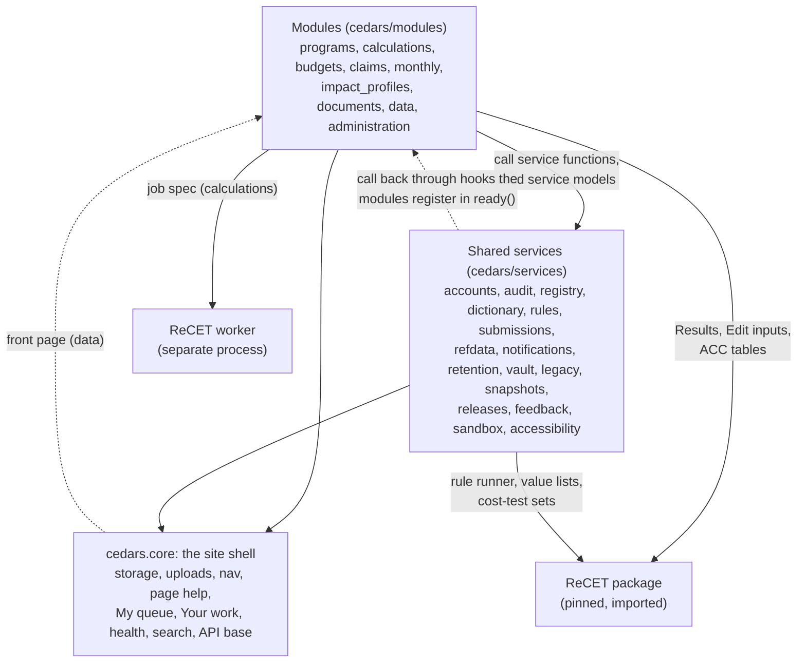

- **A module changes data only through a service's functions** (it may read a service's models to show them) **and never imports
  another module.** A search of `cedars/modules` finds no import of one module by another.
- **A service never imports a module.** Where a service needs a module's work (pricing a filing, publishing it, describing it in a
  notification, adding its rows to a program page), the module registers a function with the service in its `AppConfig.ready()`.
- `cedars.core` is the site shell above both: its URL configuration takes the front page from `cedars.modules.data`. Site search
  imports no module: the parts a service or module offers (filings, runs, confirmed claims, documents) are registered with it.
- The engine is a package dependency, never copied: the web process imports it for results, Edit inputs, rules, value lists,
  cost-test sets and the ACC tables; pricing always goes through the worker (see [ReCET engine integration](#10-recet-engine-integration)).

### 3.2 Extension hooks

Every point where a service calls back into a module is a registration function. These are the platform's internal interfaces:

| Hook | Service | Registered by | What the service calls it for |
| --- | --- | --- | --- |
| `register_pricer` | submissions | calculations | Price a validated filing version (`price_submission`) |
| `register_run_state` | submissions | calculations | Whether a version's pricing run is still running or ended without pricing it |
| `register_run_walkthrough` | submissions | calculations | The measure walkthrough of the run that priced a version, linked from the version's page |
| `register_restater` | submissions | calculations | Price a published filing again as an analysis run (restatements) |
| `register_publisher` | submissions | budgets, claims, monthly | Publish or withdraw a confirmed version's module data |
| `register_listener` | submissions | snapshots | Snapshot a published version after commit, or drop it on un-confirm |
| `register_reader` | submissions | budgets, claims, monthly | Who may read a filing on the Filings page |
| `register_version_page` | submissions | claims, budgets, monthly | A version's page, which the walkthrough of its pricing run links back to |
| `register_deadline_page`, `register_setup_page`, `register_setup_groups`, `register_setup_link` | submissions | budgets, claims, monthly | The calendar's links, its Add a filing choices, what clearing the calendar removes together, and the set-up page each filing belongs to (the Filing sets page and each deadline's page link it) |
| `register_nothing_to_file` | submissions | monthly | Deadlines that only mark a date (the 13th-month report is generated) |
| `register_filers`, `register_stream` | submissions | claims | Who files a deadline beyond its set-up's list of PAs (statewide: lead PAs), and the run of confirmations it belongs to (`statewide` or the PAs' own) |
| `register_acc_needs` | submissions | budgets, claims, monthly | ACCs the default engine release must carry |
| `register_claims_totals` | submissions | claims | A PA's confirmed claims for a year (read by Monthly reports) |
| `register_operating_budget` | registry | budgets | A PA's operating budget (read by Monthly reports, Claims, dashboards) |
| `register_reported_spend` | registry | monthly | Reported year-to-date spend (budget and spending dashboard) |
| `register_program_records` | registry | budgets, claims, monthly, documents | Each module's rows on a program page, under its own read rules |
| `register_evaluations`, `register_document_filing` | registry | documents | The studies that evaluate a program, and its Add a document link |
| `register_filing` | notifications | budgets, claims, monthly | What a filing version's events concern: its PAs, programs, a summary and the page to open |
| `register_concerns` | notifications | budgets (fund shifts), documents, releases | The same for a module's own records |
| `register_purger` | retention | calculations, data, feedback, notifications, submissions | Find and delete expired records of a class |
| `register_checker` | rules (`precheck.py`) | budgets, claims | The pre-upload checker runs the module's own rule-set step |
| `register_coded_checks` | rules (`coded.py`) | budgets, claims, monthly, impact_profiles, vault | The checks each upload runs in code beside the rule sets, listed read only on Built-in checks (`/rules/built-in/`) |
| `register_list` | dictionary `value_lists.py` | registry (a service) | A list a service keeps as a versioned value list, never handed to the engine: a program's status, segment, primary sector, implementer and category (first version from the program fields guide, read back by `field_guide.values`) |
| `register` | submissions `corrections.py` | budgets, claims, monthly | Each module's record editor for corrections in place |
| `register` | core `queue.py` | accounts, registry, submissions, snapshots, budgets, documents | Items waiting on the signed-in user in My queue |
| `register` | core `yourwork.py` | accounts, submissions, refdata, calculations, data | The signed-in person's own work at the top of the front page and the Calculations, Reference data and Published data pages |
| `register` | core `health.py` | calculations, impact_profiles, documents, notifications, releases | Job and system health checks |
| `register` | core `page_access.py` | documents, impact_profiles, refdata, snapshots | Who may open a page outside the header's menus whose own check is finer than a role, so the Help guides link to it only for people it opens for |
| `register` | core `search.py` | submissions, calculations, claims, documents | Parts of the site search results: a signed-in person's own filings and the runs they see, a confirmed claim by its ClaimID, the document library's search (each under its own pages' rules; a hit the query names exactly leads as the best match) |

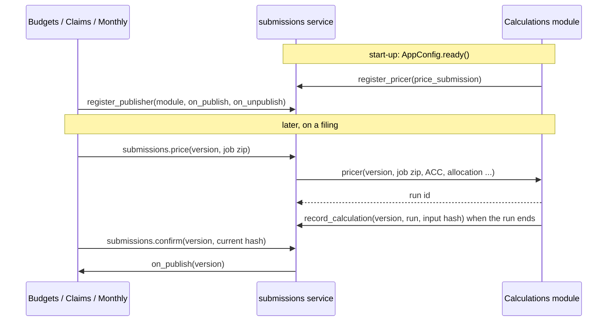

## 4. Data model

### 4.1 Where data lives

| Store | What | Notes |
| --- | --- | --- |
| Core PostgreSQL | Every model except the vault's (section 4.4) | Exclusion constraints on date ranges, partial unique constraints, check constraints and triggers enforce the invariants (section 4.3); also the `cedars_cache` table (Django's database cache) |
| Vault PostgreSQL | `PIIUpload`, `PIIContact`, `PIISite` | `VaultRouter` sends the `vault` app there and nothing else; references to core rows are plain integers (`organisation_id`, `version_id`), never foreign keys across databases |
| Object storage | Uploaded files, run inputs and outputs, reference-data packs, publication snapshots, document files, 8,760 shapes (one float64 array per SHA-256) | Keys such as `runs/<id>/job.zip` in four areas; SHA-256 recorded beside every file a record names |
| Parquet | Publication snapshots, run group sums, legacy tables, the impact-profile library | Read with pyarrow and DuckDB |

Most records keep the "versions, not edits" rule: confirmed filing versions, published rule sets, value lists, packs, catalog versions,
release notes, change letters, comments and the audit trail never change.

### 4.2 Entity-relationship diagrams

Model names are the classes in each app's `models.py` (code identifiers keep the original `Organisation` spelling). Only the main
relationships are drawn; who-did-it foreign keys to `User` (created_by, confirmed_by ...) are left out.

**Identity and access** (`cedars.services.accounts`, `cedars.services.audit`)

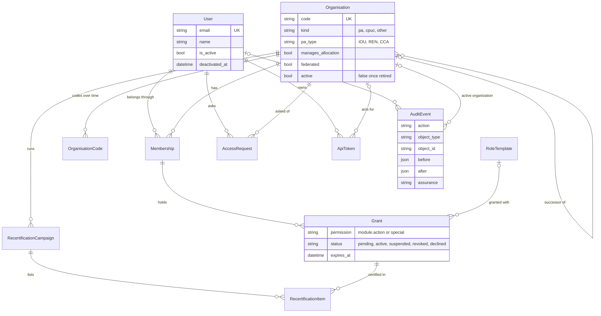

`AccessPolicy` and `PolicyChange` hold the access settings (two data stewards confirm a change); they have no relationships worth
drawing. A `PolicyChange` with the setting `organisation_federation` is a system administrator's proposal to switch an organization's
directory sign-in while its members hold or wait for PII access; its value names the organization, and a data steward other than the
proposer confirms it before it takes effect.

**Programs, periods and statewide allocation** (`cedars.services.registry`)

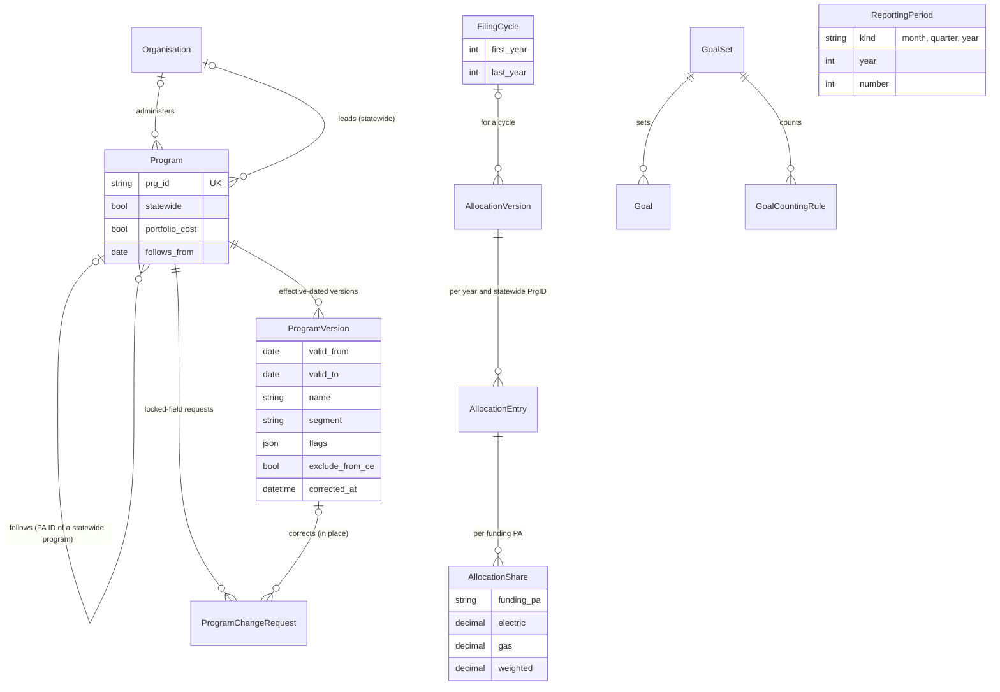

`ProgramChangePolicy` lists the locked program attributes. `ReportingPeriod` is referenced by filing deadlines (next diagram).

A program is added on its page (`registry.create_program`; `can_add_program`: a PA's organization or programs administrators for
that PA, CPUC system administrators for any PA and for statewide programs; `prg_id_problem`: the PrgID starts with one of the PA's
codes, or SW_, and is never reused in any case). A change starts a new version after the latest one. A **correction** puts right a
version's values in place, keeping its dates (`correct_version`: CPUC system administrators and programs approvers; the version
records `corrected_at` / `corrected_by` and the audit event `program.corrected` keeps the values before). A program's own
administrators send a correction as a `ProgramChangeRequest` with `corrects` set (`request_correction`), which `decide_change`
applies with `correct_version` when approved. Correcting a statewide program's version brings every ID that follows it into line
from that version's start (`_follow_from`); an ID that follows is corrected only through its statewide program.

**Filings** (`cedars.services.submissions` and the filing modules)

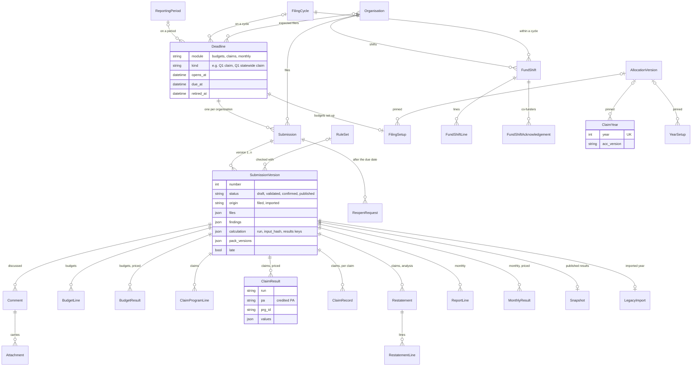

Each filing module also has an append-only `ChangeLetter` (budgets, claims and monthly each have their own, one per corrected
version against the one it replaces). `WorkflowPolicy` holds each module's correction policy, which a system administrator changes
on the workflow settings page (`/filings/workflow-settings/`, with a reason, audited). `Delegation` names an approver's delegate for
one module and a date range, with who named it and why; it is never deleted: ending it early sets `ended_at`, `ended_by` and a reason,
and `Delegation.objects.in_force(day)` is the one rule every reader (the approver check, the reviewer list, the header) uses. `ClaimYear` and `YearSetup` are tied to their deadlines by year; `FilingSetup` by a one-to-one key.

**Calculations and reference data** (`cedars.modules.calculations`, `cedars.services.refdata`, `cedars.services.snapshots`)


A run names its engine release by value (`Run.engine_release`), so it keeps naming the release it ran on whatever later happens to
the `EngineRelease` row. `TieOutRequirement` says which tie-outs each pack kind needs before it can be published: CPUC system
administrators add and retire them on the Pack acceptance checks page (`/reference-data/packs/checks/`), never edit one, and a pack
keeps the checks it was published under (`PackVersion.checks_at_publication`). A check's result is recorded from its JSON report on the
pack's page (`refdata.service.record_report`: `passed` or `status`, a SHA-256 that must name one of the pack's files) or by the
`record_tie_out` command. eTRM permutation packs are uploaded on a page (`/reference-data/packs/etrm-permutations/`, the
`load_etrm_permutations` command's `etrm.load`); the gigabyte ACC and profile-library packs stay registered from storage by command.
`ScanSettings` holds the publication scan's settings.

**Dictionary, rules and value lists** (`cedars.services.dictionary`, `cedars.services.rules`)

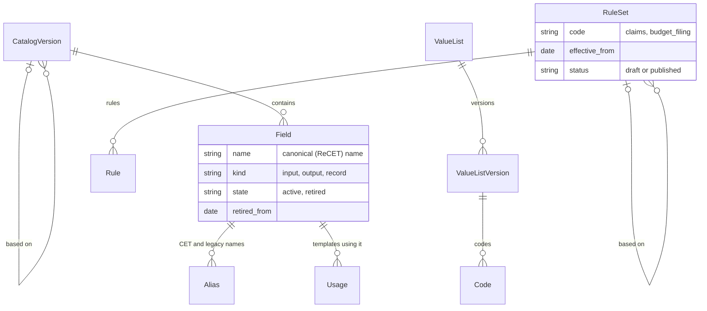

**PII vault** (`cedars.services.vault`, its own database)

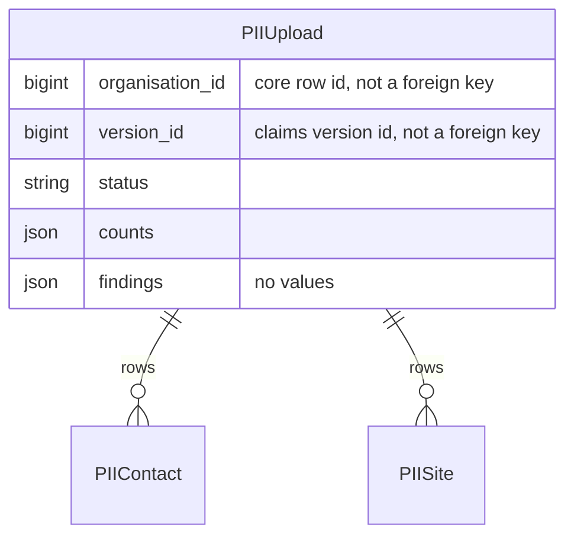

**Impact profiles** (`cedars.modules.impact_profiles`)


**Documents and EM&V** (`cedars.modules.documents`)

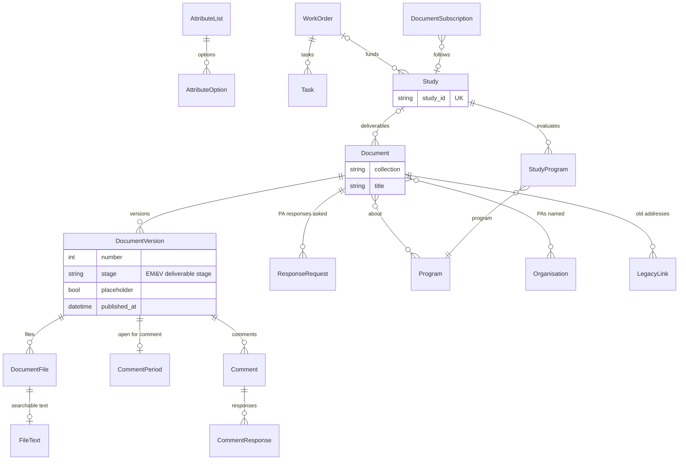

`KeyDate` holds the dates Energy Division posts on the library's home page. `LegacyLink` maps an address of the old CEDARS site or the
2006-2013 EM&V site to the migrated document or file it now opens; CPUC Energy Division's document administrators repoint one on
the Old links page, with a reason (audit `documents.legacy_link_repointed`).

### 4.3 Invariants the database enforces

| Invariant | How |
| --- | --- |
| A program's versions never overlap; an organization's codes never overlap and a code stays with one party | PostgreSQL exclusion constraints on date ranges (registry and accounts migrations) |
| One open membership per user and organization; one CPUC organization; one default engine release; one deadline per module, kind, name and period or cycle | Partial unique constraints |
| An imported version is published; a version's number is unique in its submission; an ID that follows a statewide program has a date | Check and unique constraints |
| The audit trail is append-only | Trigger, `audit` migration 0002 |
| Published rule sets, value list versions, reference packs, release notes and mandates never change; a published mandate is never deleted | Triggers (rules 0002, dictionary 0002, refdata 0002, releases 0001 and 0002) |
| Change letters, filing comments and attachments never change | Triggers (budgets 0004, claims 0002, monthly 0003, submissions 0004) |
| Published document versions and their files, EM&V deliverable stages and placeholder flags never change | Triggers (documents 0003, 0007, 0016) |
| The vault holds only its own tables; nothing else migrates there | `VaultRouter.allow_migrate` and `allow_relation` |

### 4.4 Every model

`tests/test_architecture_doc.py` checks that every model is named here.

| App | Models |
| --- | --- |
| accounts | `User`, `Organisation`, `OrganisationCode`, `Membership`, `RoleTemplate`, `Grant`, `AccessRequest`, `RecertificationCampaign`, `RecertificationItem`, `AccessPolicy`, `PolicyChange`, `ApiToken` |
| audit | `AuditEvent` |
| registry | `Program`, `ProgramVersion`, `FilingCycle`, `ReportingPeriod`, `AllocationVersion`, `AllocationEntry`, `AllocationShare`, `ProgramChangePolicy`, `ProgramChangeRequest`, `GoalSet`, `Goal`, `GoalCountingRule` |
| dictionary | `CatalogVersion`, `Field`, `Alias`, `Usage`, `ValueList`, `ValueListVersion`, `Code` |
| rules | `RuleSet`, `Rule` |
| submissions | `Deadline`, `WorkflowPolicy`, `Submission`, `SubmissionVersion`, `ReopenRequest`, `Delegation`, `Comment`, `Attachment` |
| refdata | `PackVersion`, `TieOutRequirement`, `TieOut`, `EtrmPermutation`, `EtrmPackage`, `CostTestBuild` |
| notifications | `Subscription`, `Preference`, `DeadlineReminder`, `Notification` |
| retention | `RetentionPolicy`, `LegalHold`, `PurgeRun` |
| vault | `PIIUpload`, `PIIContact`, `PIISite` |
| legacy | `LegacySource`, `LegacyImport` |
| snapshots | `Snapshot`, `Release`, `ScanSettings`, `PIIScan` |
| releases | `ReleaseNote`, `Change`, `Mandate`, `MandateLink`, `LimitChange`, `SiteNotice` |
| feedback | `Feedback` |
| sandbox | `Refresh`, `CopiedRecord` |
| accessibility | `CheckSettings`, `FileCheck` |
| impact_profiles | `Shape`, `EtrmSyncRun`, `MeasurePackage`, `PackageVersion`, `Permutation`, `ExcludedPackage`, `LoadShapeUpload`, `UploadFinding`, `LoadShape`, `LoadShapeVersion`, `ImpactProfile`, `ProfileVersion`, `ProfileZone`, `ProfileMapping`, `ProcessingJob`, `LibraryExport`, `LibrarySettings` |
| monthly | `YearSetup`, `ReportLine`, `MonthlyResult`, `ChangeLetter` |
| calculations | `EngineRelease`, `InputDraft`, `Run`, `OutputTemplate`, `OutputTemplateDefault`, `ResultView`, `Worker` |
| budgets | `FilingSetup`, `BudgetLine`, `BudgetResult`, `FundShift`, `FundShiftLine`, `FundShiftAcknowledgement`, `ChangeLetter` |
| claims | `ClaimYear`, `ClaimProgramLine`, `ClaimResult`, `ChangeLetter`, `ClaimRecord`, `Restatement`, `RestatementLine` |
| documents | `AttributeList`, `AttributeOption`, `Document`, `DocumentVersion`, `CommentPeriod`, `ResponseRequest`, `Comment`, `CommentResponse`, `DocumentFile`, `WorkOrder`, `LegacyLink`, `Task`, `Study`, `StudyProgram`, `FileText`, `DocumentSubscription`, `KeyDate` |
| data | `DownloadJob`, `SavedView`, `RecordColumnDefault` |

`core`, `administration` and `programs` have no models (Programs' records are the registry's).

## 5. Identity, organizations and roles

### 5.1 Accounts and organizations

- A **user** is one identity per person (email, unique without regard to case), whatever organizations they belong to. Accounts are
  deactivated, never deleted. An account with no membership is a **community account**: it reads what is public and runs its own
  calculations.
- **People pages** (`/admin/people/`, system administrators): find any account, correct its name (with a reason), deactivate or
  reactivate it. `accounts.deactivate_user` needs a reason, refuses the last system administrator and the last data steward, revokes
  the account's API tokens, ends its sessions and records who did it and why on the user (`deactivated_at`, `deactivated_by`,
  `deactivation_reason`); the account's runs, filings and history stay. A community account may close itself from its account page;
  only the CPUC reopens it (`reactivate_user`).
- People set their own **name** on their account page (`set_name`, audited). An **email change** is allauth's: the new address is
  verified by a link before it replaces the old one, the user signs in again to start it (`ACCOUNT_REAUTHENTICATION_REQUIRED`), and
  once it is made the platform audits `user.email_changed` (before and after), ends the user's other sessions and mails a notice to
  the old address (`accounts/signals.py`). A user created without an address record gets one, verified, the next time they sign in or
  open their account page (`ensure_email_record`), so the change page always has the current address.
- An **organization** is of kind `pa` (program administrator), `cpuc` (exactly one) or `other` (evaluators, implementers,
  consultants). A PA has a type, IOU, REN or CCA, which the dashboards and pickers group by, and the claims checks use (a REN's or CCA's
  claim must carry `CCAREN_Flag`). `SW` is the statewide pseudo-PA: statewide programs and the records CEDARS loaded under it; it does
  not file (`Organisation.files` is false for it).
- An organization's **codes** have dates (`OrganisationCode`): a rename closes the old code, a former code can be recorded, and two
  records of one party are merged (`successor`). Data keep the code as filed; `code_map` / `by_code` read any code as its party's.
- `manages_allocation` marks the funding PAs (the four IOUs by default) whose members may hold `allocation.manage`.
- A system administrator changes how an organization's members **sign in** on its page (`change_federation`: directory sign-in with
  its provider, or password and a second factor). It applies at once, unless the organization holds open `claims.pii` grants: then
  it is a proposal (`PolicyChange`, above) that a data steward confirms on the stewardship page.
- An organization is **retired** (`retire_organisation`, with a reason) when it stops filing without merging into another: `active`
  goes false, so it leaves the pickers, filing lists and token checks, while its codes, memberships, data and history stay. It can be
  brought back (`reinstate_organisation`). The CPUC and a merged organization cannot be retired.

### 5.2 Permissions and grants

A **grant** gives one permission to one membership, with who granted it and when, an optional expiry, approval, certification,
suspension and revocation; it is never deleted and every change is an audit event. The catalog (`accounts/permissions.py`):

| Permission | Meaning |
| --- | --- |
| `<module>.<action>` | For each module (programs, calculations, impact_profiles, budgets, claims, monthly, data, documents) and action (read, submit, confirm, approve, admin) |
| `org.admin` | An organization's administrator: manages its members and grants, runs its recertification (the CPUC grants only a PA's first administrator) |
| `claims.pii` | Reaches the PII vault for the organization's claims; a data steward approves every grant, and the CPUC can require a federated session for it |
| `allocation.manage` | Loads, confirms and discards statewide allocation versions; only in an organization marked `manages_allocation` |
| `system.admin` | A CPUC system administrator (CPUC organization only) |
| `pii.steward` | A data steward (CPUC organization only); approves PII grants, confirms access-policy changes; the last one cannot be revoked |

`has_permission(user, organisation, permission)` is the one check: the user's active, unexpired grants in that organization (plus the
federated-session rule for `claims.pii`). **Role templates** (`RoleTemplate`) are named bundles of module permissions a system
administrator defines and an organization's administrator applies, one grant per permission. Organization administrators run
periodic **recertification**; when a campaign closes (`close_recertifications`, daily), grants nobody certified are suspended if the
access policy says so (never the last data steward).

How the usual roles map onto grants:

| Role | Organization | Typical grants |
| --- | --- | --- |
| PA filer (IOU, REN or CCA) | The PA | `budgets.submit`, `claims.submit`, `monthly.submit`, `calculations.submit`, the matching `read`s |
| PA confirmer | The PA | `<module>.confirm` (confirming publishes the filing) |
| PA organization administrator | The PA | `org.admin` (members, grants, recertification); `programs.admin` to change the PA's programs and record statewide leads |
| Statewide program lead | The lead PA | No extra permission: `Program.lead` names the PA, and its filers file the program's statewide claims and budgets |
| Funding PA allocation manager | An IOU | `allocation.manage` |
| PII handler | The PA (upload), PA or CPUC (read) | `claims.pii`, approved by a data steward |
| CPUC reviewer | CPUC | `<module>.read` |
| CPUC approver | CPUC | `<module>.approve`: decides reopen requests and program change and correction requests (a programs approver also corrects a program version directly); names delegates for a module and a period on the delegates page (`/filings/delegates/`; a delegate is CPUC staff with `<module>.read`; a system administrator can name or end one on an approver's behalf, with a reason) |
| CPUC system administrator | CPUC | `system.admin`: set-up (claim years, filing setups, calendar), engine releases, reference packs, rules, value lists, release notes, organizations |
| Data steward | CPUC | `pii.steward` |
| Community account | none | Public pages, its own runs |

### 5.3 Signing in and acting for an organization

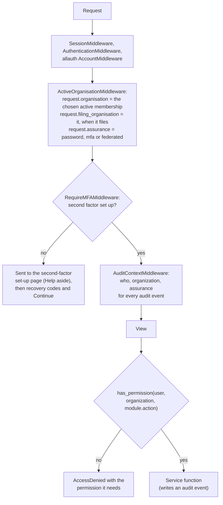

- Sign-in is django-allauth: email and password with a second factor (TOTP, WebAuthn security keys, recovery codes) for every account,
  or a federating organization's directory over OpenID Connect. Email verification is mandatory and failed sign-ins are rate limited,
  per caller address and per account. A sign-in ends after the session_hours limit and after the session_idle_minutes limit
  unused (`SessionTimeoutMiddleware`; a page's background requests do not count as use). There is no Django admin site: every administrative action is a platform page that goes
  through a service and its audit event.
- **A new account's first sign-in** has three steps, shown on its pages as a step line (`core/_set_up_steps.html`): confirm the email,
  set up the second factor, ask an organization for access. The middleware sends a password-only session to the set-up page with the
  address it was heading for (`next`), which the set-up form carries. Adding the account's first authenticator records that address in
  the session (`accounts.signals`, `FIRST_SET_UP`, kept only when it stays on this site); the recovery codes page that follows says what
  the codes are for, offers Download and Print, and Continue (`/account/continue/`, `core.views.after_set_up`), which goes to Ask for
  access for an account in no organization and otherwise to that address.
- A user acts for one organization at a time, switched in the session; runs and uploads made under a membership belong to the
  organization and stay with it when the person leaves.
- The **header** is data (`cedars/core/nav.py`): every item names who sees it (`anon`, `user`, `member`, `guest`, `public`,
  `sysadmin`, `org_admin`, `steward`, `approver`, `delegator`: a CPUC approver of a module that can be delegated); a page's view name
  picks the highlighted menu.
- **API tokens** (`ApiToken`, `Authorization: Bearer cedars_...`, only the SHA-256 stored) act for one organization, reach only their
  scopes and never more than the user's grants there, and never PII or administration.

## 6. The filing workflow

Budgets, claims and monthly reports share one state machine in `cedars.services.submissions`. A **deadline** is a calendar entry of a
module on a reporting period or a filing cycle; an organization's filing for it is a **submission**, whose **versions** carry the
files, findings, the pricing run and the packs it was priced with.

**Who files.** Not every PA files every filing. A deadline's `filers` (many-to-many to `Organisation`; none listed means every PA)
are the PAs expected to file it. A CPUC system administrator ticks them as a budget filing, a claim year or a year of monthly reports
is set up (the module's `add_filing`, `add_year` or `set_up_year` with `filers=`), and adds or removes them later in the set-up page's
Who files section (`submissions.setup.FilersForm`); both go through `submissions.set_filers`, which writes `deadline.filers_changed`
with the PAs before and after, needs a reason and at least one PA, and keeps a PA that has started filing on the deadline. A claim
year's list applies to the PAs' own five claims; its statewide confirmations are filed by the statewide programs' lead PAs
(`register_filers`). `submissions.on_filing(deadline, organisation)` answers from the list; `files_for` adds the module's own rule.
`start` refuses a PA not on the filing; the "Choose a program administrator" list (`filer_statuses`), each module's index ("Nothing to
file: ... is not on this filing") and the Filings page's status (`submissions.status.board`) follow it, and the status table leaves out
a PA on none of the filings it shows.

**Filing sets and canceling one filing.** Each module set-up (a budget filing, a claim year, a year of monthly reports) is a filing
set: the deadlines it put on the calendar. The Filing sets page (`/filings/calendar/sets/`, CPUC system administrators;
`submissions.filing_sets` over `register_setup_groups` and `register_setup_link`) lists each with its filings, how many are canceled,
what is due next and an Edit link to its set-up page. A CPUC system administrator cancels any one filing of a set, from the set-up
page's Filings in this set section (`submissions.setup.CancelForm` / `RestoreForm`) or the deadline's own page, with a reason, while
no organization has started it: `submissions.retire_deadline` sets `Deadline.retired_at` and writes `deadline.retired` (shown as
"Canceled"); `restore_deadline` undoes it (`deadline.restored`). The rest of the set is untouched. A canceled deadline is left off the
calendar (unless asked for), reminders, the Filings page's status and `start`; the modules' index and filing pages mark it Canceled.

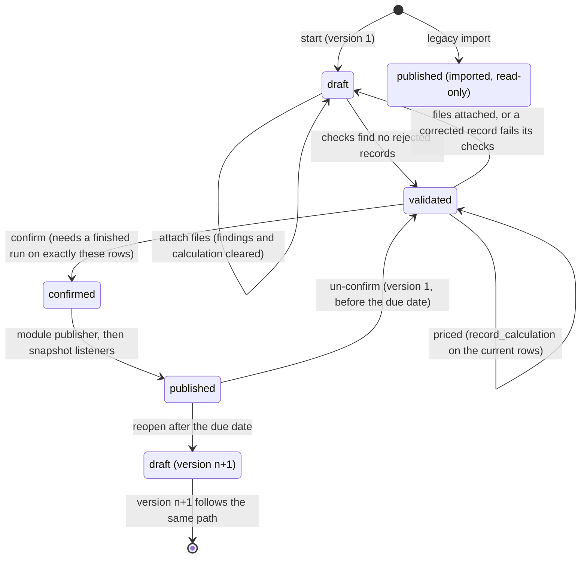

- **Priced before confirmed.** `submissions.price` calls the registered pricer (the Calculations module); when the run ends,
  `record_calculation` stores the run, its input hash, and what it was priced with (release, ACC, allocation version, cost-test set,
  packs, keys of the job spec, receipt and group sums). `confirm` refuses unless the stored hash equals the rows' hash now, so a PA
  confirms exactly what it reviewed.
- **Publication is part of confirmation**: the module's publisher runs, the version becomes published, and the listeners (publication
  snapshots) run once the transaction commits.
- **Before the due date** the first version can be un-confirmed and changed as often as needed; nothing superseded before the due date
  is kept. **After it**, a correction is version n+1 under the module's `WorkflowPolicy.reopen_after_due`: `approval` (a request an
  approver or their delegate decides), `open` (at once, with a reason) or `closed`. A late first confirmation is allowed and marked
  unless `late_confirmation` is off. A system administrator changes both on the workflow settings page; a change that tightens the
  rule offers a release note.
- **Imported versions** (legacy CEDARS years) are published on creation, never validated, priced, un-confirmed, reopened or corrected.
- **Corrections in place** (`corrections.py`): on an open draft only, a record is changed, added or deleted on a form or by a partial
  upload, previewed, then applied; the module re-checks only the records the change affects and every record change is an audit event.
  Correct records opens on the version's records with findings (`with_findings`, rejected first; findings about a whole table said
  apart). A record's form lays its fields out by section (`field_info`: the field's section in the pinned engine's input field
  reference, read by `core.engine_docs.input_sections`, else its data dictionary group), with the fields that have findings first,
  and offers a value list's codes (the version in force, else the engine's list, leaving out codes retired before the filing's first
  year) as a datalist up to the `CEDARS_CORRECTION_LIST_CODES` limit; a longer list links to its dictionary page.
- **Comments** on versions between the filer and CPUC staff, never public and never edited; **My queue** lists what waits on the user.
- **Checks on a file with missing columns.** Each missing column of the module's specification is a finding of its own (`CLM-COL`,
  `BUD-COL`; both its name and its CET name). The rules service's `needing(rule_set, table, missing)` names the rules that read a
  missing column (its field, a spec rule's columns, condition fields and value operands); only those are skipped (`rules.check(...,
  skip=)`), the other rules still run, and `missing_columns_note` tells the filer that more findings may appear once the columns are there.

**The filing pages** (claims period, budget filing, monthly report) are built from shared parts in the submissions service:
`filing_parts.py` and the `submissions/_filing_*.html` templates. `filing_parts.stage` turns a version's state into one of five steps
(Upload, Check, Price, Confirm, Published) and a sentence, drawn as the step line with the current step marked `aria-current="step"`;
the outcome card under it carries the one next action as the page's only primary button (Upload and check, Check again, Price,
Confirm and publish). `findings_by_rule` groups a version's findings by rule, using the corrections editor's record keys: the rule ID
links to the rule in the version's rule set, each rule lists its records (up to the `CEDARS_FINDING_RECORDS_SHOWN` limit) with a link
to correct each one, and a column rule lists every missing column. The upload form, the file's details, the statewide card and
earlier confirmations fold below once they are not the next step. While a pricing run is going, the page polls
`submissions:pricing_status` (`/filings/versions/<pk>/pricing.json?run=<id>`, readers of the filing only; it reports only a run
whose `submission.pricing_started` event names this version) through `core/watch.js`, announces the change through
`window.cedarsAnnounce`, and reloads when the run ends unless something has the focus. Each module's version page shows the same
status words (`filing_parts.status_words`) and offers Confirm and publish beside the results it confirms (`filing_parts.version_page`);
the claims version page marks programs whose filed first-year savings differ from the priced ones by more than 1% (`savings_differ`).
- **One name for a filing.** Wherever a person reads a filing (My queue, Requests to correct filings, notices, messages, the audit
  trail's object names) it is `Deadline.plain_name` / `Submission.plain_name`: the organization, the period or cycle in words, the
  filing's title and the due date in the site's time zone ("PGE 2027 Q1 claim, due 2026-11-01"); `submissions.filing_page` finds the
  page that filing is worked on (the module's page for the deadline, else the version's page).
- **A reopened filing in My queue.** A filing reopened for a correction is listed for its filers (`submissions.queue.corrections`)
  until it is priced and moves to the confirmations. Declining a correction request needs a reason, which the filer is told.

The whole path of one filing, with the calculation and publication:

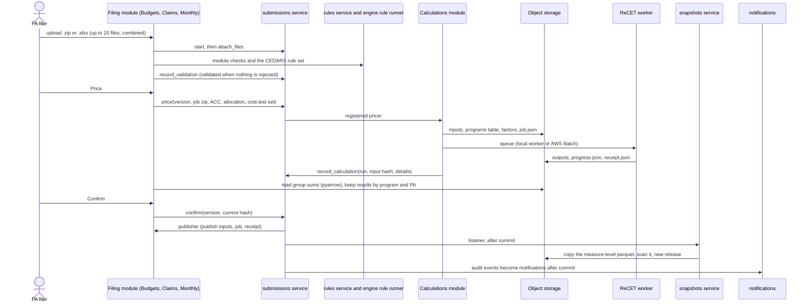

## 7. Statewide programs and statewide claims

Statewide (SW) programs are funded by several PAs through allocation factors and run by one lead PA. The registry holds them as the
source of truth, and Claims files their claims first so that every funding PA sees what is credited to it before it files its own.

### 7.1 The statewide program as source of truth

- A statewide program is a `Program` with `statewide=True` and no administrator. Its **lead PA** is `Program.lead`: recorded on the
  program page by any PA's administrators while it has none, then changed only by the current lead's (or a CPUC system administrator)
  with a reason (`registry.can_set_lead`, `set_lead`).
- Each PA's ID of it (its code before the statewide PrgID, `PGE_SW_FS` for `SW_FS`: `statewide_part_of`, `allocated_ids`) **follows**
  it (`Program.follows`, `follows_from`). `follow_statewide` (a system administrator, or `manage.py follow_statewide`) fills the
  statewide program's record once from its lead PA's own ID (over the dates either covers, so a statewide record that ends with its
  last legacy year reaches its lead's filed years), then gives every PA's ID the statewide program's attributes from that day. Each
  program keeps the dates it covers, gaps included; only attributes change (`_span`, `_pieces`, `_replace_from`: the version in force
  on the day ends the day before, later ones give way, every replaced version is kept in the audit event, and a version a change
  request started is never replaced). From then on nobody edits a following ID (`can_edit` is false); a change to the statewide
  program reaches every ID that follows it from its date on, across all of that ID's later versions (`_start_version`,
  `_follow_from`). Without `apply`, `follow_statewide` makes every change inside a transaction and rolls it back, so a dry run
  reports exactly what the run would do; the command runs each statewide program on its own and goes on past one it cannot link.
- The statewide program and its IDs share their documents and evaluations on the program page (`family`).
- `registry.filing_problem(program, organisation)` is the one rule every filing module applies: a PA files its own programs and the
  statewide programs it leads; a statewide program with no lead recorded is filed by nobody.

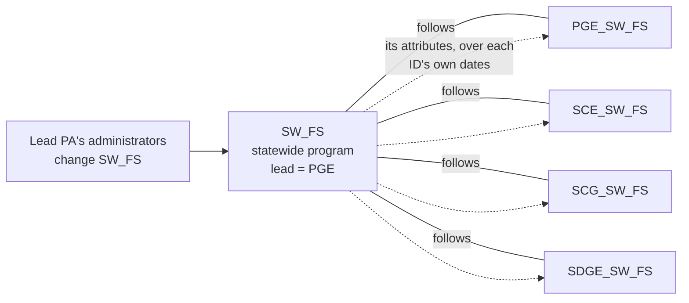

### 7.2 Statewide allocation versions

An `AllocationVersion` holds, per year and statewide PrgID (`AllocationEntry`), each funding PA's electric, gas and weighted factor
(`AllocationShare`). A funding PA's allocation manager loads one from a CSV template (each fuel's factors sum to exactly 1.0000 at four
decimals; weighted factors are computed from PercentElectric and rounded so they too sum to 1.0000), checks and confirms it; the other
managing organizations are notified. A run that allocates carries the whole factor table of the version it pins as an input, and the
receipt names its SHA-256. A filing setup or claim year may pin a version; otherwise the most recent confirmed version with factors for
the year is used. A version's page (`/allocations/<pk>/`) shows its factors as a table, filtered by year and program on the server,
beside the same values as a CSV.

### 7.3 Statewide claims are filed first

A claim year (`ClaimYear`, set up by a CPUC system administrator) creates ten `claims` deadlines: the PAs' five (Q1 to Q4 and the
annual final claim) and five statewide ones (`Q1 statewide claim` ... `Annual (final) statewide claim`). Each statewide deadline must be
due before its PAs' counterpart: by default 14 days before a quarter and one month before the annual claim (`default_sw_due`,
`_sw_due` refuses anything later).

- Only lead PAs file the statewide deadlines (`register_filers`); a PA that leads nothing is shown as having nothing to file.
- The statewide confirmations are compiled and confirmed in order as their own run of confirmations (`register_stream` /
  `same_run`), separate from the lead's own claims.
- Check `CLM-SW` keeps them apart: a statewide filing holds only statewide programs, and a PA's own claims hold none. `CLM-ORG`
  applies `filing_problem` (only the lead files a statewide program).
- A statewide filing is priced with statewide allocation (`allocate_statewide`), so the run credits each measure's results to the
  funding PAs (`ClaimResult.pa` is the credited PA).
- Before filing its own quarter, each funding PA sees its share of the confirmed statewide claims (`statewide_share`, page
  `/claims/years/<year>/statewide/` and its CSV). Only confirmed statewide versions count.
- `year_totals` (the PA's confirmed claims, read by Monthly reports' 13th-month report through `submissions.claims_totals`) adds each
  statewide program's credited share, so the lead never counts the whole program and no funder counts its share twice.
- Publication snapshots keep a lead's statewide claims in a slot of their own beside its own claims.

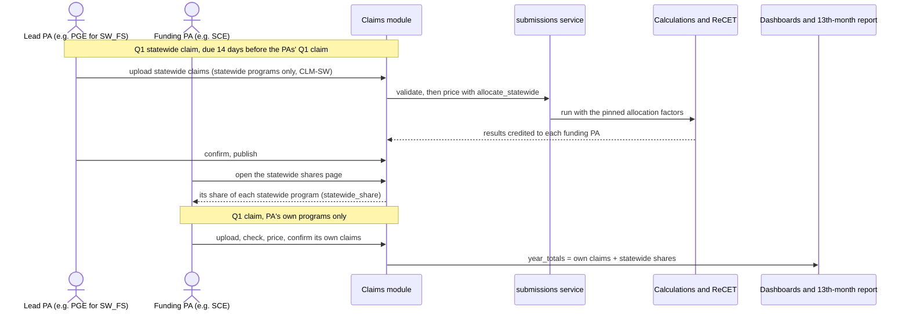

Budget filings apply the same `filing_problem` rule (only a statewide program's lead files its budget), and a statewide fund shift is
split among the funding PAs by the weighted factors (section 8.1).

## 8. The filing modules

### 8.1 Budgets (`cedars.modules.budgets`)

- A CPUC system administrator sets up each cycle filing (business plan application, TUAL, MCAL) as a `budgets` deadline on a filing
  cycle with a `FilingSetup`: the ACC it is priced on, and optionally its allocation version and cost-test set.
- A PA uploads a job (.zip of Measure and ProgramCost, or a workbook). The module derives `BudgetLine`s (the ten ProgramCost fields and
  the measures' rebates and incentives, per program and year), runs its `BUD-*` checks and CEDARS' budget filing rules year by year,
  prices through the submissions service, and keeps the run's group sums as `BudgetResult`s by program, year and credited PA.
- Confirming publishes the inputs, job spec and receipt and makes the appendix workbook; a corrected version writes a `ChangeLetter`.
- **Fund shifts** (`shifts.py`): a PA moves dollars among its programs and statewide programs within a cycle, with no calculation; a
  statewide line is split among the funding PAs by the weighted factors, each co-funder places and acknowledges its portion
  (`FundShiftAcknowledgement`), and the shift takes effect with the last one. No shift may take a program-year's operating budget below
  zero. The amounts page picks programs with core's program picker (the PA's own and, for the shift's PA, the statewide ones), shows
  what each program-year holds (`shifts.held`, `entry_budget`) and the running net, takes lines pasted from a spreadsheet
  (`paste_lines`), and its script checks each line as it is typed; the save still runs the same checks on the server.
- **Operating budget**: the standing filing's lines plus the shifts in effect since it was confirmed, by program and year; other modules
  read it through `registry.operating_budget` (`register_operating_budget`).

### 8.2 Claims (`cedars.modules.claims`)

- Claims are filed quarter by quarter. Each upload holds the records new or changed since the last confirmed quarter and is
  **compiled** over the standing version of the year's latest earlier confirmation (records replace earlier ones by primary key); the
  compiled year to date is what is checked, priced and published. Confirmations go in order, and a later confirmed quarter blocks
  un-confirming or reopening an earlier one.
- Checks: the module's `CLM-*` checks (columns, types, keys, quarters, registry programs, references between tables, NMEC, SEM, deemed,
  fuel substitution, payments, CCA/REN rules, eTRM by Measure Detail ID with blank deemed fields filled from the eTRM pack) and CEDARS'
  claims rule set on Measure and ProgramCost.
- Pricing: the year to date on the claim year's ACC (default: the ACC of the year's final budget filing, from the engine's table), with
  the year's allocation version and cost-test set, `acc_purpose = claims`.
- Withdrawals keep the records and mark them; they leave pricing and totals. Corrections after the due date write a public
  `ChangeLetter`. `ClaimRecord` links claims (NMEC chains, population sites, SEM phases, projects).
- **True-ups** are priced against the parent's profile as pinned when the parent was priced: the parent's run's profile library is read
  back (`refdata/profiles.py`) and supplied to the engine as `profiles_8760`.
- **PII** goes to the vault on the period page, checked against the version's claims (`claims.pii` to upload or read; every download
  audited). PII tables in a claims upload are refused.
- **Restatements** price a published version's job again as an analysis run (optionally per-record ACCs, with a bridge run) without
  touching the filing (`Restatement`, `RestatementLine`).
- The **claims API** (`/api/v1/claims/`) reads claim years, versions, findings, results and change letters, and uploads, checks,
  prices and confirms through the same service functions.

### 8.3 Monthly reports (`cedars.modules.monthly`)

- A `YearSetup` creates thirteen deadlines, the twelve monthly reports (each opening when its month ends) and the 13th-month report
  (due with the annual claim), and fixes the ACC and allocation version the estimates are priced on.
- A PA uploads Commitments and the year-to-date BCA inputs (Measure, ProgramCost). Spend per program is read from the BCA inputs the way
  Budgets counts a budget; the month's spend is the change since the previous confirmed month. `MON-*` checks; the BCA inputs get the
  engine's input check when priced; savings and TSB are labeled as estimates (`ReportLine`, `MonthlyResult`).
- The **13th-month report** is generated, never uploaded: the PA's confirmed claims (`submissions.claims_totals`, which includes
  statewide shares) against the operating budget and December's report.

## 9. The other modules

| Module | What it does | Key mechanics |
| --- | --- | --- |
| Programs | Public catalog and program pages; Add a program; effective-dated change form (attributes and delivery flags); corrections of a version in place; change and correction requests decided by a CPUC approver; program fields guide | Records in the registry; each module adds its rows to a program page through `register_program_records` |
| Calculations | Engine releases, New run, runs, run pages with downloads (the owner renames a run or adds a note; nothing else about it changes), Results and Compare, a walkthrough of any one measure's calculation, output templates, Edit inputs (up to the engine's 500 measures, checked cell by cell with `recet.editor`), parallel runs against CET outputs, the job API (`/api/v1/calculations/`) | Section 10 |
| Impact profiles | Nightly eTRM sync into versioned snapshots; load-shape uploads with four validation stages; generated profiles with CEDARS' formula; custom profiles; identical profiles stored once under several names; the library written in the engine's format and registered as an `impact_profiles` pack | `ProcessingJob` queues per PA; every 8,760 stored once by SHA-256 (`Shape`) |
| Documents and EM&V | One library for PA documents, CPUC guidance, DEER resources, program files and EM&V documents; numbered versions; publication; full-text search over extracted file text; EM&V deliverable stages; study register; work orders; public comment; subscriptions; PDA, PSR and CEDARS imports with old addresses redirected | `FileText` with a PostgreSQL full-text index; triggers keep published versions unchanged |
| Data | Front page, dashboards, record downloads, background downloads, saved views, the open data API (`/api/v1/data/`), parity checks against CEDARS' published totals | Section 11 |
| Administration | Account, organizations, members, grants, access requests, recertification, stewardship, role templates, audit log, jobs and health, Administration landing page | Calls the accounts service; no models |

## 10. ReCET engine integration

The platform uses ReCET, the rebuilt CET (`JRichardson-PGE/ReCET`, public, MIT), unchanged, in two ways: **the worker prices every
run** in its own process from a job spec, and **the web process imports the pinned package** for what it shows and checks.

### 10.1 The pin and how it reaches each place

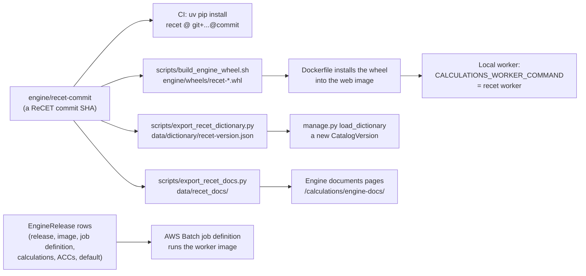

- `engine/recet-commit` names the commit the platform is built and tested against. CI installs that commit; the image installs a wheel
  built from it; `tests/test_dictionary.py` and `tests/test_engine_docs.py` check the shipped catalog and documents are the pinned
  engine's.
- Moving the pin means: change the commit, re-export the field catalog and the engine documents, run the tests; on a server, rebuild the
  wheel and the image, then load the new catalog with `load_dictionary`.
- **Engine releases are data** (`EngineRelease`): a CPUC system administrator adds a release by its version number, with its worker
  image and Batch job definition, the calculations it offers (`recet` and CET replicas such as `cet-25.1`) and the ACCs each
  has, and makes one the default. Filings are priced only with the default release's own `recet` calculation; replicas are for analysis
  runs. A local worker reports the release it runs (`Worker`), takes only that release's runs, and New run and the health page say when
  a release has no live worker.

### 10.2 The field dictionary

`scripts/export_recet_dictionary.py` writes every Measure and ProgramCost input and every measure-level output with its definition,
unit, source, cost-test treatment, time basis, aggregation, rounding and years in use (from ReCET's `field_docs` and
`field_attributes`), its type and length from CEDARS' specification, its CET and legacy names, and the templates using it.
`manage.py load_dictionary data/dictionary/recet-<version>.json` publishes it as a `CatalogVersion` with `Field`, `Alias` and
`Usage` rows, plus the platform's own records (every column of the tables listed in `dictionary/platform.py`, kind `record`) unless
`--engine-only`. The canonical names are ReCET's (decision L); CET and legacy CEDARS names are accepted on upload through the aliases.
Value lists and their versions are handed to the engine before the rules or Edit inputs read them (`value_lists.apply_to_engine`). The program registry's own lists (`register_list`) are not.

### 10.3 A run, end to end

```mermaid
sequenceDiagram
  actor U as User or filing module
  participant V as Calculations service (web)
  participant DB as PostgreSQL
  participant O as Object storage
  participant B as Local worker or AWS Batch
  participant W as recet worker run
  U->>V: create_run(release, calculation, ACC, settings, job file)
  V->>V: check request, inspect job (zip or workbook), cap records
  V->>O: job.zip or job.xlsx, optional inputs, sw_factors.csv, programs.csv
  V->>V: pin packs (ACC, impact profiles, cost-test set), input hash
  V->>O: runs/id/job.json (spec version 1)
  V->>DB: Run (queued, lane small or large), audit event
  V-->>B: after commit, submit (Batch) or nothing (local)
  B->>DB: local: claim with SKIP LOCKED
  B->>W: run SPEC_URI
  W->>O: refuses a pinned file that differs, then prices
  W->>O: out/ files, progress.json, receipt.json
  B->>DB: progress copied while it runs
  B->>DB: finish(exit code, receipt)
  DB-->>U: notification, run page, Results
```

What every run carries (`calculations/service.py create_run`, `jobspec.py`):

| Input or setting | Source |
| --- | --- |
| `job_zip` (Measure.csv and ProgramCost.csv) or `workbook` | The upload, a draft, or a filing version's compiled tables; optional files in the zip become inputs of their own |
| `programs` | `registry.run_programs(first year)`: the registry's programs as the engine's whole program table (`programs_replace`), so the `Prg_` columns, `Exclude_From_CE` and PrgID checks come from the registry |
| `sw_factors` | The pinned allocation version's whole factor table, when the run allocates statewide programs |
| `run_parameters`, `profiles_8760`, `profiles_gas` | Optional inputs, from the zip, the workbook's sheets or files of their own (`jobfiles.OPTIONAL`); for claims, `profiles_8760` carries the true-ups' parent profiles. A job's own program metadata and statewide factors are noted as not used: the registry's programs and the pinned allocation version are every run's |
| `cost_tests` or `settings.cost_test_set` | A published set by id, or a draft or custom set as the file itself |
| `cet_outputs` | A CET run's outputs, for a parallel run's comparison |
| `packs.files` | The reference-folder files of the pinned ACC and impact-profile packs, by SHA-256: the worker refuses a folder whose files differ |
| `settings` | `acc_version` and the run options (`jobspec.SETTINGS`: filing checks, Priced for, SCT, emissions, market effects, First Year, output template, ACC comparison, components, combined 8,760 ...) |
| `context` | Platform run id, organization, input hash, pinned packs, cost-test set record, notes; echoed into the receipt |

Every input is stored with its SHA-256 and the run's `input_hash` covers them, the settings, the release, the calculation, the ACC, the
allocation table and the pins, so identical jobs share a hash. A filing run that ends successfully calls `record_calculation`; a run
whose receipt names another cost-test set file fails. Runs up to `CALCULATIONS_SMALL_RUN_RECORDS` measures take the small lane, larger
ones the large lane; more than `CALCULATIONS_MAX_RECORDS` are refused before queueing.

### 10.4 What the web process imports

| Where | Engine code | For |
| --- | --- | --- |
| `calculations/results.py` | `recet.results_view`, `recet.outputs` | Results and Compare over the worker's group sums (copied once into `CALCULATIONS_RESULTS_CACHE`) |
| `calculations/walkthrough.py` | `recet.cost_test_sets`, `recet.pipeline.discount_settings`, the release tables shipped in `recet/data/cet_versions/` | Walk through a measure: one measure's steps from its row of the kept measure-level table, every sum set beside the engine's output (a run that priced a claim, budget filing or monthly report is linked from that version's page and open to the filing's readers, a published one to every signed-in user, through `submissions.versions_priced_by`); a CET replica's run is explained as that release prices it (its column names, its discount rates, CET's own tests, the CET errors the replica keeps named) |
| `calculations/walkchart.py` | `recet.pipeline.engine.price_real_hourly_per_measure`, `recet.pipeline.real_impact_profiles.shift_to_acc`, `recet.pipeline.real_avoided_cost_v2`'s utility and missing-zone tables | The walkthrough's charts of steps 3 to 6: savings, discounted savings and value year by year. The value chart prices one measure quarter by quarter with the engine's per-measure function on its load shape from the run's impact-profile pack (`refdata/profiles.py`) and its utility and zone's hourly avoided costs from the run's electric ACC pack (`refdata/acc.py`, one row group read by its statistics; pack files opened by `refdata/files.py` from default storage, a `file://` folder or `s3://`), and is drawn only when the quarters add up to the row's ElecBen (or ElecSupplyCost for added load); the numbers are kept as `walkthrough/<ACC>/<measure>.json` beside the run's outputs. Each chart has one tooltip per year (month, hour): server-rendered bands, each with its values as an SVG `<title>` without scripts, and `static/calculations/walkthrough.js` showing them beside the band under the pointer or picked with the arrow keys, spoken through `cedarsAnnounce` |
| `calculations/drafts.py`, `draft_views.py` | `recet.editor`, `recet.fieldnames`, `recet.versions` | Edit inputs: cell checks and dropdowns |
| `services/rules/service.py`, `precheck.py` | `recet.filing_rules`, `recet.editor`, `recet.fieldnames`, `recet.pipeline.real_impact_profiles` | Running stored rule sets with the engine's own rule runner, so the platform, ReCET runs and the checker never disagree |
| `services/dictionary/value_lists.py` | `recet.editor`, `recet.paths` | Handing the value lists in force to the engine |
| `services/refdata/cost_tests.py`, `builder.py` | `recet.cost_test_sets` | Validating, describing and building cost-test sets; the builder files each validator message under its step and shows it beside the form field it names, in that field's label (`builder_forms.problem`) |
| `calculations/service.py`, `claims/service.py` | `recet.versions` | The ACC tables (the claims ACC of a year, Priced for, which ACC applies) |
| `budgets/service.py`, `claims/service.py` | `recet.fieldnames` | Reading CET and older names as the canonical ones |
| `calculations/input_templates.py`, `releases/limits.py` | `recet.templates`, `recet.editor` | Upload templates and the Edit inputs row limit |

Without the engine installed those pages say so; the rest of the platform works.

## 11. Publication, snapshots and the query layer

```mermaid
flowchart LR
  conf["Version confirmed<br/>and published"] -- "listener, after commit" --> snap["Snapshot: copy the run's<br/>measure-level parquet<br/>into the snapshots area"]
  snap --> scan{"Personal-information scan<br/>(PIIScan)"}
  scan -- "hit" --> hold["Held: CPUC told,<br/>earlier snapshot stands"]
  scan -- "clean" --> rebuild["rebuild: snapshots in force<br/>per dataset and slot"]
  rebuild -- "set changed" --> release["New numbered Release<br/>(claims, forecast, monthly)"]
  release --> q["Query layer (DuckDB over<br/>the release's Parquet)"]
  q --> dash["Dashboards, front page"]
  q --> dl["Downloads and<br/>record downloads"]
  q --> api["Open data API"]
```

- **Slots**: forecast keeps every filing; claims and monthly keep one slot per PA and year (the latest year-to-date period, so quarters
  never add up twice), with a lead PA's statewide claims in a slot of their own. A release is made only when the set in force changes; an
  un-confirmation before the due date drops the snapshot and releases without it.
- **Query layer** (`data/query.py`): one query over one release gives every number a page, chart, table and download shows. Each query
  opens its own in-memory DuckDB connection over local copies of the snapshots (`DATA_CACHE`, named by SHA-256), with the thread and
  memory limits `DATA_QUERY_THREADS` and `DATA_QUERY_MEMORY`. Its state is GET parameters, so a link reproduces a view.
- Exclusions (pension and benefits, ESA, codes and standards by default) are stated parameters; downloads are stamped with the release,
  as-of time, snapshots, filters and dictionary version; only fields the dictionary marks public are served.
- Imported legacy years are snapshotted from tables their loads built.

## 12. Background work

Every background task is a management command in the same image. Queued work is claimed from PostgreSQL with `SKIP LOCKED`, so
several workers can share a queue.

| Command | Kind | What it does | Schedule (Terraform) |
| --- | --- | --- | --- |
| `calculations_worker` | Always on (local backend) | Prices queued runs with `recet worker run`, small lane first | Not used in AWS (Batch prices runs) |
| `calculations_sync` | Always on | Copies Batch jobs' progress and receipts into runs | ECS service, every 60 s |
| `run_impact_profile_jobs` | Always on | Impact profiles' per-PA job queues | ECS service, polls every 5 s |
| `run_data_downloads` | Always on | Background record downloads | ECS service, polls every 10 s |
| `purge_expired` | Daily | Deletes what retention says has expired (dry run available), one audit event per class | 02:15 Pacific |
| `close_recertifications` | Daily | Closes due recertification campaigns; uncertified grants are suspended when the access policy says so | 02:30 Pacific |
| `documents_read_text` | Daily | Reads the text of document files stored without it | 03:45 Pacific |
| `send_deadline_reminders` | Daily | Each user's deadline reminders at their chosen lead times | 07:00 Pacific |
| `sync_etrm` | Nightly | eTRM sync, retried after `ETRM_SYNC_RETRY_MINUTES`; alerts administrators if the last try fails | 01:00 Pacific, once the eTRM URL is set |
| `check_health` | Every 10 minutes | Runs every registered health check, alerts system administrators once per new set of failures, prints a JSON line for CloudWatch | `monitoring.tf` |
| `export_sandbox_bundle`, `refresh_sandbox` | Scheduled when configured | Production writes its published, non-PII data; the sandbox loads it | Off unless a bundle place and schedule are set |
| `warm_front_page` | On demand | Reads the front page's claims rows before anyone asks (after start-up, a deploy or a publication) | Not scheduled |

One-off and administrative commands:

| Command | What it does |
| --- | --- |
| `bootstrap_cpuc` | First run only: creates the CPUC organization and its first system administrator, organization administrator and data steward |
| `demo_account`, `seed_sandbox` | Test filers, a test CPUC administrator (`--cpuc`) and demo organizations (sandbox and developer databases only) |
| `load_dictionary` | Publishes a field catalog version from the engine's export |
| `import_rules`, `check_file` | Imports CEDARS' claims or budget-filing rules from the pinned engine as a draft rule set; checks a file as the pre-upload checker does |
| `import_programs`, `import_allocation`, `import_statewide_leads`, `follow_statewide` | Loads programs from a CEDARS Programs export, allocation factors, and statewide lead PAs from CEDARS' statewide programs download; links statewide programs' IDs to them |
| `register_pack`, `record_tie_out`, `register_cost_tests`, `load_etrm_permutations`, `etrm_lookup_timings` | Registers reference-data packs and their tie-outs; loads eTRM permutations; times the eTRM lookup |
| `import_profile_library`, `export_profile_library` | Loads legacy CEDARS' profile library; writes the platform's |
| `stage_legacy_sources`, `load_legacy_filings`, `load_legacy_claims`, `snapshot_legacy` | Stages legacy CEDARS downloads, loads them as imported versions, snapshots them |
| `dashboard_parity` | Checks the query layer against CEDARS' published totals |
| `documents_import_pda`, `documents_import_psr`, `documents_import_cedars` | Migrates the PDA, PSR and CEDARS' own documents |
| `snapshot_published`, `rescan_publication_holds` | Repairs a failed snapshot copy; scans held snapshots again |
| `clear_filing_calendar` | Empties a sandbox or demo calendar: deletes each set-up nothing was filed for, retires the rest |
| `help_revisions` | Records which release each user guide and the FAQ were revised for |

Work that runs after a response without a worker: notifications (`on_audit_event` defers delivery with `transaction.on_commit`),
snapshots (`register_listener` defers the copy the same way), and the front page's refresh thread (section 13).

## 13. Caching

| Cache | Where | What | Invalidated by |
| --- | --- | --- | --- |
| Django cache | Database table `cedars_cache` (`DatabaseCache`) | The front page's claims rows, the API throttle counts (so every web process sees one count) | Keys and timeouts below |
| Run results | `CALCULATIONS_RESULTS_CACHE` | A run's group sums copied once from object storage for Results and Compare | A run's outputs never change |
| Snapshots | `DATA_CACHE` | Local copies of S3 snapshots named by SHA-256, read by DuckDB | Content-addressed |

### 13.1 Front-page claims rows

The front page ("How the portfolio is doing") charts five metrics from the published claims: total system benefit, electricity saved,
peak demand avoided, gas saved and spending, by year, against spending, by PA and as benefit per dollar. It reads one query over every
claims file of the current release, every metric by year, PA type and PA with the dashboards' default exclusions, and keeps the rows
(`data/front.py`); the visitor's choices (metric, PA type, year) are applied to the kept rows in the request, and the charts are drawn
on the server as SVG with a table of the same values under each. `data/front.js` adds the values on hover and from the keyboard.

- The key is `front<CACHE_VERSION>:<default exclusions>`; `CACHE_VERSION` is bumped whenever the cached shape changes, so a deploy
  never reads an old pickle.
- Each entry keeps a **fingerprint** of what the rows were read from: the current claims release. A different fingerprint (a new
  release) reads them again **in the request**, so nobody sees the previous release's numbers.
- An entry older than `FRESH_SECONDS` (600 s) is still shown, and the rows are reread **after the response** on a daemon thread. A
  lock key (`cache.add`, `REFRESH_LOCK_SECONDS` 300 s) keeps one reread at a time; a failed reread leaves the old rows. Entries are
  kept for `KEEP_SECONDS` (7 days).
- `FRONT_PAGE_REFRESH_IN_BACKGROUND` off (as in the tests) rereads in the request instead; `manage.py warm_front_page` reads them
  ahead.

```mermaid
flowchart TD
  visit["Front page request"] --> fp["Fingerprint: current<br/>claims release"]
  fp --> get{"Cached rows<br/>with this fingerprint?"}
  get -- "no" --> build["Read the rows now,<br/>store them (7 days)"]
  get -- "yes" --> age{"Older than 600 s?"}
  age -- "no" --> show["Apply the visitor's metric,<br/>PA type and year; draw the charts"]
  age -- "yes" --> lock{"cache.add lock<br/>(300 s)"}
  lock -- "taken" --> show
  lock -- "got it" --> thread["Daemon thread rereads<br/>after the response"]
  thread --> show
  build --> show
```

## 14. Cross-cutting services

- **Audit** (`cedars.services.audit`): `audit.record(action, obj, before, after, reason)` stamps the actor, active organization,
  sign-in assurance and request id from the request context. Every service that changes a record writes one; the table is append-only.
- **Notifications**: a `post_save` receiver on `AuditEvent` defers delivery until commit, so a rolled-back change notifies nobody; one
  message per user per event, narrowed by the PAs they follow, widened by the programs they follow; email per subscription; deadline
  reminders; module messages through `notify`. **Requests are told directly** (`tell_about_request`, after commit): a correction request
  (submissions), a program change or correction request (registry) and an access request (accounts) reach the people who may decide it
  (the module's CPUC approvers and their delegates for today, `submissions.deciders`; an organization's administrators, or the CPUC
  system administrators when it has none, `accounts.access_deciders`), its decision reaches the person who asked, and a withdrawal
  reaches those told of the request (`told(key)`). Each person's `Preference.own_requests` / `requests_to_decide` (off, the page, or
  the page and email; email by default) says how, on Notification settings' Requests section. The notice carries
  `request_key(object, pk, step)`, the key the same audit event's subscription delivery uses, so a person who also subscribed is told
  once.
- **Retention** (decision M): a period per record class (`RetentionPolicy`), legal holds (`LegalHold`), and the daily purge, which
  calls each registered purger and logs `PurgeRun`s.
- **Reference data**: packs registered as drafts, published once their required tie-outs pass (the checks in force, set on a page;
  a published pack keeps the ones it was published under), withdrawn but never deleted; `pin()` is recorded by every run and filing; a
  filing never uses a draft.
- **Rules and the pre-upload checker**: stored rule sets run by the engine's rule runner; `/rules/check/` and
  `POST /api/v1/rules/check` run a module's rule-set step on a file without keeping it. The checks each upload runs in code beside the
  rule sets (the BUD-, CLM-, MON-, PII- and LS- rules) stay in code and are listed read only on `/rules/built-in/` from the lists the
  modules register (`register_coded_checks`); a test holds each list to the rule IDs its module's code raises.
- **Uploads** (`cedars/core/uploads.py`): limits from settings, several files combined into the one zip a module reads. A .zip or
  workbook is refused before anything in it is unpacked when its files, by the sizes its own directory gives, add up to more than
  `CEDARS_UPLOAD_MAX_UNZIPPED_MB` (`too_large_unzipped`, called by every filing reader, the PII upload and corrections).
- **Release notes, limits and mandates** (`cedars.services.releases`): notes published at least `CEDARS_RELEASE_NOTICE_DAYS` before
  they take effect, the Limits page read from the settings that enforce them (or the value the CPUC set, for an editable limit), Change
  limits for CPUC system administrators, the register of CPUC-mandated changes, and site notices (`SiteNotice`): a short dated
  notice a CPUC system administrator posts at once (`/releases/notices/`), shown at the top of every page from its start to its end,
  withdrawn with a reason, never edited.
- **Health** (`cedars/core/health.py`): checks modules register; `/admin/health/` and `check_health`.
- **My queue and Your work** (`cedars/core/queue.py`, `cedars/core/yourwork.py`): read live from each service's and module's
  records through the providers they register, nothing stored. My queue (`/queue/`) is the full list of what waits on the person.
  Your work is the short version at the top of a page, one card per part, each part's `provider(request, page)` returning a `Part`
  or nothing: on the front page the top three queue items and their count (core's own part), the next filing of each kind for the
  organization the person acts for with its status and one action (`submissions.status.your_work`, over the Filings page's board),
  the last three runs (Calculations) and the person's access requests, waiting or decided in the last two weeks (accounts); on
  Calculations the runs and Edit inputs drafts; on Reference data the cost-test sets being built and draft packs the person
  registered; on Published data their saved views and record downloads. The Filings page starts with the organization's own
  filings (`status.own_filings`, its row of the board, with Start, Continue or Open), then the board with that row marked, then the
  page list; the Claims and Monthly reports lists mark the next one to file and end each row with its action
  (`status.mark_next`). A provider that fails is logged and left out, as in My queue.
- **Pages**: server-rendered and usable without scripts; WCAG 2.2 AA (axe in CI on every page in both color schemes); a page help
  entry and tour for every page (`page_help.yaml`); breadcrumbs and section navigation from `nav.py`; site search over pages, guides,
  the glossary, programs, fields, confirmed claims and documents, and a signed-in person's own filings and runs, with what the query
  names exactly (a PrgID, field name, ClaimID, run name or page title) first as the best match. Security headers and a same-origin-only CSP (`SecurityHeadersMiddleware`); vendored scripts with
  their integrity checked.
- **Error pages** (`cedars/core/errors.py`, the `handler404`, `handler403` and `handler500` in `cedars/urls.py`, and
  `CSRF_FAILURE_VIEW`): every error page is in the site's layout, with one sentence, a search box and links to the front page, Help and
  My queue. A page that does not exist and a page the account cannot open show the same page and sentence (the status stays 404 or
  403), so neither says whether the page is there; under `/api/` both answer in JSON. The 500 page renders with no context, so a
  failing database or context processor cannot take it down too; a form refused for its security token says why and how to send it
  again.
- **Links only to pages that open** (`cedars/core/page_access.py`, the `` tag): a Help guide links to an
  administrators' page only for a reader it opens for; anyone else reads its name and who it is for. Who may open a page comes from the
  header's menus (`nav.Item.who`), or, for a page outside them with a finer check, from the check its owner registers.
  `tests/test_help_links.py` follows every link in every guide as each kind of account and fails on one that ends at an error page.
- **API**: Django REST Framework under `/api/v1` with an OpenAPI schema at `/api/v1/schema`; token or session authentication; per-user
  and per-address throttles. Pages and the API call the same service functions.
- **Accessibility of files** (`cedars.services.accessibility`): stored PDFs and workbooks checked; generated workbooks are accessible by
  construction (`cedars/core/workbooks.py`), and write filed text that starts with "=" as text, never as a formula.
- **Feedback** and **sandbox refresh**: a feedback link on every page; production's published, non-PII data bundled for the sandbox.

## 15. Tests and CI

- `uv run pytest` on PostgreSQL (pytest-django; the transactional tests and triggers need PostgreSQL); tests that need the engine skip
  without it. `uv run pytest -m a11y` runs axe-core in Chromium on every page listed in `tests/a11y/pages.py`, in both color schemes
  and at 320 px.
- CI (`.github/workflows/ci.yml`) on every pull request, on main and weekly: ruff (lint and format), migrations match the models,
  Django's deployment checks on the production settings, the tests with the pinned engine, axe (Playwright's Chromium cached between
  runs; its extra apt fonts are skipped when the Ubuntu mirrors cannot be reached, and a launch check fails the job if Chromium cannot
  start), the Docker image built with the pinned engine and scanned by grype, pip-audit over `uv.lock`, gitleaks over the whole
  history with the noreply-author check, and Terraform fmt and validate.
- Tests hold the documentation to the code: `test_dictionary.py` and `test_engine_docs.py` (the engine's catalog and documents),
  `test_us_spelling.py` (the docs too), `test_navigation.py` (every page in the header or listed), and `test_architecture_doc.py` (this
  file).

## 16. Keeping this document current

A pull request that changes the platform's structure, models, flows, roles and permissions, engine integration, background work,
caching or deployment updates this document and its diagrams in the same pull request (CLAUDE.md, and the checkbox in
`.github/pull_request_template.md`).

`tests/test_architecture_doc.py` fails when:

- an app in `INSTALLED_APPS` under `cedars.` is not named here;
- a model of those apps is not named here (section 4.4, and the ERDs where it has relationships worth drawing);
- a management command is not named here (section 12);
- an extension hook (`register_*` in the services, `register` in `core/queue.py`, `core/health.py`, `core/search.py` and `core/page_access.py`) is not
  named here (section 3.2);
- a Mermaid block does not start with a diagram type.

What the test cannot see, the author keeps true: a changed flow (a new state, a new check, a new step in pricing or publication), a new
role or permission, a new setting that changes behavior, a new process or schedule, a changed cache rule.
